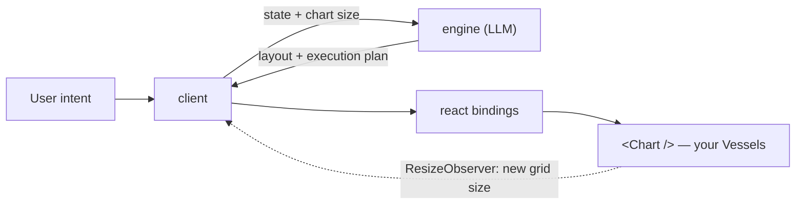

<div align="center">

# Maelstrom

**Maelstrom orchestrates the components you designed.**

It hands your model your stateful components and a live layout surface — to arrange them, resize them, and trigger their actions by intent, in real time. It never invents new ones.

[](./LICENSE)

<!-- Publication-gated badges. Paste back in when the two preconditions land —
     they render as broken images until then:
       - repo is public  → stars badge, CI badge, Star History (below)
       - packages on npm → version badge, bundle size
[](https://www.npmjs.com/package/@maelstrom-co/react)
[](https://bundlephobia.com/package/@maelstrom-co/react)
[](https://github.com/maelstrom-co/maelstrom/actions/workflows/ci.yml)
[](https://github.com/maelstrom-co/maelstrom/stargazers)
-->

[Try the playground](https://maelstrom-playground.maelstrom-36e.workers.dev) &nbsp;·&nbsp; [Documentation](https://docs.maelstrom-ai.co) &nbsp;·&nbsp; [Quick start](#60-second-quickstart)

</div>

<!-- DEMO GIF SLOT — MAE-527 produces the recording.
     Spec: ≤20s, silent, autoplays, loops. Must show a Vessel changing variant
     and the Chart re-flowing around it mid-conversation — the resize is the
     product, a static screenshot cannot carry it.
     Drop the file at .github/assets/demo.gif and replace this comment with:
     <p align="center"></p>
-->

Maelstrom is an open-source library for **AI-orchestrated UI**.

## Why Maelstrom

The most powerful technology in a generation arrived, and the industry answered with two lazy defaults. Bolt a chat box onto every app, and walls of text replace working software — the transcript becomes the UI, and human reading speed becomes the bottleneck. Let the model hallucinate the interface, and everything your team knows about its own product gets thrown out with it.

Both miss the point. The interface doesn't need to be retired into a chat log, and it doesn't need to be generated from scratch. It needs to adapt — composed by AI in the moment, out of pieces you designed on purpose.

- **It arranges; it doesn't invent.** You author Vessels — your real UI components, each a typed state machine with discrete variants and size hints. The model chooses *which* are on screen, *where*, at *what size*, in *what state* — never their contents.
- **It reasons in space, not pixels.** The Chart is a layout surface the model drives in integer coordinates — primarily a tiling tree (H/V splits, like a tiling window manager), with a grid mode as the alternative.
- **It acts; it doesn't just show.** Every Vessel exposes the actions its makers allow, and Maelstrom invokes them straight from intent. It only ever does what your app already lets a user do.

Intent has many forms — voice, text, channels not yet invented. To the model they're the same signal. No one has built UI this way before; we think it's the right shape, and we're figuring it out in the open.

## What you write

A Vessel is a state machine. Variants are its states, and each carries the size it needs:

```tsx
export const greetingVessel = defineVessel({
  id: 'greeting',
  name: 'Greeting',
  description: 'Greets the user by name.',
  defaultVariant: 'compact',
  variants: {
    compact: {
      description: 'One-line greeting',
      props: { name: 'there' },
      minSize: { width: 2, height: 1 },
      actions: [],
    },
  },
});
```

`vessel()` pairs that definition with your component, which receives typed props for whichever variant is live:

```tsx
function Greeting({ variantProps }: TypedVesselProps<typeof greetingVessel>) {
  return <div>Hello {variantProps.name}</div>;
}

const m = createMaelstrom({ vessels: [vessel(greetingVessel, Greeting)] });
const connector = new WebSocketConnector({ url: 'ws://localhost:3001/ws' });

export const App = () => (
  <m.Provider connector={connector}>
    <m.Chart style={{ height: '100vh' }} />
  </m.Provider>
);
```

Anywhere inside the Provider, `useMaelstrom()` hands you the loop:

```tsx
const { processIntent, isProcessing } = m.useMaelstrom();
```

That is the whole surface. `processIntent("show me the greeting bigger")` goes to the engine; the engine answers with layout and actions; the Chart re-flows.

## 60-second quickstart

```bash
bun add @maelstrom-co/react   # npm install / pnpm add also fine
```

> Packages publish to npm at `v0.1.0`. Until then, run the [playground](https://maelstrom-playground.maelstrom-36e.workers.dev) or clone this repo and run `nx dev demo`.

You need one LLM provider key. Copy `.env.example` to `.env` and set `GOOGLE_API_KEY` — nothing else is required to see a Vessel move.

```bash
cp .env.example .env   # set GOOGLE_API_KEY
bun install
nx dev demo
```

Full walkthrough: **[Quick start](https://docs.maelstrom-ai.co/getting-started/quick-start/)**.

## How it works



The engine is stateless: it receives the current state and the Chart's dimensions in grid cells, and returns where things go and what to invoke. `protocol` is the typed message contract all four packages speak, so an engine and a client that disagree fail at the type level rather than at runtime.

Applying a response re-renders the UI, the Chart measures itself, and a changed grid size schedules the next request — that observer is what closes the loop.

## How Maelstrom compares

The axis that matters: **does the AI arrange spatial layout over _your_ stateful components, or render into a chat thread?**

| | UI surface | Whose components | AI arranges layout? |
|---|---|---|---|
| **Maelstrom** | **spatial surface (tiling/grid)** | **yours, pre-built** | **yes** |
| Tambo | chat thread / inline | yours, registered | no |
| CopilotKit | copilot / chat | your app's | no |
| assistant-ui | chat thread | chat-embedded | no |
| Thesys C1 | generated at runtime | C1-generated | n/a — generated |
| Vercel AI SDK | chat + generative-UI primitives | tool-call slots | no |

Tambo is the closest — it lets the model pick *your* registered components — but renders them inline and never decides layout or state transitions.

LangGraph, AG-UI, and the Vercel AI SDK are substrate rather than competition: Maelstrom is the layout layer their output can drive. Full detail, including [where Maelstrom is the wrong tool](https://docs.maelstrom-ai.co/understanding/comparison/#where-maelstrom-is-the-wrong-tool), is in the [comparison](https://docs.maelstrom-ai.co/understanding/comparison/).

## Packages

| Package | Description |
| --- | --- |
| [`@maelstrom-co/protocol`](./packages/protocol) | Core types and message contract |
| [`@maelstrom-co/client`](./packages/client) | Framework-agnostic client |
| [`@maelstrom-co/react`](./packages/react) | React bindings and components |
| [`@maelstrom-co/engine`](./packages/engine) | LLM decision engine |

Voice is opt-in and ships separately — see [`packages/realtime`](./packages/realtime).

## Documentation

**📖 [docs.maelstrom-ai.co](https://docs.maelstrom-ai.co)**

- [Introduction](https://docs.maelstrom-ai.co/getting-started/introduction/) — what Maelstrom is and why it exists
- [Quick start](https://docs.maelstrom-ai.co/getting-started/quick-start/) — your first Vessel
- [Core concepts](https://docs.maelstrom-ai.co/getting-started/core-concepts/) — Vessels, Chart, Engine
- [How Maelstrom compares](https://docs.maelstrom-ai.co/understanding/comparison/) — vs chat-UI libraries and agent frameworks
- [API reference](https://docs.maelstrom-ai.co/reference/)

## Voice

Hear it working first: [Run the voice demo locally](https://docs.maelstrom-ai.co/tutorials/run-voice-locally/) takes one API key and one command.

- [Voice overview](https://docs.maelstrom-ai.co/guides/voice/overview/) — choose a mode and find the guide that builds it
- [OpenAI Realtime guide](https://docs.maelstrom-ai.co/guides/voice/openai-realtime/) — direct browser-to-provider speech sessions
- [LiveKit cascade guide](https://docs.maelstrom-ai.co/guides/voice/livekit-cascade/) — browser, room, and worker setup
- [The voice boundary](https://docs.maelstrom-ai.co/understanding/voice-architecture/) — why a voice model never plans your UI
- [Realtime voice architecture](https://github.com/maelstrom-co/maelstrom/blob/main/docs/realtime-voice-architecture.md) — design constraints and decisions behind the integrations

## Packages

| Package | Description |
| --- | --- |
| [`@maelstrom-co/protocol`](./packages/protocol) | Core types and message contract |
| [`@maelstrom-co/client`](./packages/client) | Framework-agnostic client |
| [`@maelstrom-co/react`](./packages/react) | React bindings and components |
| [`@maelstrom-co/engine`](./packages/engine) | LLM decision engine |
| [`@maelstrom-co/realtime`](./packages/realtime) | Provider-neutral realtime voice session core |
| [`@maelstrom-co/react-realtime`](./packages/react-realtime) | React bindings for realtime voice sessions |
| [`@maelstrom-co/realtime-server`](./packages/realtime-server) | Server-side OpenAI ephemeral-token minter |
| [`@maelstrom-co/realtime-livekit`](./packages/realtime-livekit) | LiveKit cascade browser adapter and protocol |
| [`@maelstrom-co/realtime-livekit-server`](./packages/realtime-livekit-server) | Server-side LiveKit room-token minter |
| [`@maelstrom-co/realtime-livekit-agent`](./packages/realtime-livekit-agent) | LiveKit speech worker runtime |

## Running the demo

See [`apps/demo/README.md`](./apps/demo/README.md) for how to run the demo app locally, including optional LiveKit voice setup.

## Contributing

Contributions are welcome — start with the [contributing guide](./CONTRIBUTING.md).

## License

MIT — see [LICENSE](./LICENSE).

<!-- Star History renders only for a public repo; restore on the same flip as the badges above.
## Star History

[](https://star-history.com/#maelstrom-co/maelstrom&Date)
-->
