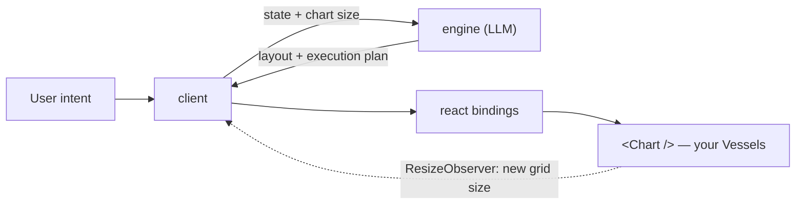

<div align="center">
  <picture>
    <source media="(prefers-color-scheme: dark)" srcset="https://raw.githubusercontent.com/maelstrom-co/maelstrom/main/media/logo-white.svg" />
    <source media="(prefers-color-scheme: light)" srcset="https://raw.githubusercontent.com/maelstrom-co/maelstrom/main/media/logo-black.svg" />
    
  </picture>
</div>

<br />

<div align="center">
  <a href="https://npmjs.com/package/@maelstrom-co/react" target="_parent"></a>
  <a href="https://bundlephobia.com/result?p=@maelstrom-co/react@latest" target="_parent"></a>
  <a href="./LICENSE" target="_parent"></a>
  <a href="https://github.com/maelstrom-co/maelstrom" target="_parent"></a>
  <a href="https://x.com/maelstrom_co" target="_parent"></a>
</div>

# Maelstrom

**Maelstrom orchestrates the components you designed.** It hands your model your
stateful components and a live layout surface — to arrange them, resize them, and
trigger their actions by intent, in real time. It never invents new ones.

Maelstrom is an open-source library for **AI-orchestrated UI**. You author your
components as Vessels — typed state machines with discrete variants and size
hints — and a model arranges, resizes, transitions, and invokes them on a spatial
layout surface, from whatever the user is trying to do.

## <a href="https://docs.maelstrom-ai.co">Read the docs -></a>

## Start Here

- [Introduction](https://docs.maelstrom-ai.co/getting-started/introduction/) -
  what Maelstrom is and why it exists.
- [Quick Start](https://docs.maelstrom-ai.co/getting-started/quick-start/) -
  your first Vessel, from install to a running chart.
- [Core Concepts](https://docs.maelstrom-ai.co/getting-started/core-concepts/) -
  Vessels, the Chart, and the Engine.
- [How Maelstrom Compares](https://docs.maelstrom-ai.co/understanding/comparison/) -
  against chat-UI libraries and agent frameworks.
- [API Reference](https://docs.maelstrom-ai.co/reference/react/readme/) - every
  export, generated from source.

## Why Maelstrom

The most powerful technology in a generation arrived, and the industry answered
with two lazy defaults. Bolt a chat box onto every app, and walls of text replace
working software — the transcript becomes the UI, and human reading speed becomes
the bottleneck. Let the model hallucinate the interface, and everything your team
knows about its own product gets thrown out with it.

Both miss the point. The interface doesn't need to be retired into a chat log, and
it doesn't need to be generated from scratch. It needs to adapt — composed by AI
in the moment, out of pieces you designed on purpose.

- **It arranges; it doesn't invent.** You author Vessels — your real UI
  components, each a typed state machine with discrete variants and size hints.
  The model chooses *which* are on screen, *where*, at *what size*, in *what
  state* — never their contents.
- **It reasons in space, not pixels.** The Chart is a layout surface the model
  drives in integer coordinates — primarily a tiling tree (H/V splits, like a
  tiling window manager), with a grid mode as the alternative.
- **It acts; it doesn't just show.** Every Vessel exposes the actions its makers
  allow, and Maelstrom invokes them straight from intent. It only ever does what
  your app already lets a user do.

Intent has many forms — voice, text, channels not yet invented. To the model
they're the same signal. No one has built UI this way before; we think it's the
right shape, and we're figuring it out in the open.

## Install

```bash
npm install @maelstrom-co/react
```

Bun, pnpm, and Yarn work the same way. `@maelstrom-co/react` re-exports the
vessel helpers and connectors, so a React app needs nothing else.

To run the reference engine locally:

```bash
git clone https://github.com/maelstrom-co/maelstrom && cd maelstrom
cp .env.example .env   # set GOOGLE_API_KEY — nothing else is required
bun install
bunx nx dev demo
```

## Define a Vessel

A Vessel is a state machine. Variants are its states, and each declares a
`minSize` in grid cells. Grid mode enforces it: the engine drops any placement
below the minimum, and names the number when it re-prompts. Tiling mode ignores
it — a leaf's size comes from the split tree:

```tsx
import { defineVessel } from '@maelstrom-co/react';

export const greetingVessel = defineVessel({
  id: 'greeting',
  name: 'Greeting',
  description: 'Greets the user by name.',
  defaultVariant: 'compact',
  variants: {
    compact: {
      description: 'One-line greeting',
      props: { name: 'there' },
      minSize: { width: 2, height: 1 },
      actions: [],
    },
  },
});
```

Learn more in the
[Creating Vessels docs](https://docs.maelstrom-ai.co/guides/react/creating-vessels/)
and the
[Variants & Actions docs](https://docs.maelstrom-ai.co/guides/react/variants-and-actions/).

## Render the Chart

`vessel()` pairs the definition with your component, which receives typed props
for whichever variant is live:

```tsx
import {
  createMaelstrom,
  type TypedVesselProps,
  vessel,
  WebSocketConnector,
} from '@maelstrom-co/react';

function Greeting({ variantProps }: TypedVesselProps<typeof greetingVessel>) {
  return <div>Hello {variantProps.name}</div>;
}

const m = createMaelstrom({ vessels: [vessel(greetingVessel, Greeting)] });
const connector = new WebSocketConnector({ url: 'ws://localhost:3001/ws' });

export const App = () => (
  <m.Provider connector={connector}>
    <m.Chart style={{ height: '100vh' }} />
  </m.Provider>
);
```

Learn more in the
[Layout Modes docs](https://docs.maelstrom-ai.co/guides/react/layout-modes/) and
the
[Programmatic Layout docs](https://docs.maelstrom-ai.co/guides/client/programmatic-layout/).

## Drive It With Intent

`useMaelstrom()` hands you the loop from any component under the Provider:

```tsx
function IntentBar() {
  const { processIntent, isProcessing } = m.useMaelstrom();
  return (
    <input
      disabled={isProcessing}
      onKeyDown={(e) =>
        e.key === 'Enter' && processIntent(e.currentTarget.value)
      }
    />
  );
}
```

Mount it anywhere under the same `Provider` as the Chart:

```tsx
<m.Provider connector={connector}>
  <IntentBar />
  <m.Chart style={{ height: '100vh' }} />
</m.Provider>
```

`processIntent("show me the greeting bigger")` goes to the engine; the engine
answers with layout and actions; the Chart re-flows. Learn more in the
[Error Handling docs](https://docs.maelstrom-ai.co/guides/react/error-handling/).

## How It Works



The engine holds no layout state: it receives the current state and the Chart's
dimensions in grid cells, and returns where things go and what to invoke.
Conversation history is opt-in — hand it a `HistoryStore` and prior turns ride
along in the prompt; leave it out and every request stands alone. `protocol` gives
every package the same TypeScript types and the zod schemas that validate what
actually crosses the wire — a malformed or incompatible message gets rejected at
runtime, where engine and client, built and deployed separately, actually meet.

Applying a response re-renders the UI, the Chart measures itself, and a changed
grid size schedules the next request — that observer is what closes the loop.

## How Maelstrom Compares

The axis that matters: **does the AI arrange spatial layout over _your_ stateful
components, or render into a chat thread?**

| | UI surface | Whose components | AI arranges layout? |
|---|---|---|---|
| **Maelstrom** | **spatial surface (tiling/grid)** | **yours, pre-built** | **yes** |
| Tambo | chat thread / inline | yours, registered | no |
| CopilotKit | copilot / chat | your app's | no |
| assistant-ui | chat thread | chat-embedded | no |
| Thesys C1 | generated at runtime | C1-generated | n/a — generated |
| Vercel AI SDK | chat + generative-UI primitives | tool-call slots | no |

Tambo is the closest — it lets the model pick *your* registered components — but
renders them inline and never decides layout or state transitions. LangGraph,
AG-UI, and the Vercel AI SDK are substrate rather than competition: Maelstrom is
the layout layer their output can drive. The comparison docs carry the full
tables and
[where Maelstrom is the wrong tool](https://docs.maelstrom-ai.co/understanding/comparison/#where-maelstrom-is-the-wrong-tool).

## Packages

| Package | Use it for |
| --- | --- |
| [`@maelstrom-co/react`](https://docs.maelstrom-ai.co/reference/react/readme/) | React bindings: `createMaelstrom`, `vessel`, Provider, Chart, hooks |
| [`@maelstrom-co/client`](https://docs.maelstrom-ai.co/reference/client/readme/) | Framework-agnostic orchestrator, connectors, and layout |
| [`@maelstrom-co/engine`](https://docs.maelstrom-ai.co/reference/engine/readme/) | The LLM decision core, built on TanStack AI |
| [`@maelstrom-co/protocol`](https://docs.maelstrom-ai.co/reference/protocol/readme/) | Shared types, zod schemas, and the message contract |

Voice is opt-in and ships separately. Start with
[Run the voice demo locally](https://docs.maelstrom-ai.co/tutorials/run-voice-locally/) —
one API key, one command — then the
[voice overview](https://docs.maelstrom-ai.co/guides/voice/overview/) to pick a
mode, and [the voice boundary](https://docs.maelstrom-ai.co/understanding/voice-architecture/)
for why a voice model never plans your UI.

## Get Involved

- Read the [docs](https://docs.maelstrom-ai.co).
- Run the demo — see [`apps/demo/README.md`](./apps/demo/README.md) for local
  setup, including optional LiveKit voice.
- See [CONTRIBUTING.md](./CONTRIBUTING.md) for setup instructions.
- Follow [@maelstrom_co](https://x.com/maelstrom_co) for what we're building.

MIT licensed — see [LICENSE](./LICENSE).

## Star History

[](https://star-history.com/#maelstrom-co/maelstrom&Date)
