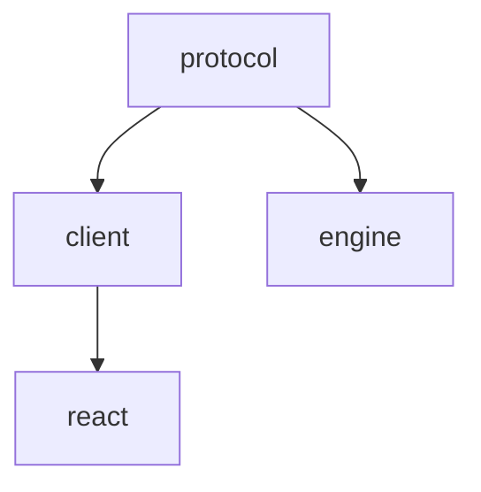

Maelstrom is an Nx monorepo with published TypeScript packages, a demo app, and this Astro docs site. Good contributions keep package boundaries clear, include the right tests, and treat public API documentation as part of the shipped surface.

## Quick start for contributors

1. Fork the repository.
2. Clone and install dependencies with `bun install`.
3. Create a branch for your changes.
4. Make the smallest focused change that solves the issue.
5. Add or update tests for code changes.
6. Run the relevant package target, then broader verification when needed.
7. Submit a pull request with the user-facing behavior and verification evidence.

## Developer Certificate of Origin (DCO)

Every commit must be signed off:

```bash
git commit -s -m "feat: ..."   # appends a "Signed-off-by" trailer
```

This certifies you have the right to submit the change under the project's
license. To have the trailer added automatically, enable the bundled hook once
per clone:

```bash
git config core.hooksPath .githooks
```

The `dco` check is required on `main` and runs on every pull request. A commit
missing its sign-off turns the check red and a bot comment lists the offending
commits. See
[Enforcement](https://github.com/maelstrom-co/maelstrom/blob/main/CONTRIBUTING.md#enforcement)
in the root `CONTRIBUTING.md` for how to fix it.

Because you contribute from a fork (step 1 above), every commit you push needs a
sign-off. The exemption for commits from a bot account applies only to branches
in the `maelstrom-co/maelstrom` repository itself, so it will never cover a
commit on your branch, whatever account that commit appears to be from.

See the root
[`CONTRIBUTING.md`](https://github.com/maelstrom-co/maelstrom/blob/main/CONTRIBUTING.md#developer-certificate-of-origin-dco)
for the full DCO 1.1 text, the enforcement rules (what counts as a match,
what's exempt), and sign-off instructions for tools other than plain `git`
(jj, JetBrains IDEs, lazygit, Sourcetree).

## Pull request process

When you open a pull request, optimize for reviewability rather than volume:

- Keep the branch focused on one problem or one coherent slice of work.
- Explain the user-facing behavior change in the PR description, not just the implementation detail.
- Include the exact verification you ran so a reviewer can reproduce it quickly.
- Call out follow-up work explicitly instead of hiding it in TODO comments.

If the change affects public API or generated docs, mention which package or page a reviewer should inspect after the docs build.

## Development commands

```bash
# Install dependencies
bun install

# Run the demo app
nx serve demo

# Build all packages
nx run-many -t build

# Run all tests
nx run-many -t test

# Type check all packages
nx run-many -t typecheck
```

Package tests can depend on built outputs from other packages. If a test fails because an upstream package is stale, build the dependency before rerunning the focused test.

## Package boundaries

Maelstrom packages build on each other in layers:



Keep changes in the lowest package that owns the behavior. For example, message shapes belong in `@maelstrom-co/protocol`, orchestration state belongs in `@maelstrom-co/client`, and React-specific hooks belong in `@maelstrom-co/react`.

## Public API documentation

Anything re-exported from a package `src/index.ts` appears in the generated API reference. If you add or change a public symbol, update its JSDoc in the source file and verify that the generated page still reads correctly.

Read [Document a public symbol](/community/jsdoc-contract/) before changing a public export.

## Tests and verification

Use focused commands first, then broaden only as far as the change requires:

- Package code change: run that package's tests and typecheck target.
- Cross-package contract change: run affected downstream package tests too.
- Docs-only change: run the docs build.
- Public API/JSDoc change: build docs and inspect the generated reference page.

## Getting help

- Contact the maintainers with a reproducible report.
- Check existing work items and pull requests for related context.
- Link to the package, page, or API reference affected by your change so reviewers can verify the right surface.
