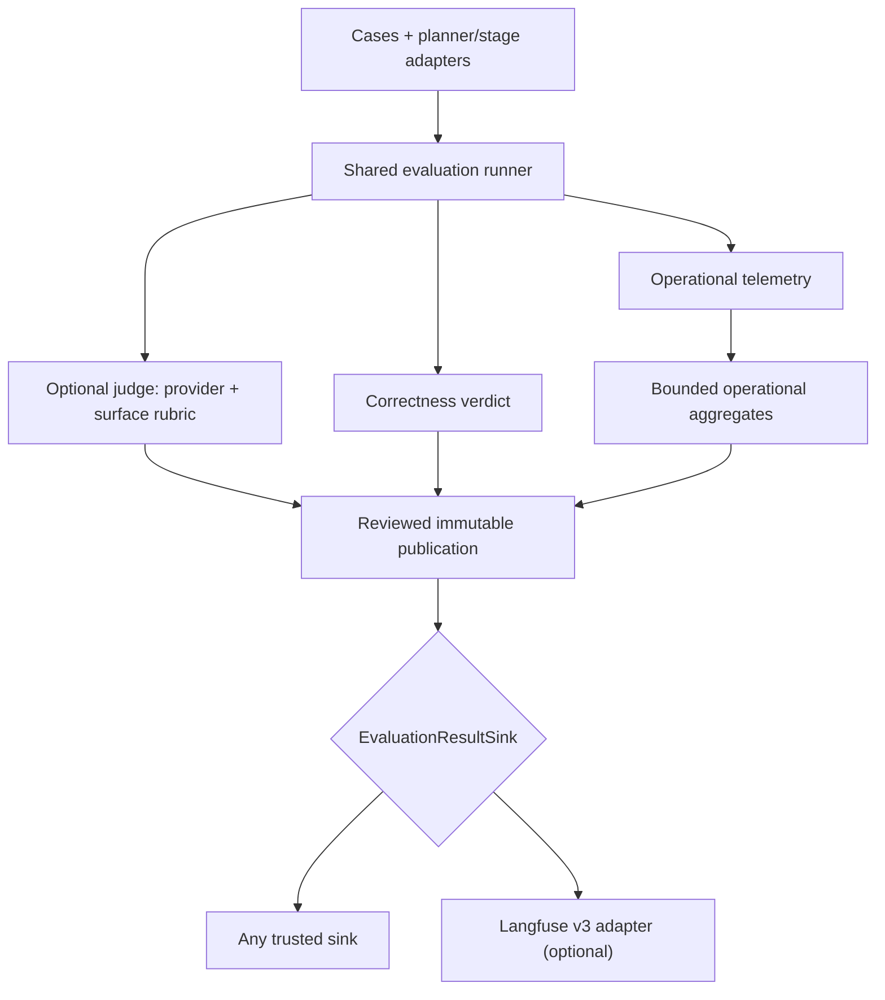

An **evaluation** is a repeatable check of how Maelstrom behaves on a specified task. It supplies an input, observes the result, and checks declared expectations—for example, whether a request to show weekly weather selects the expected Variant and Action. An evaluation only establishes what those checks measure; a passing result is not proof that every part of the user experience is correct.

## Terms used in this section

| Term | Meaning |
| --- | --- |
| **Case** | One defined check: its inputs, starting state, and expected properties. |
| **Suite** | A named collection of tasks selected for a run. `--suite all` selects the full planner suite, not one case. |
| **Arm** | A configuration being compared on the same tasks. The planner runner supports `baseline` and `jev-poc`. |
| **Judge** | An optional additional evaluator, such as an LLM that rates the observed result against a rubric (a set of grading criteria). It does not replace the programmed correctness checks. |
| **Score** | A recorded measurement, such as a correctness pass/fail or a judge's rating. Errors and missing measurements are not automatically scores of zero. |
| **Langfuse** | An external system for viewing saved evaluation results. It is an optional publication destination, also called a **sink**; it does not run or grade this evaluation. |

The checks can cover the **planner** (which chooses UI updates), an isolated **stage** (one part of that decision), a multi-turn **session**, or **client** behavior such as executing Actions. Results from one of these do not automatically prove the others work.

## Start here

1. Choose the behavior to check and the arms to compare. Read [Evaluation cases](/evals/cases/) for examples and coverage limits.
2. Run the evaluator and retain its records and summary. Provider-backed runs can cost money; scripted offline checks measure harness behavior rather than model quality.
3. Review correctness, missing evidence, and any optional judge ratings separately. Repeats are repeated attempts at the selected tasks, not additional kinds of coverage.
4. Optionally publish reviewed saved results. The [Langfuse workflow](/evals/langfuse/) walks through creating a runner script, running or reusing an evaluation, previewing it, and approving publication.

Running an evaluation and publishing evidence are separate operations; publication never reruns or rescores the evaluation. The rest of this page explains the boundaries behind that workflow.

## Architecture at a glance

The evaluator owns execution and scores. Operational telemetry describes runtime behavior and remains separate from correctness. After evaluation, the generic publisher reviews exact, bounded bytes and passes the resulting publication to a destination adapter:

`EvaluationResultSink` is the destination boundary. The core evaluation package prepares/reviews the publication and owns retry identity; it must not import Langfuse, initialize a destination, or publish implicitly. `tools/evals-langfuse` is one opt-in implementation of the sink. It maps finalized evidence into Langfuse events and scores; it does not define or change the evaluation verdict. A different trusted destination can implement the same sink contract.

## Adding another sink

To publish to another system, leave the evaluator core unchanged and add a destination adapter outside `packages/evals/src/core`:

1. Implement `EvaluationResultSink.publish(publication, signal)`. Map the already-reviewed `EvaluationPublication` into the destination's events; do not rerun evaluation, rescore, or infer values from raw records.
2. Use explicit destination configuration and caller-owned credentials. Keep credentials out of the publication payload. If the adapter owns a client or queue, expose explicit startup/shutdown and report its real delivery boundary.
3. Derive destination event/score IDs from the stable publication identity plus the event or metric key, so retries of the same reviewed bytes do not create duplicates. Return `accepted`, `partial`, `failed`, or `uncertain` according to what the destination actually acknowledged; acceptance is not proof of durable storage.
4. Add fake-transport tests for exact payload mapping, bounds/privacy, partial and uncertain delivery, aborts, and retry identity. Preview and review must remain offline and credential-free; only an explicitly approved publish may send data.

Keep deterministic correctness, secondary judge scores and operational metrics separate, and preserve missing measurements as missing. A destination adapter may project either signal, but must not turn telemetry into task correctness.

## Optional judging, independent of the sink

1. **Choose a provider.** `typesafe` and `openai` are LLM judges. Scores labeled
   `heuristic` are **non-LLM** text checks, never a fallback when an LLM request fails.
2. **Choose a rubric separately.** For LLM judging, `surface` uses the planner
   dimensions `request_satisfied` and `arrangement_match`, a stage-decision rubric
   for isolated stages, and session/client rubrics for their actual observations.
   Isolated stages always use their stage rubric: a routing decision is not a
   finished user task.
3. **Opt in before running.** Both planner and stage CLIs accept `--grader`,
   `--judge-provider`, `--judge-model` and `--judge-rubric`. Supplying a judge setting
   also enables judging. Explicit flags override environment defaults; `--no-grader`
   explicitly disables it. Provider credentials alone do not enable it.

For example, append `--grader --judge-provider=openai --judge-rubric=surface
--judge-model=gpt-5.4-mini` to the planner command in the [Langfuse workflow](/evals/langfuse/). OpenAI uses
`OPENAI_API_KEY`; TypeSafe uses `TYPESAFE_API_KEY` and an explicit judge model or
`JEV_MODEL`. Enabled missing credentials, empty models and unknown providers/rubrics
fail before evaluation work. These are potentially paid calls: review the case
content before sending it to either provider.

For environment-based LLM judging, set all four settings explicitly rather than
relying on defaults:

| Setting | Recommended value |
| --- | --- |
| `MAELSTROM_ENABLE_LLM_JUDGE` | `true` to enable judging (`1` also works; `false`/`0` disable). |
| `MAELSTROM_LLM_JUDGE_PROVIDER` | `openai` or `typesafe` for an LLM judge. |
| `MAELSTROM_LLM_JUDGE_MODEL` | The selected judge model, independent of the tested planner. |
| `MAELSTROM_LLM_JUDGE_RUBRIC` | `surface` for the task-specific criteria described above. |

Explicit `--grader` defaults to TypeSafe + `surface` unless overridden. A result
without valid evidence remains `not_run/no_valid_evidence`, not an invented score.
`MAELSTROM_LLM_JUDGE_THRESHOLD` does **not** gate deterministic correctness.

Library runners do not read environment implicitly. Call
`configureJudge(options, process.env)` from `packages/evals/src/plugins/judging/config.ts`
at the application boundary, then spread its `{ judge, judgeRubric }` into
`runEval`, `runStageEval` or `runOfflineCases`. Synthetic offline observations stay
synthetic even if an optional live judge rates them.

Every selected sample records `scored`, `failed` or `not_run`. Enabled judging runs
once per eligible sample/repeat, including deterministic failures, actual deferrals
and retained partial-session evidence—not only passes. Missing runtime output or
inapplicable stage inputs remain explicit coverage gaps. TypeSafe's intentional
near-boundary resampling remains part of one logical native grade; OpenAI does not
supply calibrated level probabilities, so no probabilities or resampling are invented.

Judging finishes before evaluation callbacks, record projection and reports. JSON,
Markdown (including paired reports), generic publications and destination adapters
retain its status/result. Run summaries show coverage and rubric/provider-separated descriptive
means labeled **unvalidated**. Calibration checks whether judge ratings agree with
reference judgments; that gate remains separate and requires evidence bound to the
same provider/model. Missing judge data stays unknown, never zero. Reports,
publishing and retries reuse the saved result; they never call a judge.

The separately acknowledged manual probes also honor judge environment activation.
Their planner dispatch caps do not change: judge calls are reported separately in
`judgeCalls`, dry-run makes neither call, and missing output is not graded. Review
provider budgets before enabling a judge on these one-shot probes.

:::note
If you choose Langfuse, its optional v3 adapter imports bounded per-sample summaries—not a hosted dataset experiment or full replay archive. See the [Langfuse workflow](/evals/langfuse/) to create the runner script, run or reuse an evaluation, review its exact preview, and explicitly approve publication.
:::
