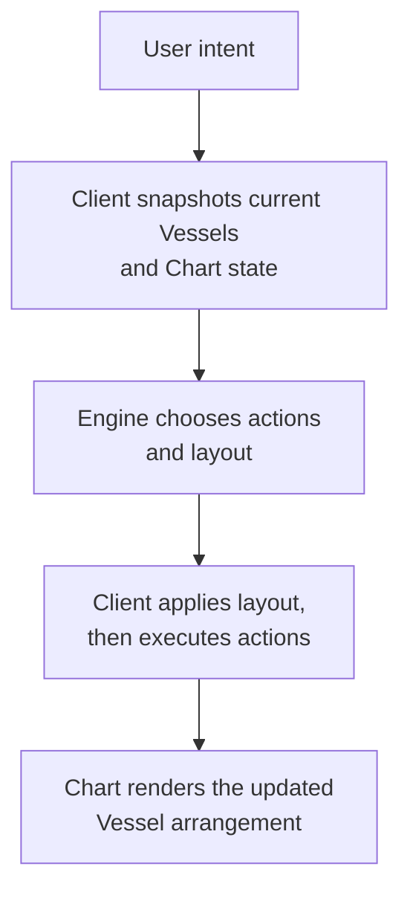
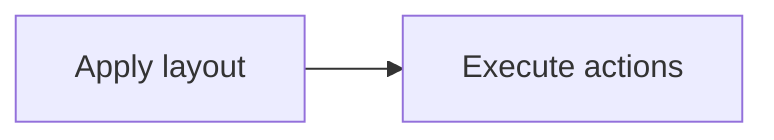

import { LinkCard, CardGrid } from '@astrojs/starlight/components';

Maelstrom has five core concepts. The important invariant is that the LLM orchestrates declared UI capabilities; it does not generate arbitrary components at runtime.

<CardGrid>
  <LinkCard title="Vessels" href="/understanding/vessel-state-machine/" description="Predefined UI components represented as state machines. Each Vessel declares variants, minimum sizes, and actions the engine may invoke."/>
  <LinkCard title="Chart" href="/understanding/grid-vs-tiling/" description="Layout surface that renders Vessels. The engine works with integer layout units, not raw pixels." />
  <LinkCard title="Engine" href="/understanding/engine/" description="Decision core. It reads user intent, current chart state, registered Vessels, and chart dimensions, then returns actions and layout."/>
  <LinkCard title="Protocol" href="/understanding/protocol/" description="Shared message contract between client and engine. It keeps transports swappable because every transport carries the same payloads."/>
  <LinkCard title="Voice" href="/guides/voice/overview/" description="An effort to give adaptive interfaces senses beyond text-to-UI. Realtime and cascade routes both reduce speech to natural-language intent before the client snapshots the Chart for the Engine."/>
</CardGrid>

## The turn lifecycle

A Maelstrom turn starts with intent and ends with a rendered chart.



That separation is what keeps Maelstrom safe. The LLM can choose from the catalogue you gave it, but your code still owns the actual components, action handlers, validation, and rendering.

## Vessels

A Vessel is the fundamental unit in Maelstrom. Think of it as a UI component with an explicit state machine that the engine can reason about.

### Variants

Each Vessel has one or more **variants**. A variant is a named UI state with three pieces of information: the props your component receives, the minimum chart size it needs, and the actions available while that variant is active.

### Actions

Actions are named operations the engine may invoke. Some actions transition the Vessel to another variant, while others keep the same variant and let your application mutate data or perform side effects.

```typescript
const weatherVessel = defineVessel({
  id: 'weather',
  name: 'Weather Widget',
  description: 'Shows weather information for a location',
  defaultVariant: 'compact',
  variants: {
    compact: {
      description: 'Shows temperature and conditions',
      props: { location: 'San Francisco', temp: 72 },
      minSize: { width: 2, height: 1 },
      actions: [
        { name: 'expand', description: 'Show detailed forecast', transitionsTo: 'detailed' },
      ],
    },
    detailed: {
      description: 'Shows 5-day forecast with hourly breakdown',
      props: { location: 'San Francisco', forecast: [] },
      minSize: { width: 4, height: 3 },
      actions: [
        { name: 'collapse', description: 'Return to compact view', transitionsTo: 'compact' },
      ],
    },
  },
});
```

## Chart

The Chart is the layout container. In grid mode, the engine returns row and column positions and enforces each active variant's `minSize`. In tiling mode, it returns a split tree whose leaves derive their size from the tree and container; tiling does not enforce `minSize`.

The Chart also notifies the engine when it gets resized. When the container dimensions change, the client sends a `chart_resize` update to the engine so it can recalculate the layout and reposition Vessels that no longer fit.

## Engine

The Engine runs server-side and processes user intent. When a user says "show me the weather and my calendar", the Engine:

1. Reads available Vessels, current variants, and Chart dimensions.
2. Decides which Vessels to show and which actions to invoke.
3. Returns an execution plan and layout directive.

## Protocol

The Protocol defines the messages moving between client and engine. The client can use WebSocket, HTTP, or an in-memory connector, but the payload shape remains the same.

## Voice

Voice is Maelstrom's effort to add senses beyond text-to-UI: an adaptive interface can listen and speak without creating a second planning path. A realtime route connects the browser to a voice-to-voice model, while a cascade route separates speech-to-text and text-to-speech into worker stages. Both routes cross into Maelstrom as natural-language intent; the client still captures the current Chart snapshot, and the Engine still makes the UI decision from that client-owned truth.

Start with the [Voice overview](/guides/voice/overview/) to compare the realtime and cascade routes and follow their shared intent boundary.

## Execution order

When processing Engine responses, the client dispatches layout and actions as an atomic batch, applying them in this order:



1. **Apply layout** using the layout directive the engine returned.
2. **Execute actions** so variants can transition.

Layout is applied first because it declares which instances exist. In tiling mode, the client rebuilds its instance map from the response, so an action targeting a newly introduced instance cannot run until layout creates that instance. The client applies both commands as one atomic batch and does not run a separate size or overflow pass afterward. See [How the LLM orchestrates UI](/understanding/llm-orchestration/) for the complete response lifecycle.
