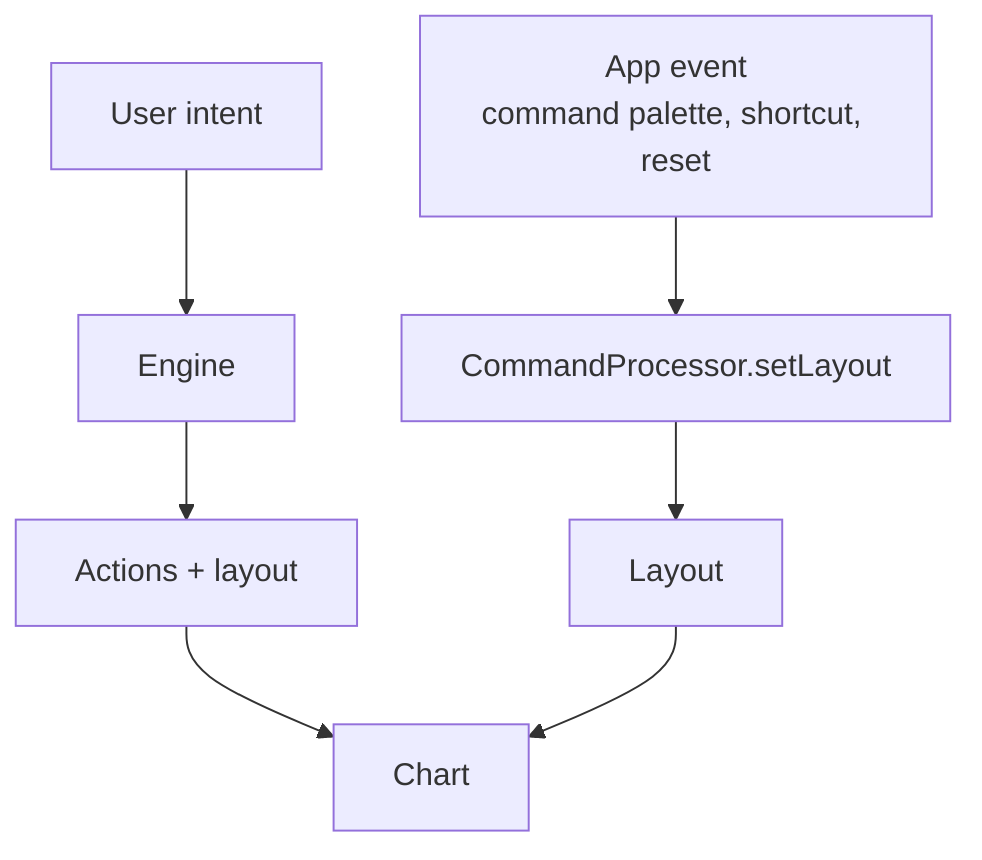

import { Aside } from '@astrojs/starlight/components';

Maelstrom's normal loop is engine-owned: user intent goes to the engine, and the engine returns actions plus layout. Programmatic layout is the escape hatch for controlled cases where your application already knows the exact arrangement it wants.

Use it sparingly. If every user interaction overwrites the engine's layout, the product stops feeling orchestrated and starts fighting its own decision loop.

## When to use it

Programmatic layout fits cases where determinism matters more than orchestration:

| Use case | Why programmatic control helps |
| --- | --- |
| Tests | Assert a known chart state without waiting for an LLM response. |
| Demo reset buttons | Return to a curated layout before a presentation. |
| Admin tooling | Force a diagnostic panel onto the chart. |
| Command palettes | Snap the UI to a named workspace when the user chooses a command. |
| Keyboard shortcuts | Move from broad orchestration to a deterministic layout for power-user flows. |
| Import/export flows | Restore a saved arrangement exactly. |

For normal user intent, prefer `processIntent()` so the engine can choose actions and layout together.

## Engine-owned vs developer-triggered layout



The difference is ownership. In the engine-owned path, layout reflects the model's interpretation of intent. In the programmatic path, layout reflects a deterministic application event.

## Safety rules

- Keep programmatic layout changes explicit and user-visible.
- Do not repeatedly override the layout immediately after every engine response.
- Preserve `minSize` constraints so Vessels are not rendered into unusable tiles.
- Prefer saved layouts or reset actions over hidden background corrections.

<Aside type="caution">
  Programmatic control can be useful, but it is not a substitute for better Vessel descriptions or better engine prompts. If the engine consistently chooses poor layouts, fix the orchestration inputs first.
</Aside>

## A note on `instanceId`

Each mounted Vessel instance gets an `instanceId` from the client runtime. That identifier is how you address one specific live instance when you call APIs such as `executeAction()` or `setLayout()`.

In other words, `InstanceId('weather-1')` is not an arbitrary label you invent for the example. It must match the instance the client actually created for that mounted Vessel. Use the instance ID you already have in application state, or the one returned by the part of your app that created the instance.

## Example: reset to a known layout

```ts {20-22}
import { InstanceId, type GridLayout } from '@maelstrom-co/protocol';
import type { Orchestrator } from '@maelstrom-co/client';

const defaultLayout: GridLayout = {
  type: 'grid',
  positions: [
    {
      instanceId: InstanceId('weather-1'),
      position: { row: 0, column: 0 },
      size: { width: 2, height: 1 },
    },
    {
      instanceId: InstanceId('calendar-1'),
      position: { row: 0, column: 2 },
      size: { width: 4, height: 3 },
    },
  ],
};

function resetDashboard(orchestrator: Orchestrator) {
  orchestrator.commandProcessor.setLayout(defaultLayout);
}
```

Use this pattern for deterministic resets. For user requests such as "show me the week and my urgent tasks," keep the request in the engine path.

## Next steps

- [Custom Connectors](/guides/client/custom-connectors/) — choose the transport that carries engine messages
- [Layout Modes](/guides/react/layout-modes/) — understand grid and tiling behavior
- [Grid vs Tiling Layout](/understanding/grid-vs-tiling/) — conceptual layout trade-offs
