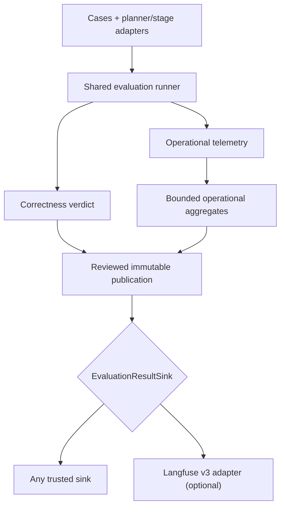

Run Maelstrom's native full-planner suite with the `baseline` and `jev-poc` arms, retain its output, then optionally publish reviewed results to a sink. Running an evaluation and publishing evidence are separate operations; publication never reruns or rescores the evaluation.

## Architecture at a glance

The evaluator owns execution and scores. Operational telemetry describes runtime behavior and remains separate from correctness. After evaluation, the generic publisher reviews exact, bounded bytes and passes the resulting publication to a destination adapter:



`EvaluationResultSink` is the destination boundary. The core evaluation package prepares/reviews the publication and owns retry identity; it must not import Langfuse, initialize a destination, or publish implicitly. `tools/evals-langfuse` is one opt-in implementation of the sink. It maps finalized evidence into Langfuse events and scores; it does not define or change the evaluation verdict. A different trusted destination can implement the same sink contract.

## Adding another sink

To publish to another system, leave the evaluator core unchanged and add a destination adapter outside `packages/evals/src/core`:

1. Implement `EvaluationResultSink.publish(publication, signal)`. Map the already-reviewed `EvaluationPublication` into the destination's events; do not rerun evaluation, rescore, or infer values from raw records.
2. Use explicit destination configuration and caller-owned credentials. Keep credentials out of the publication payload. If the adapter owns a client or queue, expose explicit startup/shutdown and report its real delivery boundary.
3. Derive destination event/score IDs from the stable publication identity plus the event or metric key, so retries of the same reviewed bytes do not create duplicates. Return `accepted`, `partial`, `failed`, or `uncertain` according to what the destination actually acknowledged; acceptance is not proof of durable storage.
4. Add fake-transport tests for exact payload mapping, bounds/privacy, partial and uncertain delivery, aborts, and retry identity. Preview and review must remain offline and credential-free; only an explicitly approved publish may send data.

Keep correctness scores separate from operational metrics, and preserve missing measurements as missing. A destination adapter may project either signal, but must not turn telemetry into task correctness.

## Example sink: Langfuse v3

This guide's script is one way to run the evaluation and optionally publish its reviewed summary to the Langfuse v3 sink. Use Bun and installed workspace dependencies from the repository root; the Langfuse CLI requires **Node ≥24** and targets **self-hosted Langfuse OSS 3.163.0**, not Cloud/v4. Deployment compatibility, access, retention and deletion policy still need verification and approval. See `tools/evals-langfuse/README.md` for the authoritative CLI contract and bounds.

**Cost warning:** the full suite makes many paid provider calls. Before `run-preview`, configure an external hard spending cap with your providers; the runner has no internal spend guard. Inject `OPENAI_API_KEY` and `TYPESAFE_API_KEY` through a trusted environment. Defaults below are `JEV_MODEL=jev-1.13.0`, `EVAL_MODEL=gpt-5.6-luna` and `REPEATS=3`.

### Run, preview, then approve

The following Bash 3.2 fragments form one script. Paste them in order into one shell session, or concatenate them into a local `full-planner-langfuse.sh` outside the checkout and run it from the repository root. Do not run each fragment in a fresh shell; later steps use variables set earlier. The script requires exactly one mode:

- `run-preview`: paid full-planner run into a **new** absolute `EVAL_OUT`, followed by local preview only. If unset, it creates a private directory under `${TMPDIR:-/tmp}` and uses its `run` subdirectory.
- `preview`: use an **existing** `EVAL_OUT` containing `records.json` and `summary.json`; no provider calls or upload. This also works for an earlier Bash run.
- `publish`: reuse those same files, the saved preparation timestamp and an explicitly selected preview plus its reviewed hash; never run the evaluator.

Set `LANGFUSE_BASE_URL` and `LANGFUSE_DESTINATION_ID` in your shell. For `run-preview`, optionally set a new absolute `EVAL_OUT` and `PREVIEW_FILE`; the default preview is `$EVAL_OUT/langfuse-preview.json`. Keep outputs outside the checkout, including when overriding `TMPDIR`. Record the printed paths: for later `preview` or `publish`, explicitly set `EVAL_OUT` to that saved directory and `PREVIEW_FILE` to the selected absolute preview path. A custom preview's parent must already exist. The script passes URL and destination as explicit CLI flags: the CLI does **not** read those variables or load `.env`. Only publish reads `LANGFUSE_PUBLIC_KEY` and `LANGFUSE_SECRET_KEY`; inject them securely, never into flags, evidence, shell history or logs. Prefer HTTPS.

### 1. Validate the invocation

This opening fragment enables strict shell handling, accepts exactly one mode, and requires an approved Langfuse URL and destination.

```bash title="1. Initialize the script"
#!/bin/bash
set -euo pipefail
umask 077

# Run the complete script from the workspace root.

die() { printf '%s\n' "$*" >&2; exit 2; }
if [ "$#" -ne 1 ]; then
  die 'Usage: bash full-planner-langfuse.sh run-preview|preview|publish'
fi
mode=$1
case "$mode" in
  run-preview|preview|publish) ;;
  *) die 'Choose run-preview, preview, or publish explicitly.' ;;
esac
: "${LANGFUSE_BASE_URL:?Set the approved Langfuse base URL}"
: "${LANGFUSE_DESTINATION_ID:?Set the approved destination ID}"
```

### 2. Choose private output paths

For `run-preview`, the next fragment creates a fresh output location (or a private temporary directory), checks absolute paths, verifies the repository root and Node version, and refuses to overwrite a preview.

```bash title="2. Choose private output paths"
# Set defaults only for a new paid run; preview/publish reuse saved paths.
if [ "$mode" = run-preview ]; then
  if [ -z "${EVAL_OUT:-}" ]; then
    temp_root=${TMPDIR:-/tmp}
    case "$temp_root" in /*) ;; *) die 'TMPDIR must be absolute.' ;; esac
    EVAL_OUT="$(mktemp -d "$temp_root/maelstrom-evals.XXXXXX")/run"
  fi
  PREVIEW_FILE=${PREVIEW_FILE:-"$EVAL_OUT/langfuse-preview.json"}
fi
: "${EVAL_OUT:?Set the absolute saved run directory}"
: "${PREVIEW_FILE:?Set the explicit absolute preview file path}"
case "$EVAL_OUT" in /*) ;; *) die 'EVAL_OUT must be absolute.' ;; esac
case "$PREVIEW_FILE" in /*) ;; *) die 'PREVIEW_FILE must be absolute.' ;; esac
[ -f tools/evals-langfuse/cli.ts ] || die 'Run from the repository root.'
node -e 'if (Number(process.versions.node.split(".")[0]) < 24) process.exit(2)'
```

### 3. Run the planner only when requested

This is the only fragment that executes the paid planner evaluation. `preview` and `publish` skip this branch and reuse saved `records.json` and `summary.json`.

```bash title="3. Run the planner only when requested"
# Only run-preview invokes the provider-backed planner.
if [ "$mode" != publish ]; then
  if [ -e "$PREVIEW_FILE" ] || [ -L "$PREVIEW_FILE" ]; then
    die 'Preview must be a new file.'
  fi
fi
if [ "$mode" = run-preview ]; then
  : "${OPENAI_API_KEY:?Inject the provider key securely}"
  : "${TYPESAFE_API_KEY:?Inject the provider key securely}"
  export JEV_MODEL="${JEV_MODEL:-jev-1.13.0}"
  EVAL_MODEL=${EVAL_MODEL:-gpt-5.6-luna}
  REPEATS=${REPEATS:-3}
  [[ "$REPEATS" =~ ^[1-9][0-9]*$ ]] || die 'REPEATS must be a positive integer.'
  if [ -e "$EVAL_OUT" ] || [ -L "$EVAL_OUT" ]; then
    die 'Use a new EVAL_OUT for a paid run.'
  fi
  mkdir -p "$EVAL_OUT"
  [ -d "$(dirname "$PREVIEW_FILE")" ] || die 'Preview parent directory must exist.'
  printf 'Retain EVAL_OUT=%s\nPREVIEW_FILE=%s\n' "$EVAL_OUT" "$PREVIEW_FILE"
  eval_log=$(mktemp "$EVAL_OUT/planner-output.XXXXXX")
  eval_status=0
  bunx nx run @maelstrom-co/evals:eval -- \
    --suite all --arm baseline --arm jev-poc --repeats "$REPEATS" \
    --model "$EVAL_MODEL" --out "$EVAL_OUT" > "$eval_log" 2>&1 || eval_status=$?
  printf 'Planner exit %s; private log at %s\n' "$eval_status" "$eval_log"
  [ "$eval_status" -eq 0 ] || exit "$eval_status"
fi
```

### 4. Validate and freeze the saved evidence

This fragment verifies the native run files, creates or reuses the fixed preparation timestamp, and builds the exact CLI arguments for preview and publish. The timestamp marks publication preparation, not evaluation latency.

```bash title="4. Validate and freeze saved evidence"
# Reuse this exact timestamp for preview and publish.
[ -d "$EVAL_OUT" ] || die 'EVAL_OUT must be an existing run directory.'
for file in records.json summary.json; do
  if [ ! -f "$EVAL_OUT/$file" ] || [ -L "$EVAL_OUT/$file" ]; then
    die "Missing regular input: $file"
  fi
done

prepared_file="$EVAL_OUT/langfuse-prepared-at.txt"
[ ! -L "$prepared_file" ] || die 'Preparation timestamp must not be a symlink.'
if [ ! -e "$prepared_file" ]; then
  [ "$mode" != publish ] || die 'Publish requires the saved preparation timestamp.'
  (set -C; date -u '+%Y-%m-%dT%H:%M:%S.000Z' > "$prepared_file")
fi
[ -f "$prepared_file" ] || die 'Missing preparation timestamp file.'
IFS= read -r prepared_at < "$prepared_file"
[ -n "$prepared_at" ] || die 'Empty preparation timestamp.'
args=(
  --input-format full-planner-run
  --input "$EVAL_OUT"
  --destination "$LANGFUSE_DESTINATION_ID"
  --artifact summary
  --prepared-at "$prepared_at"
  --base-url "$LANGFUSE_BASE_URL"
  --server-version 3.163.0
)
```

### 5. Preview or publish

Preview needs no Langfuse credentials and makes no network calls. Publish verifies the saved preview’s exact approval hash before reading credentials or sending the reviewed batch.

```bash title="5. Preview or publish"
# Publish is gated by the exact reviewed preview hash and secure credentials.
if [ "$mode" = publish ]; then
  : "${APPROVAL_SHA256:?Set the exact approvalSha256 reviewed after preview}"
  if [ ! -f "$PREVIEW_FILE" ] || [ -L "$PREVIEW_FILE" ]; then
    die 'Select the reviewed preview file.'
  fi
  preview_hash=$(node --input-type=module -e '
    import { readFileSync } from "node:fs";
    import { createHash } from "node:crypto";
    console.log(
      createHash("sha256")
        .update(readFileSync(process.argv[1]))
        .digest("hex"),
    );
  ' "$PREVIEW_FILE")
  if [ "$preview_hash" != "$APPROVAL_SHA256" ]; then
    die 'Approval does not match the selected preview.'
  fi
  : "${LANGFUSE_PUBLIC_KEY:?Inject the project public key securely}"
  : "${LANGFUSE_SECRET_KEY:?Inject the project secret key securely}"
  receipts=$(mktemp "$EVAL_OUT/langfuse-receipts.XXXXXX")
  status=0
  node tools/evals-langfuse/cli.ts "${args[@]}" \
    --publish --approve-sha256 "$APPROVAL_SHA256" > "$receipts" || status=$?
  printf 'Publish exit %s; retain receipts at %s\n' "$status" "$receipts"
  exit "$status"
else
  node tools/evals-langfuse/cli.ts "${args[@]}" --preview-out "$PREVIEW_FILE"
fi
```

With the environment configured, choose `bash /path/to/full-planner-langfuse.sh run-preview` for a new paid run, **or** `bash /path/to/full-planner-langfuse.sh preview` for saved evidence. Neither publishes. The planner's stdout and stderr go only to a private log under `EVAL_OUT`; the script prints its exit status and log path, and stops before preview on failure with the same exit status. That log can contain raw planner output, including errors and deferral details: inspect it privately, never copy it into shared shell or CI logs. Temp directories can be cleaned by the OS; preserve the private run directory for review and any later publication. The CLI writes a private (`0600`), no-overwrite preview; it needs no Langfuse credentials and makes no network calls in preview mode. Keep the saved native files private and unchanged during review/publication. The fixed timestamp in `langfuse-prepared-at.txt` marks publication preparation, not evaluation execution time.

Inspect the **entire exact batch envelope** locally in a trusted editor, not by dumping it into logs. Check every `publication.json` string, both source digests, expected/actual record counts, destination, physical base URL, server version and limits. Count equality validates structure, not semantic completeness or correct scenario selection. Only after review, set `APPROVAL_SHA256` to the preview command's `approvalSha256` and invoke `bash /path/to/full-planner-langfuse.sh publish`. The hash covers the entire preview file, including its trailing newline; `payloadDigest` and `publicationId` are not approval hashes. Do not automatically approve a computed hash without review.

The script checks the selected preview's hash; the CLI then re-prepares from the saved inputs and fixed timestamp and validates the same approval **before reading credentials or sending**. Preserve the same invocation configuration and limits. Any source-byte, endpoint, destination, timestamp or limit change requires a new preview file and approval. If default bounds reject a large run, consult the README and explicitly apply the same reviewed limit flags to both preview and publish; nothing is silently raised.

## What is imported

Import emits **per-sample summaries**, not a hosted dataset experiment or full replay archive. Only an explicit planned Boolean `score.pass` becomes Boolean `eval.correctness`. Runner errors, expected deferrals and missing scores remain unscored, never inferred failures. Alongside identity and bounded status/count summaries, only the expected-deferral flags `expectedDeferral` and optional `deferredAsExpected` are allowlisted metadata. No raw prompts, messages, Execution Plans, trees, stages, LLM calls, grader output or error text is exported. A scored fallback remains scored even if an earlier stage deferred; deferral flags alone do not establish final runtime disposition.

Langfuse correctness averages may differ from native `overall`: native denominators include planned errors and missing-score rows, whereas this import leaves them unscored. The secondary grader does not replace the native deterministic score.

Publication is **sequential and non-atomic**, stopping at the first nonaccepted receipt. Retain the receipt file, including attempted-item statuses and the `unsent` count. Exit `0` means all publications accepted with clean shutdown; `1` is a terminal failure with no accepted prefix; `2` is a validation/setup failure; `3` means partial or uncertain delivery/shutdown. There is no automatic retry/resume or cross-process exactly-once guarantee. Review receipts before any separately authorized retry, using the same saved evidence, timestamp, settings and approval—not another paid run. Acceptance receipts do not prove durable storage or retention.
