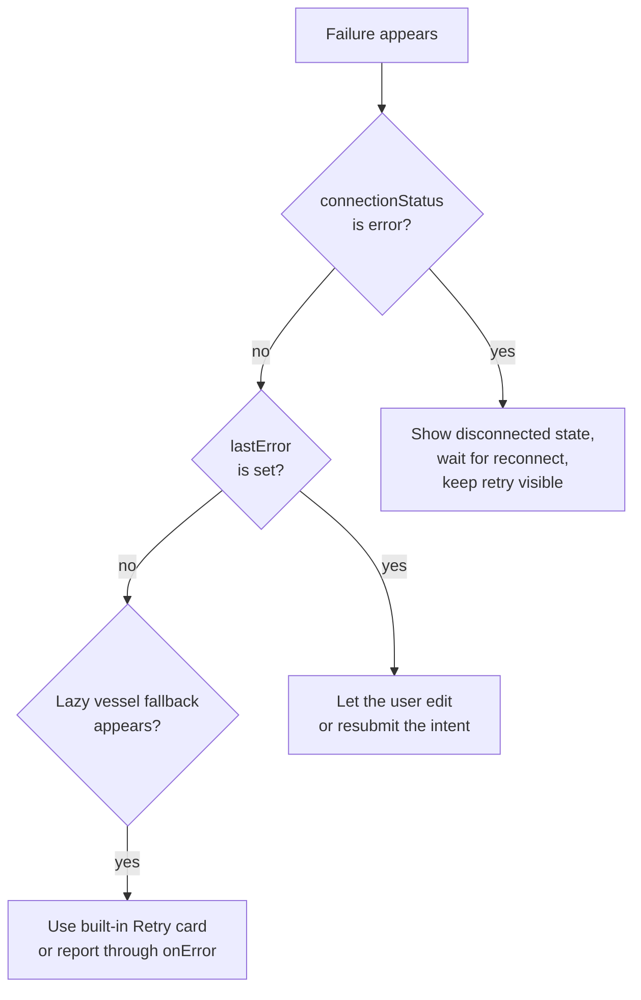

import { Aside } from '@astrojs/starlight/components';
import PromptDisclosure from '../../../../components/PromptDisclosure.astro';

Maelstrom surfaces failures through a small, deliberate set of channels. This guide shows you where each kind of error lands and how to build UI around it.

<Aside type="tip" title="Use with a coding agent">
  To investigate a concrete issue, use the [Maelstrom debugging prompt](/agents/prompts/maelstrom-debugging/) with the symptom and redacted evidence. It is for diagnosis from repository and runtime evidence before changing code; it does not authorize a fix by itself.
  <PromptDisclosure id="maelstrom-debugging" />
</Aside>

<Aside type="note">
  **Before you start:** this guide builds on the `greetingVessel` and `<m.Provider connector={...}>` setup from [Creating Vessels](/guides/react/creating-vessels/). The React package surfaces plain `Error` objects; there is no public error-type taxonomy to match on, so handle errors by *where* they come from, not by class.
</Aside>

## The three failure surfaces

Frame your handling around where the failure originates. Each surface has a distinct channel:

| Surface | Channel | What it covers |
| --- | --- | --- |
| [Engine / processing](/understanding/engine/) | `useMaelstrom().lastError` (plus `onError`) | A `processIntent` call fails: the engine rejects, the request times out, or response handling throws. |
| [Connector](/understanding/connectors/) | `useMaelstrom().connectionStatus` + `connectionError` (plus `onError` on initial connect) | The transport fails to connect or the Orchestrator fails to start. Mid-session drops update `connectionStatus`/`connectionError` only; they do not reach `onError`. |
| [Vessel runtime](/understanding/vessel-state-machine/) | The built-in `ErrorBoundary` | A *lazy* vessel's render throws or its chunk fails to load. Eagerly-registered vessels rely on your own React error boundary. |

The first two are reactive state you read in your own components. The third is automatic and internal, covered below.

## Catching engine and connector errors

Two entry points cover both surfaces.

### The Provider `onError` callback

`<m.Provider>` accepts an `onError` prop that fires for connection failures, Orchestrator startup failures, `processIntent` failures, and failed `executeAction` calls. It receives a single `Error`:

```tsx title="src/app.tsx"
import { m } from './maelstrom';
import { myConnector } from './connector';

export default function App() {
  return (
    <m.Provider
      connector={myConnector}
      onError={(error) => {
        // error is always a plain Error. Log it, report to telemetry, etc.
        console.error('[Maelstrom]', error);
      }}
    >
      <m.Chart />
    </m.Provider>
  );
}
```

`onError` is the right place for side effects: logging, toasts, error reporting. It is not where you render fallback UI; for that, read the state with `useMaelstrom()`.

<Aside type="tip">
  Every error passed to `onError` *also* surfaces through `useMaelstrom()`. Use `onError` for fire-and-forget side effects and the hook for anything you render. You don't have to choose one.
</Aside>

### Reading error state with `useMaelstrom()`

`useMaelstrom()` exposes the reactive error state you render against:

| Field | Type | Description |
| --- | --- | --- |
| `lastError` | `Error \| null` | The last error from `processIntent`. Auto-clears on the next call. |
| `connectionStatus` | `ConnectionStatus` | One of `'disconnected'`, `'connecting'`, `'connected'`, `'error'`. |
| `connectionError` | `Error \| null` | The last connection error, set when `connectionStatus` is `'error'`. |

`processIntent` never rejects; it always resolves, and a failure shows up as a populated `lastError` instead. So you don't need a `try/catch` around the call; read `lastError` afterwards.

```tsx title="src/components/intent-bar.tsx"
import { useState } from 'react';
import { m } from '../maelstrom';

export default function IntentBar() {
  const { processIntent, isProcessing, lastError, connectionStatus, connectionError } =
    m.useMaelstrom();
  const [intent, setIntent] = useState('');

  const handleSubmit = async (e: React.FormEvent) => {
    e.preventDefault();
    if (!intent.trim() || isProcessing) return;
    // processIntent never rejects; inspect lastError after it resolves.
    await processIntent(intent);
    setIntent('');
  };

  return (
    <div>
      {connectionStatus === 'error' && (
        <div role="alert">
          Lost connection to the engine.
          {connectionError && <span> {connectionError.message}</span>}
        </div>
      )}

      {lastError && (
        <div role="alert">Couldn't process that: {lastError.message}</div>
      )}

      <form onSubmit={handleSubmit}>
        <input
          type="text"
          value={intent}
          onChange={(e) => setIntent(e.target.value)}
          disabled={isProcessing || connectionStatus !== 'connected'}
        />
        <button type="submit" disabled={isProcessing || !intent.trim()}>
          {isProcessing ? 'Working...' : 'Send'}
        </button>
      </form>
    </div>
  );
}
```

Gate input on `connectionStatus === 'connected'` so users aren't typing into a dead session, and use `connectionStatus` (not just `connectionError`) to drive the banner, since `'connecting'` is a normal transient state, not a failure.

## Vessel runtime errors

Rendering a vessel can throw errors. Maelstrom catches them so one broken vessel can't take down the whole Chart.

This is **automatic and internal**: there is nothing to wire up, and almost nothing to configure:

- The Chart wraps each **lazy** vessel in a built-in `ErrorBoundary`. If a lazy component's chunk fails to load or its render throws, the boundary catches it.
- The fallback is a built-in error card (`VesselLoadError`) showing "Failed to load" plus a **Retry** button. Retry works by incrementing an internal key, which produces a fresh `React.lazy()` instance and re-attempts the import.
- The same caught error is forwarded to your Provider `onError` callback, so you still get to log or report it.

<Aside type="caution">
  The `ErrorBoundary` and its fallback card are **not exported** and the Chart wires them only around **lazy** vessels; eagerly-registered (non-lazy) vessels render without a boundary, so a throw there propagates to your own nearest React error boundary. The only knobs you control are the Provider `onError` callback and the per-vessel loading component (see [Lazy Loading](/guides/react/lazy-loading/)). The fallback card markup, the retry mechanism, and the boundary placement are all internal. If you need a custom error card for a non-lazy vessel, add your own React error boundary around it.
</Aside>

## Retry UX

There is no single global "retry", recovery is per-surface:

- **Connector errors.** When `connectionStatus === 'error'`, recovery depends on your connector's reconnect behavior. Surface the `'error'` state in your UI and give the user a way to retry the action once status returns to `'connected'`.
- **Lazy vessel loads.** The built-in `VesselLoadError` card already renders a **Retry** button that re-imports the failed chunk. You get this for free; see [Lazy Loading](/guides/react/lazy-loading/) for how lazy entries are registered.
- **Failed intents.** Because `lastError` auto-clears on the next `processIntent` call, the simplest user-facing affordance is letting the user resubmit, since the stale error clears itself on the retry.

The throughline: keep a working input path visible whenever an error is on screen, so the user always has a way forward.

## Recovery decision tree



The useful rule is to keep a working input path visible. Users should never have to refresh the page just to recover from a failed intent or transient connector issue.

Reference surfaces: [`MaelstromProviderProps`](/reference/react/type-aliases/maelstromproviderprops/), [`MaelstromState`](/reference/react/interfaces/maelstromstate/), and [`DynamicVesselHandle`](/reference/react/interfaces/dynamicvesselhandle/).

## Next steps

- [Lazy Loading Vessels](/guides/react/lazy-loading/) — register lazy vessels and customize their loading and error states
- [Creating Vessels](/guides/react/creating-vessels/) — the `greetingVessel` setup this guide builds on
- [The Engine](/understanding/engine/) — how the engine validates and heals responses, the source of many processing errors
