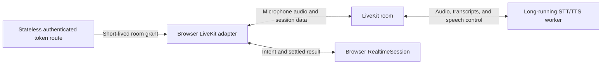

import { Aside, Steps } from "@astrojs/starlight/components";

The LiveKit cascade adds hold-to-talk voice without adding another planning model. A worker transcribes speech with Deepgram and synthesizes settled results with Cartesia, while the browser sends each final transcript through `RealtimeSession` as an ordinary `update_ui` intent.

### The three runtime roles

Deploy the cascade as three roles with different lifecycles and credential boundaries:

1. The **browser bundle** captures microphone audio, joins LiveKit, and connects final transcripts to the Maelstrom client.
2. The **stateless authenticated token route** runs on the application server. It authenticates each mint request, derives room and participant scope from server policy, signs a short-lived grant, and then ends.
3. The **separately deployed long-running worker** joins LiveKit for session work. It holds the Deepgram and Cartesia credentials and performs speech-to-text (STT) and text-to-speech (TTS).

The worker stays model-free: it transcribes and synthesizes speech but never plans UI changes or receives Chart grounding. Each final transcript returns through the browser as ordinary intent, so the Engine still plans against the client-built Chart snapshot. For a successful UI update, TTS starts only after rendering settles and the browser sends the successful result back through LiveKit. Malformed tool arguments and genuine submission failures return failure results immediately, without waiting for render settlement.

### Understand what runs where

The LiveKit cascade separates browser transport, credential minting, and speech processing into three runtime roles.



The browser LiveKit adapter joins a LiveKit room. A stateless authenticated token route uses server-held LiveKit credentials to sign a short-lived room grant, returns it to the browser, and ends after the request. The LiveKit room relays microphone audio and session data from the browser to a separate STT/TTS worker, then relays synthesized audio and session data back to the browser. The worker holds the speech-provider credentials and stays attached for session work. The worker publishes each final transcript to the room. The browser adapter turns that transcript into an ordinary Maelstrom intent through `RealtimeSession`. Successful UI updates wait for rendering to settle before the successful result returns through LiveKit for worker TTS. Malformed tool arguments and genuine submission failures return failure results immediately, without waiting for render settlement. The worker has no LLM and receives no UI grounding; the Engine remains the only planning model.

## Prerequisites

Before wiring the track, provide:

- a Maelstrom React instance with its normal Engine Connector
- a LiveKit server and credentials for both the token service and worker
- Deepgram and Cartesia credentials for the worker
- a browser secure context with microphone permission
- the `@maelstrom-co/realtime-livekit`, `@maelstrom-co/realtime-livekit-server`, `@maelstrom-co/realtime-livekit-agent`, and `@maelstrom-co/react-realtime` packages

<Aside type="note" title="Examples are integration excerpts">
  The code fences in this guide are illustrative integration excerpts. They omit
  app-specific route registration, authentication and room policy, dependency
  configuration, UI styling, telemetry, and consent copy.
</Aside>

## Follow the cascade

One hold-to-talk turn follows this path:

1. The microphone publishes audio to a LiveKit room.
2. The Deepgram STT worker publishes one final transcript for the turn.
3. The browser's `LiveKitAdapter` converts that transcript to an `update_ui` tool call.
4. `RealtimeSession` submits the natural-language intent to the Maelstrom client.
5. The Engine plans against the client-built Chart snapshot and returns the normal Execution Plan and Layout Directives.
6. For a successful UI update, `RealtimeSession` waits for rendering to settle before returning the successful result to the adapter. Malformed arguments and genuine submission failures return failure results immediately.
7. The adapter sends the result text on the LiveKit `speak` topic.
8. The Cartesia TTS worker publishes audio back to the room.

<Aside type="note" title="The worker has no planning model">
  The worker performs only Deepgram STT and Cartesia TTS. It receives no Vessel,
  Instance, Variant, Action, Chart, or grounding context. The Maelstrom Engine
  is the only planning LLM, and `LiveKitAdapter.injectGrounding()` is
  intentionally a no-op.
</Aside>


## Connect the browser adapter

Create one `LiveKitAdapter` for each Maelstrom voice session. The callback that fetches the room grant is application-provided; keep LiveKit signing credentials out of the browser bundle.

```ts title="src/voice/livekit-adapter.ts"
export function createLiveKitAdapter({
  sessionId,
}: CreateAdapterContext): LiveKitAdapter {
  return new LiveKitAdapter({
    roomName: `maelstrom-${sessionId}`,
    mintToken: fetchLiveKitToken,
    thinkingFallbackMs: 10_000,
  });
}
```

This compile-checked integration excerpt uses the public browser package. During `connect()`, the adapter calls LiveKit's `setMicrophoneEnabled(true)` to acquire and publish the microphone, then `setMicrophoneEnabled(false)` to mute the existing publication until a turn starts. A denied browser permission surfaces as `MIC_PERMISSION_DENIED`; explain how to allow access, then reconnect.

The adapter ignores partial and blank transcription segments. Each non-empty final transcript emits a user transcript event and exactly one synthetic `update_ui` tool call whose `intent` is the trimmed transcript. That natural-language intent follows the normal Maelstrom path; the worker never plans the UI.

## Delimit each held turn

The current LiveKit cascade implementation uses explicit hold-to-talk boundaries. Call `turnControl.startTurn()` on press and `turnControl.endTurn()` on every release or cancellation path. This behavior belongs to this adapter, not to the shared voice architecture. Realtime adapters may instead use provider-managed turn detection and leave `turnControl` undefined.

```ts title="src/voice/held-turn.ts"
export async function runHeldTurn(
  turnControl: AdapterTurnControl,
): Promise<void> {
  await turnControl.startTurn();
  try {
    await waitForRelease();
  } finally {
    await turnControl.endTurn();
  }
}
```

`startTurn()` unmutes the published microphone. `endTurn()` mutes it before signaling the worker to flush the turn. If a held turn produces no final transcript, the provider-specific `thinkingFallbackMs` timer returns the session from `thinking` to `connected`; the configured `10_000` milliseconds bounds that recovery. Set the option to `0` only when another integration owns empty-turn recovery, because disabling it can leave an unanswered empty turn in `thinking`.

## Run the checked-in demo locally

Use this checkpoint to hear the repository demo before building a production integration. The checked-in demo mint route is development-only and is not deployable.

1. Copy the root `.env.example` to `.env`. Keep the existing `GOOGLE_API_KEY` or `GEMINI_API_KEY` for the Engine, add real `DEEPGRAM_API_KEY` and `CARTESIA_API_KEY` values, and leave the example `LIVEKIT_*` values unchanged.
2. Follow the official [Install LiveKit Server](https://docs.livekit.io/home/self-hosting/local) instructions if the binary is not installed. Then start the local LiveKit process in one terminal:

   ```bash
   livekit-server --dev
   ```

   The `--dev` flag uses well-known insecure `devkey` / `secret` credentials that are suitable only for local development.
3. From the repository root, start the full demo in another terminal:

   ```bash
   bunx nx dev-livekit demo
   ```

   The Nx target starts the Engine host, the long-running STT/TTS worker, and the browser app. The separate `livekit-server --dev` command supplies the local LiveKit process. Open [http://localhost:3000](http://localhost:3000), connect voice, hold to talk, and release. A final transcript should become ordinary intent; after the UI settles, the worker should speak the result.

For a deployable integration, continue to the [production token and worker checkpoint](#add-the-server-token-route). It replaces the demo mint route with server-owned room and participant scope. The browser checkpoint above does not make the development route production-ready.

The canonical public guide URL is [https://docs.maelstrom-ai.co/guides/voice/livekit-cascade/](https://docs.maelstrom-ai.co/guides/voice/livekit-cascade/).

## Steps

<Steps>
1.  ### Add the server token route

    Create the authenticated endpoint that derives room scope and signs a grant before writing browser code that consumes it.

2.  ### Start the STT/TTS worker

    Run the model-free worker as a separate long-running process with only its server and speech-provider credentials.

3.  ### Validate the browser grant

    Fetch the grant with same-origin credentials and a CSRF proof, then validate the unknown response before connecting.

4.  ### Connect the browser adapter

    Configure the generic adapter callback while leaving actual room authorization to authenticated server policy and the signed grant.

5.  ### Use the protocol entry point

    Import shared turn and speech topics without pulling browser dependencies into the worker.

6.  ### Render a safe hold-to-talk control

    Serialize turn operations, release the turn on common cancellation paths, and expose only fixed recovery copy.

7.  ### Harden the deployment

    Enforce authentication, trusted scope derivation, origin and CSRF checks, shared rate limiting, no-store responses, session limits, and redacted telemetry.

</Steps>

## Add the server token route

Keep LiveKit signing credentials in server-only code. The minter validates the request, trims the room name, signs a token scoped to that room, and returns a typed `Result`.

```ts title="server/livekit-token.ts"
import { isOk } from '@maelstrom-co/protocol';
import {
  LiveKitTokenGrantSchema,
  type LiveKitTokenGrant,
} from '@maelstrom-co/realtime-livekit/token';
import {
  mintFailureHttpStatus,
  mintLiveKitToken,
} from '@maelstrom-co/realtime-livekit-server';

const TOKEN_RESPONSE_HEADERS = {
  'Cache-Control': 'private, no-store',
};

/**
 * Authenticates and authorizes one room-token request before minting a grant
 * from server-derived scope. Every response is non-cacheable; unexpected
 * failures cross the boundary only as a generic error after redacted telemetry.
 */
export async function POST(request: Request): Promise<Response> {
  try {
    if (!isTrustedVoiceMintOrigin(request)) {
      return Response.json(
        { error: 'request-denied' },
        { status: 403, headers: TOKEN_RESPONSE_HEADERS },
      );
    }

    const authenticated = await requireAuthenticatedVoiceSession(request);
    if (authenticated === null) {
      return Response.json(
        { error: 'unauthorized' },
        { status: 401, headers: TOKEN_RESPONSE_HEADERS },
      );
    }

    if (!isValidVoiceMintCsrf(request, authenticated)) {
      return Response.json(
        { error: 'request-denied' },
        { status: 403, headers: TOKEN_RESPONSE_HEADERS },
      );
    }

    const rateLimit = await consumeVoiceMintRateLimit(
      authenticated.principalId,
    );
    if (!rateLimit.allowed) {
      return Response.json(
        { error: 'rate-limited' },
        {
          status: 429,
          headers: {
            ...TOKEN_RESPONSE_HEADERS,
            'Retry-After': String(rateLimit.retryAfterSeconds),
          },
        },
      );
    }

    const result = await mintLiveKitToken({
      roomName: authenticated.roomName,
      identity: authenticated.identity,
    });
    if (isOk(result)) {
      return Response.json(result.value, { headers: TOKEN_RESPONSE_HEADERS });
    }

    return Response.json(
      { error: 'mint-failed' },
      {
        status: mintFailureHttpStatus(result.error.reason),
        headers: TOKEN_RESPONSE_HEADERS,
      },
    );
  } catch (error) {
    try {
      await reportRedactedVoiceMintFailure({
        source: 'livekit-token-route',
        error,
      });
    } catch {
      // Telemetry failure must not escape the HTTP boundary.
    }
    return Response.json(
      { error: 'mint-failed' },
      { status: 500, headers: TOKEN_RESPONSE_HEADERS },
    );
  }
}

/**
 * Fetches and validates an authenticated room grant without sending browser-
 * selected room or participant scope. Rejects non-success HTTP responses and
 * schema-invalid response bodies, leaving voice disconnected for the caller.
 */
export async function fetchAuthenticatedLiveKitToken(): Promise<LiveKitTokenGrant> {
  const response = await fetch('/api/livekit-token', {
    method: 'POST',
    credentials: 'same-origin',
    headers: { 'X-CSRF-Token': getCsrfToken() },
  });

  if (!response.ok) {
    throw new Error(`LiveKit token mint failed with status ${response.status}`);
  }

  return LiveKitTokenGrantSchema.parse(await response.json());
}
```

<Aside type="danger" title="The minter is a bootstrap primitive">
  `mintLiveKitToken` validates shape and signs a room token, but it does not
  authenticate or authorize callers. `requireAuthenticatedVoiceSession` is the
  app-specific boundary that must authenticate and authorize the request, bind
  the principal to its server-side session, and derive `roomName` and `identity`
  from that trusted session. It does not validate CSRF; `isValidVoiceMintCsrf`
  owns that check. Restrict origins and rooms, rate-limit attempts, and monitor
  abuse. Never expose `LIVEKIT_API_KEY`, `LIVEKIT_API_SECRET`, or worker
  provider keys to browser code.
</Aside>

The imported authentication, CSRF, origin, shared rate-limit, and telemetry functions are mandatory app-provided fail-closed controls, not implementations supplied by Maelstrom. `requireAuthenticatedVoiceSession` must return `null` for authentication or authorization denial, bind the principal to its server-side session, and derive room scope only from that trusted session; it does not validate CSRF. `isTrustedVoiceMintOrigin` must parse the request's `Origin`, compare it with an exact configured allowlist, and return `false` when the header or policy is missing or invalid. `isValidVoiceMintCsrf` is the only control in this example that validates CSRF; it checks the application's proof against the authenticated session and returns `false` when the proof or policy is missing or invalid. `consumeVoiceMintRateLimit` must atomically consume from a shared limit keyed by the authenticated `principalId`, return a bounded `retryAfterSeconds`, and return a denied result on policy-store failure. None of these controls may accept a policy key or room scope from browser input.

The outer `try` covers the complete route boundary. Unexpected exceptions are reported only through the redacted telemetry boundary, which must emit allowlisted metadata without raw messages, stacks, credentials, token contents, request bodies, or session data. If telemetry itself fails, the route still returns the same generic failure. Neither mapped mint failures nor unexpected exceptions expose internal failure reasons to the browser.

Every route response sets `Cache-Control: private, no-store`. `no-store` prevents private and shared caches from retaining the bearer room token; `private` also documents that the response is user-specific. Keep this response header even when an authenticated framework supplies its own default caching policy.

The checked minter issues only the grants this browser role uses: `roomJoin` for the server-derived room, `canPublish` for microphone audio and data, and `canSubscribe` for worker audio and room events. It does not grant room administration, recording, ingress, egress, or permission to join any other room. If your application needs a narrower publication policy, wrap or replace the minter and test that policy against the media and data topics your integration actually publishes.

<Aside type="danger" title="Repository demo route is development-only">
  The repository demo mint route is development-only. Its implementation at
  `apps/demo/src/lib/voice/get-livekit-token.ts` currently lacks production
  authentication, trusted scope derivation, and explicit no-store cache headers.
  Do not deploy that route. Use the hardened authenticated POST route above.
</Aside>

The server process requires `LIVEKIT_URL`, `LIVEKIT_API_KEY`, and `LIVEKIT_API_SECRET`. `LIVEKIT_TOKEN_TTL` is optional and defaults to `15m`; supported values are a positive integer number of seconds or one `<int><unit>` value using `s`, `m`, `h`, or `d`. Unsupported or unsafe values fail closed as `invalid-config`.

These token and reconnect statements are scoped to the repository's locked `livekit-client` and `livekit-server-sdk` 2.13.1 releases. Re-check the provider's [token generation guide](https://docs.livekit.io/home/server/generating-tokens/) before changing either dependency.

## Start the STT/TTS worker

Run the agent in a process separate from the application server and browser.

The worker has no planning LLM and receives no UI grounding. It runs only the Deepgram STT and Cartesia TTS paths; the browser converts final transcripts into intent, and the Maelstrom Engine plans from the client-built Chart snapshot.

```ts title="voice-worker.ts"
import { runVoiceAgent } from '@maelstrom-co/realtime-livekit-agent';

runVoiceAgent();
```

Run that entry with LiveKit's `start` worker command:

```bash
node --env-file=.env voice-worker.ts start
```

For the checked-in demo, use the full `bunx nx dev-livekit demo` checkpoint above rather than launching only the worker role. The target starts `apps/demo/voice-worker.ts` together with the Engine host and browser app.

When a custom worker harness needs the underlying definition, export the factory result instead:

```ts title="embedded-voice-agent.ts"
import { defineMaelstromVoiceAgent } from "@maelstrom-co/realtime-livekit-agent";

export default defineMaelstromVoiceAgent();
```

Keep environment values grouped by the process that reads them:

| Process        | Required environment                                                                           | Optional environment                              |
| -------------- | ---------------------------------------------------------------------------------------------- | ------------------------------------------------- |
| Token endpoint | `LIVEKIT_URL`, `LIVEKIT_API_KEY`, `LIVEKIT_API_SECRET`                                         | `LIVEKIT_TOKEN_TTL` (default `15m`)               |
| Agent worker   | `LIVEKIT_URL`, `LIVEKIT_API_KEY`, `LIVEKIT_API_SECRET`, `DEEPGRAM_API_KEY`, `CARTESIA_API_KEY` | `MAELSTROM_STT_FLUSH_TIMEOUT_MS` (default `2000`) |
| Browser        | None of these secrets                                                                          | None                                              |

Keep all provider credentials in worker-only or server-only configuration. `MAELSTROM_STT_FLUSH_TIMEOUT_MS` must be positive and bounds the fallback when a flush-produced final transcript does not arrive. When the timeout expires, the worker emits buffered text when any is available; an empty turn emits nothing.

The worker commands and APIs above are scoped to `@livekit/agents`, `@livekit/agents-plugin-deepgram`, and `@livekit/agents-plugin-cartesia` 1.4.8. Follow LiveKit's [voice AI quickstart](https://docs.livekit.io/agents/start/voice-ai/) when upgrading the worker packages, then re-run this guide's compile-checked fixture.

## Validate the token contract in the browser

The `/token` entry point contains the grant schema without importing the LiveKit browser transport. The compile-checked `fetchAuthenticatedLiveKitToken` helper above treats the token endpoint's response as unknown data and validates it before joining a room.

The authenticated POST sends the app's same-origin session credentials and CSRF token, but no client-selected room or participant identity. The schema requires a non-empty token, a `ws:` or `wss:` LiveKit URL, and an absolute expiry in Unix seconds. Shape validation does not replace endpoint authentication or authorization.

## Connect the browser adapter

Create one adapter per Maelstrom session. The generic `LiveKitAdapterOptions` contract calls `mintToken(roomName)` so the package can support integrations in which the callback uses a configured room name. This hardened example deliberately ignores that browser-side callback argument: authenticated server policy derives `authenticated.roomName` and `authenticated.identity`, and the signed grant alone selects and authorizes the actual room.

```ts title="src/maelstrom.ts"
import { createMaelstrom } from "@maelstrom-co/react";
import { maelstromRealtime } from "@maelstrom-co/react-realtime";
import { LiveKitAdapter } from "@maelstrom-co/realtime-livekit";
import { fetchAuthenticatedLiveKitToken } from "./voice/mint-livekit-token";
import { vessels } from "./vessels";

export const m = createMaelstrom({ vessels }).with(
  maelstromRealtime({
    createAdapter: () =>
      new LiveKitAdapter({
        roomName: "not-authoritative",
        mintToken: (_roomName) => fetchAuthenticatedLiveKitToken(),
      }),
  }),
);
```

The `roomName` option remains necessary to satisfy the generic adapter API, and the adapter forwards it only to `mintToken(roomName)`. It is not an authorization input in this integration. The browser fetch sends no room or identity in its body; the authenticated endpoint's signed grant is the authority used when LiveKit joins the participant.

`connect()` joins the room and calls `setMicrophoneEnabled(true)`, which acquires and publishes the microphone track, followed by `setMicrophoneEnabled(false)` to mute that publication. This implementation therefore requests microphone access during connection, before the first held turn. The browser retains microphone access while the published track is muted, until `disconnect()` leaves the room and stops the adapter's media resources. Hold-to-talk changes the existing track's mute state; it does not acquire or release microphone permission. This track has no provider-managed voice activity detection.

Token expiry is checked for each initial or fresh room connection, including an explicit `connect()` after `disconnect()`. It does not impact LiveKit SDK-managed reconnects for an already connected participant because LiveKit pushes refreshed tokens to connected clients, and the SDK uses the refreshed token for managed reconnects. Expiry alone does not disconnect an active participant or end the room. Each fresh `connect()` invokes `mintToken`; the adapter does not read `expiresAt` or schedule proactive renewal. Expiry does not impose a maximum room duration or schedule adapter cleanup, so production hosts must enforce their own maximum session duration, call `disconnect()` on policy termination, and clean up abandoned rooms and participants separately.

## Use the protocol entry point

The `/protocol` entry point is shared by the browser adapter and worker. It defines the topics without pulling browser dependencies into the worker.

```ts
import {
  SPEAK_TOPIC,
  TURN_TOPIC,
  TTS_TOPIC,
} from "@maelstrom-co/realtime-livekit/protocol";
```

`TURN_TOPIC` carries turn-end and TTS-cancel data messages. `SPEAK_TOPIC` carries settled result text to the worker, and `TTS_TOPIC` carries playout-complete or synthesis-error status back to the browser. Application code normally lets the adapter and worker publish these messages.

## Render a safe hold-to-talk control

Disable hold-to-talk until the transport is connected. Prevent repeated starts and queue serialized, best-effort cleanup when a normal release is lost to pointer-capture loss, control or window blur, a hidden document, disconnect, or unmount. Browser termination can still prevent JavaScript cleanup, so server-side session limits remain necessary.

```tsx title="src/HoldToTalk.tsx"
import {
  useCallback,
  useEffect,
  useRef,
  useState,
  type KeyboardEvent,
  type PointerEvent,
} from "react";
import { RealtimeVoiceError } from "@maelstrom-co/realtime";
import { m } from "./maelstrom";
import { reportRedactedVoiceFailure } from "./redacted-telemetry";

const LIVE_STATES = new Set(["connected", "listening", "thinking", "speaking"]);
const OPERATION_FAILURE_COPY =
  "Voice control failed. Release the control, then try again.";

function voiceSessionErrorCopy(error: unknown): string {
  if (error instanceof RealtimeVoiceError) {
    switch (error.code) {
      case "MIC_PERMISSION_DENIED":
        return "Microphone access was denied. Allow microphone access before reconnecting.";
      case "TOKEN_MINT_FAILED":
        return "Voice credentials could not be issued. Check the voice server, then reconnect.";
      case "CONNECTION_FAILED":
      case "DATA_CHANNEL_ERROR":
      case "ALREADY_CONNECTED":
      case "CONNECT_SUPERSEDED":
        return "The voice connection failed. Reconnect voice to continue.";
    }
  }

  return "The voice session failed unexpectedly.";
}

function reportHoldToTalkFailureSafely(
  phase: "start" | "end",
  error: unknown,
): void {
  void Promise.resolve()
    .then(() =>
      reportRedactedVoiceFailure({ source: `hold-to-talk-${phase}`, error }),
    )
    .catch(() => {
      console.warn("Voice telemetry unavailable.");
    });
}

export function HoldToTalk() {
  const { state, error, turnControl } = m.useVoice();
  const [operationFailure, setOperationFailure] = useState<string>();
  const pressRequested = useRef(false);
  const requestSequence = useRef(0);
  const failureGeneration = useRef(0);
  const turnActive = useRef(false);
  const lifecycle = useRef<Promise<void>>(Promise.resolve());
  const connected = LIVE_STATES.has(state);

  const serialize = useCallback(
    (phase: "start" | "end", operation: () => Promise<void>) => {
      const generation = failureGeneration.current;
      const run = lifecycle.current.then(operation);
      lifecycle.current = run.catch((error) => {
        reportHoldToTalkFailureSafely(phase, error);
        if (failureGeneration.current === generation) {
          setOperationFailure(OPERATION_FAILURE_COPY);
        }
      });
      return lifecycle.current;
    },
    [],
  );

  const begin = useCallback(async () => {
    if (pressRequested.current || !turnControl || !connected) return;
    failureGeneration.current += 1;
    setOperationFailure(undefined);
    pressRequested.current = true;
    requestSequence.current += 1;
    const request = requestSequence.current;

    await serialize("start", async () => {
      // A release can arrive before this queued operation begins. In that case
      // no microphone turn was opened, so the queued end operation is a no-op.
      if (
        !pressRequested.current ||
        requestSequence.current !== request ||
        turnActive.current
      )
        return;
      await turnControl.startTurn();
      turnActive.current = true;
    });
  }, [connected, serialize, turnControl]);

  const stopTurn = useCallback(
    async (force: boolean) => {
      if (!force && !pressRequested.current) return;
      pressRequested.current = false;
      requestSequence.current += 1;

      await serialize("end", async () => {
        // This runs after any queued or pending startTurn() has settled.
        if (!turnActive.current) return;
        try {
          await turnControl?.endTurn();
        } finally {
          turnActive.current = false;
        }
      });
    },
    [serialize, turnControl],
  );

  useEffect(() => {
    if (connected) {
      failureGeneration.current += 1;
      setOperationFailure(undefined);
    }
  }, [connected]);

  useEffect(() => {
    if (!connected) void stopTurn(true);
  }, [connected, stopTurn]);

  useEffect(() => {
    const stopForFocusLoss = () => {
      void stopTurn(true);
    };
    const stopWhenHidden = () => {
      if (document.visibilityState === "hidden") stopForFocusLoss();
    };

    window.addEventListener("blur", stopForFocusLoss);
    document.addEventListener("visibilitychange", stopWhenHidden);

    return () => {
      window.removeEventListener("blur", stopForFocusLoss);
      document.removeEventListener("visibilitychange", stopWhenHidden);
      void stopTurn(true);
    };
  }, [stopTurn]);

  const endPress = () => void stopTurn(false);
  const cancelPress = () => void stopTurn(true);
  const isTurnKey = (key: string) => key === "Enter" || key === " ";
  const sessionError =
    error === undefined ? undefined : voiceSessionErrorCopy(error);
  const alertCopy = sessionError
    ? `Voice stopped: ${sessionError} Release the control, reconnect voice, then try again.`
    : operationFailure;

  if (!turnControl) return null;

  return (
    <div>
      <button
        type="button"
        disabled={!connected}
        aria-describedby={alertCopy ? "voice-turn-error" : undefined}
        onPointerDown={(event: PointerEvent<HTMLButtonElement>) => {
          if (pressRequested.current) return;
          event.currentTarget.setPointerCapture(event.pointerId);
          void begin();
        }}
        onPointerUp={endPress}
        onPointerLeave={endPress}
        onPointerCancel={endPress}
        onLostPointerCapture={cancelPress}
        onBlur={cancelPress}
        onKeyDown={(event: KeyboardEvent<HTMLButtonElement>) => {
          if (!isTurnKey(event.key) || event.repeat || pressRequested.current)
            return;
          event.preventDefault();
          void begin();
        }}
        onKeyUp={(event: KeyboardEvent<HTMLButtonElement>) => {
          if (isTurnKey(event.key)) endPress();
        }}
      >
        Hold to talk
      </button>
      {alertCopy && (
        <p id="voice-turn-error" role="alert">
          {alertCopy}
        </p>
      )}
    </div>
  );
}
```

`lifecycle` serializes every turn operation. If release or cleanup occurs while `startTurn()` is pending, the queued end waits for that start to settle and calls `endTurn()` only when the local queue recorded a started turn. `lostpointercapture`, control blur, window blur, and a hidden document cover common pointer and keyboard release-loss paths. `pressRequested` prevents duplicate pointer and keyboard starts, and `requestSequence` prevents a later press from reviving a start invalidated by an earlier release.

There are two error paths. Fatal adapter failures emit `RealtimeVoiceError` on the session channel and tear down the connection. `voiceSessionErrorCopy` maps only the typed code to fixed recovery copy; unknown values and future codes use one generic fallback, and raw messages, stacks, causes, diagnostics, session data, and credentials never reach the alert. `useVoice().error` exposes that fatal channel, so fatal copy derives from `error` rather than treating turn-control promise fulfillment as success.

A directly rejected `startTurn()` or `endTurn()` promise is a recoverable local operation failure, not a fatal session error. `serialize` catches the rejection so the queue can continue, shows only the fixed `OPERATION_FAILURE_COPY` through the same alert boundary, and sends the original value through the app-provided `reportRedactedVoiceFailure` boundary with only its lifecycle phase as public context. A new valid press or a reconnection clears that local copy. The generation guard prevents an older rejection from restoring stale copy after either recovery action. `reportHoldToTalkFailureSafely` contains synchronous telemetry throws and rejected telemetry promises; if reporting fails, it logs only `Voice telemetry unavailable.` and never the raw rejection.

`turnActive` is local ordering bookkeeping, not provider status. Because an adapter-emitted failure can resolve the operation, `turnActive` may briefly record a failed start. Once an end is attempted, `finally` clears the flag even when `endTurn()` rejects, so the next press is not wedged behind stale local bookkeeping. The session error tears down the connection. The disconnect and focus-loss effects queue cleanup through the same serializer, so cleanup runs after pending turn work; whether it calls `endTurn()` depends on the local `turnActive` bookkeeping and adapter state. This is best-effort browser cleanup, not a guarantee against process termination or suspension. The control remains disabled until the shared session connects again.

This excerpt is illustrative rather than a standalone runnable unit; validate its behavior in your application integration.

An empty held turn produces no final transcript, no intent or Engine request, and no spoken response. After the bounded empty-turn fallback completes, the session returns to `connected`.

## Preserve the runtime boundaries

Each final transcript becomes one `update_ui` call. For a successful UI update, `RealtimeSession` waits for rendering to settle before it calls `sendToolResult()`, so the Cartesia read-back describes the rendered result rather than a prediction. Malformed tool arguments and genuine submission failures return failure results immediately, without waiting for render settlement. Failed TTS is non-fatal because the UI update has already applied.

Unlike the OpenAI track, the LiveKit worker has no model session to ground. Settled structural summaries may reach `LiveKitAdapter.injectGrounding()`, but the method deliberately does nothing. Do not forward Chart structure or Vessel domain data to the worker.

## Harden the deployment

Before exposing the token route or worker:

1. authenticate and authorize every mint caller
2. derive trusted room names and participant identities on the server
3. restrict allowed origins, rooms, methods, and session policy
4. use short token lifetimes and rate-limit mint attempts
5. enforce maximum active-session duration and clean up rooms independently of token TTL
6. monitor room creation, mint failures, worker failures, and unusual usage
7. avoid logging room tokens, LiveKit secrets, or provider API keys

## Verify

Check one complete held turn across all three roles:

- **Token route:** an authenticated request passes the configured origin, CSRF, and rate-limit controls; the returned grant validates with `LiveKitTokenGrantSchema` and every response carries `Cache-Control: private, no-store`.
- **Browser:** after the adapter uses that grant, the shared voice state reaches `connected` without any browser-supplied room or identity becoming authoritative.
- **Worker:** the separately deployed worker joins the authorized room and publishes one final transcript when the held turn ends.
- **Lifecycle:** a successful turn progresses through the observable `listening`, `thinking`, and `speaking` states; the final transcript becomes ordinary intent, the intent renders, and TTS follows settle rather than predicting the result. An empty held turn instead produces no final transcript, intent or Engine request, or spoken response, then returns to `connected` after the bounded fallback.

## Recover from failures

| Failure                                      | Recovery                                                                                                                 |
| -------------------------------------------- | ------------------------------------------------------------------------------------------------------------------------ |
| Token request or grant validation fails      | Keep voice disconnected, reject partial data, and correct caller policy or server configuration before retrying          |
| LiveKit URL uses `http:` or `https:`         | Configure a `ws:` or `wss:` URL; the grant schema rejects unsupported schemes                                            |
| Microphone permission is denied              | Explain how to allow microphone access, then reconnect before enabling hold-to-talk                                      |
| Worker does not answer                       | Check the worker process, LiveKit connectivity, and the Deepgram and Cartesia keys; do not move planning into the worker |
| A press is cancelled or the connection drops | Call `endTurn()` from cancellation cleanup so the microphone does not remain active                                      |
| TTS fails after rendering                    | Keep the session usable and report that spoken confirmation was lost; the UI result is already applied                   |

## Extend or replace the speech providers

The checked-in worker currently constructs Deepgram for STT and Cartesia for TTS. That selection happens inside the worker, not in `LiveKitAdapter` or other browser configuration. `defineMaelstromVoiceAgent()` currently accepts no provider-injection options, so configuration such as `sttProvider` or `ttsProvider` would describe an API that does not exist.

Today, replacing either provider requires a custom worker. Preserve the integration contract when doing so: publish final transcripts in the form the browser adapter consumes, honor `TURN_TOPIC` for turn completion and cancellation, receive settled result text on `SPEAK_TOPIC`, and publish playout-complete or synthesis-error status on `TTS_TOPIC`. Keeping those semantics intact lets the browser continue turning one final transcript into one natural-language intent and keeps TTS after UI settlement. If a future worker API adds provider injection, prefer that supported seam instead of copying the worker implementation, but do not assume that seam exists until the package publishes it.

Teams may accept the custom-worker cost to specialize recognition by language or domain, improve medical-vocabulary handling, choose a different voice, meet provider or data-residency compliance requirements, or optimize usage cost. Separate provider stages also make later swaps possible without changing the Engine boundary. The tradeoff is additional integration, deployment, observability, and failure handling, and each network or processing stage may increase turn latency. Evaluate those costs against measured recognition quality, synthesis quality, and end-to-end latency for your own traffic.

## API reference

Use the generated reference for the public contracts used in this guide:

- [`LiveKitAdapter`](https://docs.maelstrom-ai.co/reference/realtime-livekit/packages/realtime-livekit/src/classes/livekitadapter/) from the `@maelstrom-co/realtime-livekit` root
- [`SPEAK_TOPIC`](https://docs.maelstrom-ai.co/reference/realtime-livekit/packages/realtime-livekit/src/protocol/variables/speak_topic/) from `@maelstrom-co/realtime-livekit/protocol`
- [`LiveKitTokenGrantSchema`](https://docs.maelstrom-ai.co/reference/realtime-livekit/packages/realtime-livekit/src/livekit-token/variables/livekittokengrantschema/) from `@maelstrom-co/realtime-livekit/token`
- [`mintLiveKitToken`](https://docs.maelstrom-ai.co/reference/realtime-livekit-server/functions/mintlivekittoken/) and [`LiveKitTokenRequestSchema`](https://docs.maelstrom-ai.co/reference/realtime-livekit-server/variables/livekittokenrequestschema/) from `@maelstrom-co/realtime-livekit-server`
- [`defineMaelstromVoiceAgent`](https://docs.maelstrom-ai.co/reference/realtime-livekit-agent/functions/definemaelstromvoiceagent/) and [`runVoiceAgent`](https://docs.maelstrom-ai.co/reference/realtime-livekit-agent/functions/runvoiceagent/) from `@maelstrom-co/realtime-livekit-agent`

Return to the [Voice overview](https://docs.maelstrom-ai.co/guides/voice/overview/) to compare this cascade with OpenAI Realtime, or read the [Maelstrom architecture](https://docs.maelstrom-ai.co/understanding/architecture/) for the Engine and Chart boundaries.
