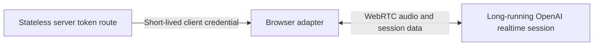

import { Aside, Steps } from "@astrojs/starlight/components";

OpenAI Realtime adds speech-native voice to a Maelstrom app. Your server mints a short-lived client credential, the browser connects directly to OpenAI over WebRTC, and `RealtimeSession` turns provider tool calls into ordinary Maelstrom intents.

### Understand what runs where

OpenAI Realtime uses two application-owned runtime roles: the browser session and a server token route.



The browser opens WebRTC directly to OpenAI. Microphone audio and realtime session data flow between the browser and OpenAI; they do not pass through your server. The stateless server token route uses its server-held OpenAI API key to mint the grant. It returns a short-lived client credential to the browser, then ends after each mint request. OpenAI operates the long-running realtime model session, including model inference and turn detection, while the browser keeps the WebRTC connection for the voice session.


## Prerequisites

Before wiring the track, provide:

- a Maelstrom React instance with its normal Engine Connector
- a server runtime that can read `OPENAI_API_KEY`
- a browser secure context with microphone permission
- the `@maelstrom-co/react`, `@maelstrom-co/protocol`, `@maelstrom-co/realtime`, `@maelstrom-co/react-realtime`, and `@maelstrom-co/realtime-server` packages

OpenAI manages voice activity and turn detection for this track. `OpenAIAdapter` therefore does not expose `turnControl`; render an always-on connect/disconnect control rather than hold-to-talk controls.

<Aside type="note" title="Examples are integration excerpts">
  The code fences in this guide are illustrative integration excerpts. They omit
  app-specific route registration, authentication and session policy, dependency
  configuration, UI styling, telemetry, and consent copy.
</Aside>

## Separate package responsibilities

The browser owns `RealtimeSession`, the OpenAI adapter, and the React binding. The application server owns the minter and the long-lived OpenAI API key. The Engine remains unchanged and receives the same client-built request that typed intent uses.

## Steps

<Steps>
1.  ### Add the server mint route

    Create a server-only endpoint that authenticates and authorizes callers before minting a short-lived OpenAI client credential.

2.  ### Validate the browser grant

    Fetch the credential from the same origin and validate the response with `OpenAITokenGrantSchema` before using it.

3.  ### Connect the adapter and React binding

    Give `OpenAIAdapter` the validated mint function, then extend the Maelstrom React instance with `maelstromRealtime`.

4.  ### Render state and transcripts

    Connect voice from your UI and show the session state, user transcript, assistant transcript, and recoverable failures.

5.  ### Preserve speak-after-render and grounding

    Keep intent settlement on the strong planning path and UI grounding on its separate latest-wins channel.

6.  ### Harden the deployment

        Apply application authentication, CSRF, origin, model-policy, rate-limit, telemetry, consent, and secret-handling controls before exposing the route.

</Steps>


<Aside type="caution" title="Keep credentials on the server">
  Never send provider API keys or LiveKit secrets to the browser. Token minters
  are unauthenticated bootstrap primitives; put caller authentication and
  authorization, trusted session policy, origin or room controls, rate limits,
  and abuse monitoring in front of them before production use.
</Aside>


## Add the server mint route

Create the minter once in server-only code, then map its `Result` to your framework's HTTP response.

```ts title="server/realtime-token.ts"
import { isOk } from '@maelstrom-co/protocol';
import {
  createOpenAIMinter,
  mintFailureHttpStatus,
} from '@maelstrom-co/realtime-server';
import { requireAuthenticatedRealtimeSession } from './auth';
import {
  areRealtimeMintAuthAndCsrfCheapAndConstantTime,
  consumeRealtimeMintPreAuthRateLimit,
  consumeRealtimeMintRateLimit,
  isTrustedRealtimeMintOrigin,
  isValidRealtimeMintCsrf,
  resolveTrustedRealtimeMintClientAddress,
  resolveAllowedRealtimeModel,
} from './realtime-mint-policy';
import { reportRedactedRealtimeMintFailure } from './redacted-telemetry';

const mint = createOpenAIMinter({
  apiKey: process.env.OPENAI_API_KEY ?? '',
  model: 'gpt-realtime-2',
});
const TOKEN_RESPONSE_HEADERS = { 'Cache-Control': 'private, no-store' };

export async function POST(request: Request): Promise<Response> {
  try {
    if (!isTrustedRealtimeMintOrigin(request)) {
      return Response.json(
        { error: 'request-denied' },
        { status: 403, headers: TOKEN_RESPONSE_HEADERS },
      );
    }

    if (!areRealtimeMintAuthAndCsrfCheapAndConstantTime()) {
      const clientAddress = resolveTrustedRealtimeMintClientAddress(request);
      if (clientAddress === null) {
        return Response.json(
          { error: 'request-denied' },
          { status: 403, headers: TOKEN_RESPONSE_HEADERS },
        );
      }

      const preAuthRateLimit =
        await consumeRealtimeMintPreAuthRateLimit(clientAddress);
      if (!preAuthRateLimit.allowed) {
        return Response.json(
          { error: 'rate-limited' },
          {
            status: 429,
            headers: {
              ...TOKEN_RESPONSE_HEADERS,
              'Retry-After': String(preAuthRateLimit.retryAfterSeconds),
            },
          },
        );
      }
    }

    const authenticated = await requireAuthenticatedRealtimeSession(request);
    if (authenticated === null) {
      return Response.json(
        { error: 'unauthorized' },
        { status: 401, headers: TOKEN_RESPONSE_HEADERS },
      );
    }

    if (!isValidRealtimeMintCsrf(request, authenticated)) {
      return Response.json(
        { error: 'request-denied' },
        { status: 403, headers: TOKEN_RESPONSE_HEADERS },
      );
    }

    const rateLimit = await consumeRealtimeMintRateLimit(
      authenticated.principalId,
    );
    if (!rateLimit.allowed) {
      return Response.json(
        { error: 'rate-limited' },
        {
          status: 429,
          headers: {
            ...TOKEN_RESPONSE_HEADERS,
            'Retry-After': String(rateLimit.retryAfterSeconds),
          },
        },
      );
    }

    let input: unknown;
    try {
      input = await request.json();
    } catch {
      return Response.json(
        { error: 'invalid-request' },
        { status: 400, headers: TOKEN_RESPONSE_HEADERS },
      );
    }

    const model = resolveAllowedRealtimeModel(authenticated, input);
    if (model === null) {
      return Response.json(
        { error: 'request-denied' },
        { status: 403, headers: TOKEN_RESPONSE_HEADERS },
      );
    }

    const result = await mint({
      provider: 'openai',
      sessionId: authenticated.sessionId,
      model,
    });
    if (isOk(result)) {
      return Response.json(result.value, { headers: TOKEN_RESPONSE_HEADERS });
    }

    return Response.json(
      { error: 'mint-failed' },
      {
        status: mintFailureHttpStatus(result.error.reason),
        headers: TOKEN_RESPONSE_HEADERS,
      },
    );
  } catch (error) {
    try {
      await reportRedactedRealtimeMintFailure({
        source: 'openai-token-route',
        error,
      });
    } catch {
      // Telemetry failure must not escape the HTTP boundary.
    }
    return Response.json(
      { error: 'mint-failed' },
      { status: 500, headers: TOKEN_RESPONSE_HEADERS },
    );
  }
}
```

<Aside type="danger" title="The minter does not authenticate callers">
  `createOpenAIMinter` validates the final mint request and exchanges
  credentials, but it does not decide who may mint one. The imported
  authentication, CSRF, origin, model-policy, shared rate-limit, and telemetry
  functions are mandatory app-provided fail-closed controls. Keep
  `OPENAI_API_KEY` in server-only configuration.
</Aside>

The policy and telemetry names imported from local files are illustrative application boundaries, not APIs exported by the Maelstrom packages or features supplied by a particular server runtime. Implement them in the transport that exposes this route. Keep the exact server-side origin allowlist check first. When authentication and CSRF validation are not demonstrably cheap and constant-time, run the app-provided fail-closed pre-auth transport throttle before both controls. Derive its IP-equivalent client address from a trusted server or proxy, and reject browser-controlled forwarding headers instead of accepting them as trusted address data.

`requireAuthenticatedRealtimeSession` then authenticates and authorizes the request, binds the principal to its trusted server session, and supplies the server-derived `sessionId`; it does not validate CSRF. `isValidRealtimeMintCsrf` alone validates the application's CSRF proof. Retain `consumeRealtimeMintRateLimit` after both controls as an atomic shared limit keyed by `principalId`. Both the pre-auth transport throttle and retained principal throttle must deny on store failure, return a bounded `Retry-After`, and use the same generic 429 body. `resolveAllowedRealtimeModel` may inspect the parsed body only to select from an allowlist derived from trusted server policy; browser input must never define or widen that policy.

The complete POST boundary returns stable public errors and `Cache-Control: private, no-store` for success, expected denials, malformed JSON, mapped mint failures, and unexpected exceptions. `mintFailureHttpStatus` maps only the status; no `MintFailureReason`, credential diagnostic, raw exception, request body, or session data reaches the response or logs. Unexpected failures go only to `reportRedactedRealtimeMintFailure`, which must emit allowlisted metadata and fail without escaping the route.

The minter requests a credential with a 600-second lifetime, scoped to the selected model. OpenAI returns the authoritative `expiresAt` timestamp in the grant. OpenAI recommends the privacy-preserving `OpenAI-Safety-Identifier` header when creating client secrets. The current `createOpenAIMinter` API cannot send that header, so this example does not send `OpenAI-Safety-Identifier`.

## Validate the browser grant

Treat the route response as unknown data. Validate it before handing the opaque credential to `OpenAIAdapter`.

```ts title="src/voice/mint-openai-token.ts"
import {
  OpenAITokenGrantSchema,
  type OpenAITokenGrant,
} from '@maelstrom-co/realtime/openai';
import { getCsrfToken } from '../auth/csrf';

export async function mintOpenAIToken(): Promise<OpenAITokenGrant> {
  const response = await fetch('/api/realtime-token', {
    method: 'POST',
    credentials: 'same-origin',
    headers: {
      'Content-Type': 'application/json',
      'X-CSRF-Token': getCsrfToken(),
    },
    body: JSON.stringify({}),
  });

  if (!response.ok) {
    throw new Error(`Token mint failed with status ${response.status}`);
  }

  return OpenAITokenGrantSchema.parse(await response.json());
}
```

The browser sends only its same-origin session credentials, the app-provided CSRF proof, and an empty JSON object required by this POST contract. It does not send `sessionId`, a model, or model-policy data. The server derives the session, principal, and allowed model from trusted application state before calling the minter. Schema validation proves only that the response has the expected wire shape.

## Connect the adapter and React binding

Build one adapter per Maelstrom session. `maelstromRealtime` creates one shared `RealtimeSession` for all `useVoice()` consumers under that Maelstrom Provider.

```ts title="src/maelstrom.ts"
import { createMaelstrom } from '@maelstrom-co/react';
import { maelstromRealtime } from '@maelstrom-co/react-realtime';
import { OpenAIAdapter } from '@maelstrom-co/realtime/openai';
import { mintOpenAIToken } from './voice/mint-openai-token';
import { vessels } from './vessels';

export function createOpenAIAdapter(): OpenAIAdapter {
  return new OpenAIAdapter({
    mintToken: mintOpenAIToken,
  });
}

export const m = createMaelstrom({ vessels }).with(
  maelstromRealtime({
    createAdapter: createOpenAIAdapter,
  }),
);
```

Calling `connect()` mints a fresh credential and begins microphone capture. Once WebRTC connects, the browser sends that microphone track directly to OpenAI until `disconnect()` stops the track and closes the peer connection. Make this media lifecycle clear in consent and connection UI. A second session-level `connect()` while the session is already live is a no-op; the adapter itself rejects a direct duplicate connection.

OpenAI manages turn detection, model responses, and response audio for this track. When OpenAI publishes audio, `OpenAIAdapter` attaches the remote audio stream to an autoplay audio element and exposes both microphone and playback streams through `getAudioStreams()`. `disconnect()` stops local tracks, pauses playback, clears both streams, and closes the data channel and peer connection. The adapter does not expose manual turn controls or an application-owned audio-response queue; this differs from the LiveKit cascade track, where the application explicitly starts and ends held turns and the worker owns TTS.

## Render state and transcripts

Use the extension's hook for lifecycle state, connection controls, and the latest user and assistant transcript entries. The following custom control calls the public `connect()` and `disconnect()` functions from `UseVoiceResult`. Use `m.VoiceOrb` instead when its built-in button and audio-reactive meter fit your UI.

```tsx title="src/VoiceControl.tsx"
import { useEffect, useState } from "react";
import { reportRedactedVoiceFailure } from "./redacted-telemetry";
import { m } from "./maelstrom";

function reportVoiceFailureSafely(
  source: "session" | "connect" | "disconnect",
  error: unknown,
): void {
  void Promise.resolve()
    .then(() => reportRedactedVoiceFailure({ source, error }))
    .catch(() => {
      console.warn("Voice telemetry unavailable.");
    });
}

export function VoiceControl() {
  const {
    state,
    error,
    userTranscript,
    assistantTranscript,
    connect,
    disconnect,
  } = m.useVoice();
  const [operationFailed, setOperationFailed] = useState(false);
  const canStart = state === "idle" || state === "error";
  const hasFailure = operationFailed || error !== undefined;
  const recovery = canStart
    ? "Select Start voice to retry."
    : "Select Stop voice to retry cleanup.";

  useEffect(() => {
    if (error !== undefined) {
      reportVoiceFailureSafely("session", error);
    }
  }, [error]);

  return (
    <section aria-label="Voice controls">
      <button
        type="button"
        disabled={state === "connecting"}
        aria-describedby={hasFailure ? "voice-error" : undefined}
        onClick={() => {
          setOperationFailed(false);
          const operation = canStart ? connect : disconnect;
          const source = canStart ? "connect" : "disconnect";
          void operation().catch((error) => {
            reportVoiceFailureSafely(source, error);
            setOperationFailed(true);
          });
        }}
      >
        {canStart ? "Start voice" : "Stop voice"}
      </button>
      <p>Voice: {state}</p>
      {userTranscript && <p>You: {userTranscript.text}</p>}
      {assistantTranscript && <p>Assistant: {assistantTranscript.text}</p>}
      {hasFailure && (
        <div id="voice-error" role="alert">
          Voice is unavailable. {recovery}
        </div>
      )}
    </section>
  );
}
```

The session accumulates non-final transcript fragments and replaces them with the final entry. The control starts from `idle` or `error`, stops any live session, and disables itself while a connection is being established. A failed `connect()` both rejects directly and moves the session to `error`; `useVoice().error` exposes the session failure. A rejected `disconnect()` is not normalized into an empty catch, so `operationFailed` keeps that direct failure visible and lets the user retry cleanup without changing connect/disconnect semantics.

The alert deliberately contains only a generic recovery message. `reportRedactedVoiceFailure` is an app-specific telemetry boundary: implement it to emit only allowlisted fields such as operation and typed error code, and to discard raw messages, stacks, request or response bodies, credentials, transcript text, and session data. `reportVoiceFailureSafely` moves both synchronous throws and rejected telemetry promises into one handled promise chain. If reporting fails, it logs only the stable `Voice telemetry unavailable.` message; it never renders or logs the raw error. The same session failure can arrive through the rejected `connect()` promise and `useVoice().error`, so the telemetry implementation should deduplicate repeated reports.

## Preserve speak-after-render and grounding

`RealtimeSession` exposes `update_ui`, `get_ui_state`, and `get_capabilities` to the provider. For a successful `update_ui` call, it withholds the successful tool result until the client reports that rendering has settled. OpenAI can narrate a successful change only after that result confirms the rendered UI. Malformed tool arguments and genuine submission failures return failure results immediately, without waiting for render settlement.

Grounding follows a separate, weaker channel. Settled UI changes produce a debounced, latest-wins structural summary. The adapter deletes the previous grounding item and recreates it at the conversation tail, while `get_ui_state` lets the model pull current structural state when it needs certainty. Grounding contains structure, not Vessel domain data, and never becomes Engine planning input.

## Harden the deployment

Before exposing the mint route:

1. authenticate and authorize the caller
2. validate the CSRF proof against the authenticated session
3. bind the caller to an allowed Maelstrom session and trusted model policy
4. allow only expected origins and HTTP methods
5. rate-limit by caller and origin
6. monitor mint failures, unusual session volume, and abuse
7. avoid logging the API key or returned client credential

Browser-direct WebRTC means audio travels between the browser and OpenAI rather than through Maelstrom infrastructure. Review the [OpenAI Realtime WebRTC guide](https://platform.openai.com/docs/guides/realtime-webrtc) for the browser transport and the [OpenAI Realtime guide](https://platform.openai.com/docs/guides/realtime) for provider-managed session behavior and data handling.

## Verify

Confirm each observable boundary before relying on the integration:

1. Call the token route and confirm that `OpenAITokenGrantSchema` accepts the response body. The successful response is a schema-valid grant with `Cache-Control: private, no-store`.
2. Start voice and confirm that the session state reaches `connected`.
3. Speak one utterance and confirm that it appears as a user transcript.
4. Request a successful UI change and confirm that the intent and rendering settle before assistant narration begins. Then send malformed tool arguments or force a genuine submission failure and confirm that the failure result returns immediately without waiting for render settlement.

## Recover from failures

| Scoped outcome                  | Recovery                                                                                                                   |
| ------------------------------- | -------------------------------------------------------------------------------------------------------------------------- |
| `400 Bad Request`               | Fix the route-body or integration contract before retrying.                                                                |
| `401 Unauthorized`              | Reauthenticate, obtain a fresh CSRF proof, and start a new mint attempt.                                                    |
| `403 Forbidden`                 | Do not retry until origin, CSRF, session authorization, or server-derived model policy is corrected.                       |
| `429 Too Many Requests`         | Keep voice disconnected and wait for the bounded `Retry-After` interval before a deliberate retry.                         |
| `500 Internal Server Error`     | Treat the mint service or its configuration as unavailable; alert operators without exposing diagnostics to the browser.   |
| `502 Bad Gateway`               | Treat OpenAI minting as temporarily unavailable and retry later with bounded backoff.                                      |
| Grant validation fails          | Reject the response; do not pass partial data to the adapter.                                                               |
| Microphone permission is denied | Explain how to enable site microphone permission, then let the user call `connect()` again.                                 |
| WebRTC connection fails         | Show the session's `error` state, disconnect stale UI controls, and offer a deliberate reconnect.                           |
| A UI update is superseded       | Let the latest voice correction proceed; the superseded call still receives a result, so no manual retry is required.       |

## API reference

Use the generated reference for the public contracts used in this guide:

- [`RealtimeSession`](/reference/realtime/packages/realtime/src/classes/realtimesession/) from `@maelstrom-co/realtime`
- [`OpenAIAdapter`](/reference/realtime/packages/realtime/src/openai/classes/openaiadapter/) and [`OpenAITokenGrantSchema`](/reference/realtime/packages/realtime/src/openai/variables/openaitokengrantschema/) from `@maelstrom-co/realtime/openai`
- [`maelstromRealtime`](/reference/react-realtime/functions/maelstromrealtime/) and [`UseVoiceResult`](/reference/react-realtime/interfaces/usevoiceresult/) from `@maelstrom-co/react-realtime`
- [`createOpenAIMinter`](/reference/realtime-server/functions/createopenaiminter/) from `@maelstrom-co/realtime-server`

Continue with the [Voice overview](/guides/voice/overview/) to compare the two shipped tracks.
