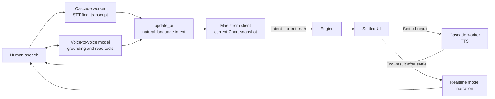

Voice lets people speak to a Maelstrom interface, and lets the interface speak back.

A person says what they want out loud. The UI adapts to it, the same way it adapts to typed input. Nothing about your Vessels changes.

Maelstrom ships two **voice modes**. Your first decision is which one to use.

## Choose a voice mode

Both modes preserve the same intent boundary. Pick one by deciding where the conversation, the speech-to-text (STT), and the text-to-speech (TTS) should run.

**Realtime** sends audio straight to a speech-native model. You get lower latency and fewer moving parts, and the provider owns the pipeline.

**Cascade** splits STT and TTS into a worker you operate. You choose the STT model and the TTS voice, and hold-to-talk lets you decide when a turn commits. You pay for that with higher latency and a worker to run.

Use the [cascade versus realtime architecture guide](/understanding/voice-architecture/) to compare latency, provider control, specialization, operations, observability, and privacy considerations. Then follow the [OpenAI Realtime setup](/guides/voice/openai-realtime/) or [LiveKit cascade setup](/guides/voice/livekit-cascade/) for the shipped implementation of your chosen mode.

## Wire voice into your UI

Choose a provider adapter first, then pass its factory to the provider-neutral extension. React is the binding available today. Your application keeps its existing Vessels and selects the adapter at this boundary:

```tsx title="src/maelstrom.ts"
export const m = createMaelstrom({ vessels }).with(
  maelstromRealtime({ createAdapter }),
);
```

Every adapter then reaches application UI through the same `m.useVoice()` and `m.VoiceOrb` API:

```tsx title="src/VoiceControls.tsx"
export function VoiceControls() {
  const {
    state,
    error,
    userTranscript,
    assistantTranscript,
    connect,
    disconnect,
    turnControl,
  } = m.useVoice();
  const [operationError, setOperationError] = useState<string>();
  const connected =
    state !== 'idle' && state !== 'connecting' && state !== 'error';
  const alertCopy =
    operationError ?? (error === undefined ? undefined : voiceErrorCopy(error));

  async function toggleVoice() {
    setOperationError(undefined);
    try {
      if (connected) await disconnect();
      else await connect();
    } catch {
      setOperationError(
        'Voice could not change connection state. Check the status before trying again.',
      );
    }
  }

  return (
    <section>
      <m.VoiceOrb />
      <p>Voice status: {state}</p>
      <button
        type="button"
        disabled={state === 'connecting'}
        onClick={toggleVoice}
      >
        {connected ? 'Disconnect voice' : 'Connect voice'}
      </button>
      {turnControl && <p>This provider requires explicit turn controls.</p>}
      {userTranscript && <p>You: {userTranscript.text}</p>}
      {assistantTranscript && <p>Assistant: {assistantTranscript.text}</p>}
      {alertCopy && <p role="alert">{alertCopy}</p>}
    </section>
  );
}
```

The checked fixture supplies `voiceErrorCopy()` with bounded recovery copy for every currently published fatal `RealtimeVoiceError` code. A successful `connect()` means the provider session is ready. A rejected `connect()` or an `error` state means the attempt failed. `disconnect()` ends the shared session. Repeated calls while a connection is already starting or live may be no-ops, and consumers should render the current `state` rather than infer success from a fixed sequence.

The common contract does not promise one universal state sequence and does not define a universal retry policy. For example, `turnControl` exists only when an adapter requires explicit turn boundaries; speech-native adapters leave it undefined. Use the error code and your deployment policy to decide whether to ask for microphone permission, repair token minting, inspect the current connection, or offer a reconnect.

Continue with the [OpenAI Realtime guide](/guides/voice/openai-realtime/) or [LiveKit cascade guide](/guides/voice/livekit-cascade/) for provider-specific setup. The [Voice API reference](/reference/realtime/readme/), [React voice API reference](/reference/react-realtime/readme/), and [voice architecture comparison](/understanding/voice-architecture/) describe the shared contracts and planning boundary.

## Follow the shared intent boundary

Both voice modes rejoin the normal Maelstrom request loop at natural-language intent. They may maintain different audio and conversation state, but neither can replace the client-built Chart snapshot that the Engine uses for planning.



In the cascade flow, browser audio travels through LiveKit to the worker's STT stage. The worker publishes a final transcript, and the browser adapter converts it into a synthetic `update_ui` call containing only the natural-language intent. The client then captures the current Instances, Variants, and Chart dimensions and sends that snapshot with the intent to the Engine. After the Engine's result renders and the UI settles, the browser returns result text to the worker for TTS.

In the realtime flow, the browser exchanges audio directly with a voice-to-voice model. Structural UI grounding and read-only tools help that model converse about the interface, but only the natural-language intent from `update_ui` crosses into the Maelstrom client. The client—not the realtime model—captures the Chart snapshot and sends it to the Engine. `RealtimeSession` withholds the successful tool result until the resulting UI settles, so the model receives evidence of the rendered change before narrating it.

This separation is the shared safety invariant: a voice model's belief about the interface may be useful for conversation, but it never becomes Engine planning input. Voice providers do not supply Vessel IDs, Actions, or layout coordinates to the Engine. Read the [Architecture Overview](/understanding/architecture/) for the request and render loop that both modes reuse.

## Know the package boundaries

The voice packages separate browser, server, and worker responsibilities:

| Package                                                                                                    | Runtime | Responsibility                                                                                  |
| ---------------------------------------------------------------------------------------------------------- | ------- | ----------------------------------------------------------------------------------------------- |
| [`@maelstrom-co/realtime`](/reference/realtime/readme/)                                                    | Browser | Provider-neutral session, intent routing, speak-after-render ordering, and structural grounding |
| [`@maelstrom-co/realtime/openai`](/reference/realtime/packages/realtime/src/openai/classes/openaiadapter/) | Browser | OpenAI WebRTC transport and token grant schemas                                                 |
| [`@maelstrom-co/react-realtime`](/reference/react-realtime/readme/)                                        | Browser | Shared React session, `useVoice()`, transcripts, state, and `VoiceOrb`                          |
| [`@maelstrom-co/realtime-server`](/reference/realtime-server/readme/)                                      | Server  | Exchange a server-held OpenAI API key for a short-lived client credential                       |
| [`@maelstrom-co/realtime-livekit`](/reference/realtime-livekit/readme/)                                    | Browser | LiveKit room transport, final-transcript intent conversion, and hold-to-talk control            |
| [`@maelstrom-co/realtime-livekit-server`](/reference/realtime-livekit-server/readme/)                      | Server  | Sign a short-lived grant for one LiveKit room and participant identity                          |
| [`@maelstrom-co/realtime-livekit-agent`](/reference/realtime-livekit-agent/readme/)                        | Worker  | Run Deepgram STT and Cartesia TTS without an LLM or UI grounding                                |

These boundaries keep `OPENAI_API_KEY`, LiveKit secrets, and speech-provider keys out of browser code. They also keep provider transport details out of the Engine.

The package reserves the `@maelstrom-co/realtime/google` subpath for a future adapter, but no Google adapter is implemented or usable today.

## Next step

Follow [OpenAI Realtime](/guides/voice/openai-realtime/) for provider-managed realtime conversation, or [LiveKit cascade](/guides/voice/livekit-cascade/) for an application-operated STT/TTS pipeline.
