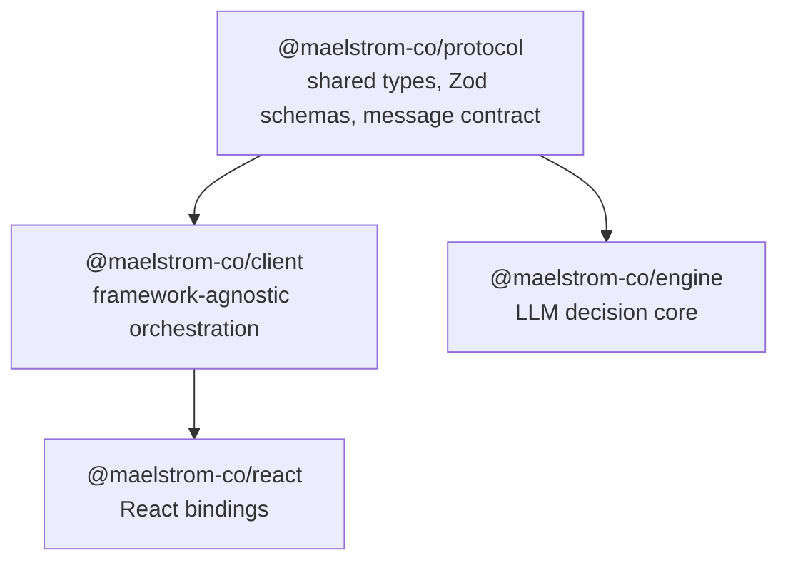

Maelstrom is organized as a layered architecture because the UI, protocol, and engine fail in different ways and need different deployment boundaries. Browser packages render and capture input, server packages own provider calls and orchestration, and the protocol keeps the two sides speaking one contract.

## Package responsibilities

| Package | Layer | Responsibility |
|---------|-------|---------------|
| `protocol` | Foundation | Types, Zod schemas, message definitions. Transport-agnostic. |
| `client` | Client | Orchestrator, ChartManager, CommandProcessor, VesselManager, connectors. Framework-agnostic. |
| `react` | UI | React bindings — `createMaelstrom()`, `vessel()`, Provider, Chart, hooks. |
| `engine` | Server | LLM decision engine — processes context and returns execution plans. |

## Client architecture

The client uses a **microkernel architecture**. The `Orchestrator` is the composition root that coordinates independent managers:

- **ConnectionManager** — Manages transport lifecycle, reconnection, circuit breaking
- **VesselManager** — Tracks registered vessels and their current state
- **ChartManager** — Manages grid dimensions and layout computation
- **CommandProcessor** — Event loop that processes layout and action commands
- **RequestCoordinator** — Coordinates request/response pairs with the engine

Each manager owns a TanStack Store for reactive state and extends TypedEmitter for events.

## Data flow

1. User expresses intent
2. Client packages intent + context into a `ChartRequest`
3. `ChartRequest` is sent to the Engine via a connector
4. Engine processes with LLM and returns a `MaelstromResponse`
5. Client applies layout, executes actions, reads the resulting variant sizes, then handles overflow

The order in step 5 is load-bearing. The runtime dispatches layout first and actions second as one response batch, then uses the final overflow pass to account for variants whose `minSize` changed after an action transition.
