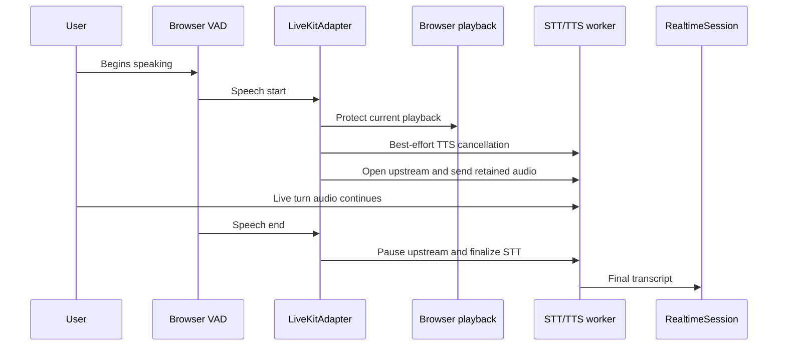

The LiveKit adapter uses browser voice activity detection (VAD) by default. It retains bounded transport pre-roll and keeps upstream publication paused while idle. Intentional `vad: false` configuration and safe automatic-mode degradation expose `turnControl` for manual turns.

This page explains the ownership and operating contract. Use the [LiveKit cascade guide](/guides/voice/livekit-cascade/#configure-browser-vad) for the copyable setup and [Delimit each manual turn](/guides/voice/livekit-cascade/#delimit-each-manual-turn) for fallback controls.

## Turn ownership in the LiveKit cascade

The browser keeps a local microphone stream available to VAD while the LiveKit publication is paused. When speech is accepted, the adapter sends bounded pre-roll once and opens live upstream audio. At speech end, it drains accepted audio, pauses publication, and tells the worker to finalize STT. The worker receives only audio that the browser admits to an active turn.

## Why detection runs in the browser

### Detect interruption before a network round trip

A server-side detector can react only after microphone audio reaches the transport. Browser VAD can begin interruption as soon as the local detector accepts speech. It does not remove later LiveKit, STT, Engine, rendering, or TTS latency; it reduces the delay before Maelstrom treats speech as an interruption.

### Stop what the user hears locally

Automatic mode protects browser playback as soon as it accepts speech and requests best-effort worker cancellation. Remote cancellation may not immediately silence buffered audio, so the audible interruption path remains browser-owned.

### Keep idle microphone media out of the transport

Automatic mode keeps upstream publication paused during silence, opens it only for accepted speech, and pauses it again when the turn ends. Manual fallback appears only after the adapter has safely restored that invariant.

### Tune the acoustic boundary

Applications can tune speech confidence, the non-speech boundary, silence redemption, minimum speech duration, retained transport audio, and the supported browser processor and Silero model generation. Stricter thresholds can reduce false barge-ins but miss quiet speech. Longer silence handling preserves pauses but delays turn completion. Tune with representative users, microphones, browsers, playback volume, and background noise.

## The barge-in sequence

A speech start may occur while the session is `speaking`, while TTS is pending in `thinking`, or while an earlier Engine request is in flight. These are distinct concurrency boundaries. `LiveKitAdapter` serializes interruption and turn opening. `RealtimeSession` retains the newest correction through latest-wins handling rather than building an unbounded request queue; it still returns one result for each provider call.

## Why pre-roll is part of turn detection

A detector needs audio frames before it can decide that speech started. Opening transport only after that decision can clip the first consonant or word.

The adapter keeps a bounded local buffer. At speech start it sends the retained audio once, then continues with live microphone audio. `preRollMs` controls this transport buffer and defaults to 250 milliseconds. The provider's `preSpeechPadMs` changes the segment considered by VAD but does not create or populate transport pre-roll.

More pre-roll protects word beginnings but admits more audio from before the accepted boundary. Tune it only after reproducing clipping on supported devices and browsers.

## Configuration and operating details

The `vad` option has four forms:

| Value     | Result                                                                                                  |
| --------- | ------------------------------------------------------------------------------------------------------- |
| omitted   | Enable automatic browser VAD with `assetBaseUrl: '/vad-web/'`, `preRollMs: 250`, and provider defaults. |
| `true`    | Use the same automatic defaults as an omitted value.                                                    |
| `{ ... }` | Enable automatic browser VAD and override supported adapter or provider settings.                       |
| `false`   | Start in intentional manual mode without loading VAD assets or creating VAD and pre-roll worklets.      |

### Adapter-owned settings

| Field             | Meaning                                                                                                                                   |
| ----------------- | ----------------------------------------------------------------------------------------------------------------------------------------- |
| `assetBaseUrl`    | Trusted directory containing the complete VAD and ONNX Runtime asset set. The default is `/vad-web/`.                                     |
| `preRollMs`       | Browser-local transport audio sent once at speech start. The default is `250`; accepted values are finite numbers from `0` through `500`. |
| `providerOptions` | Supported VAD detection tuning. Streams, callbacks, lifecycle, assets, and ONNX Runtime configuration remain adapter-owned.               |

### Provider detection settings

| Field                     | Accepted value                                     | Developer effect                                                                      |
| ------------------------- | -------------------------------------------------- | ------------------------------------------------------------------------------------- |
| `model`                   | `'v5'` or `'legacy'`                               | Select the supported Silero model generation.                                         |
| `positiveSpeechThreshold` | number from `0` through `1`                        | Set the confidence required to recognize speech.                                      |
| `negativeSpeechThreshold` | number from `0` through `1`                        | Set the non-speech boundary used to end speech.                                       |
| `redemptionMs`            | non-negative finite number                         | Keep a turn open through this silence grace period.                                   |
| `preSpeechPadMs`          | non-negative finite number                         | Add provider-level audio before the detected segment; this is not transport pre-roll. |
| `minSpeechMs`             | non-negative finite number                         | Treat shorter segments as VAD misfires.                                               |
| `processorType`           | `'AudioWorklet'`, `'ScriptProcessor'`, or `'auto'` | Select the browser audio processor strategy.                                          |
| `workletOptions`          | object                                             | Pass supported AudioWorklet construction settings.                                    |

Unsupported fields fail configuration instead of being ignored. Maelstrom keeps provider callbacks, microphone streams, asset paths, audio contexts, `ortConfig`, and start policy adapter-owned to preserve lifecycle and privacy gating.

### Asset hosting

Automatic VAD is enabled by default, but `/vad-web/` does not create or publish files. The [LiveKit cascade guide](/guides/voice/livekit-cascade/#configure-browser-vad) shows how to copy the package-matched VAD and ONNX Runtime assets.

A same-origin directory is the simplest deployment. An absolute asset directory must use credential-free HTTPS. For a controlled CDN, publish the complete set under an immutable versioned directory, configure CORS for the application origin, and serve JavaScript, WebAssembly, and model files with correct content types.

The browser executes worklet, JavaScript, and WebAssembly files from this directory. Treat `assetBaseUrl` as trusted executable infrastructure and never derive it from user input. The local pre-roll bridge also uses a Blob-backed AudioWorklet module, so the application's Content Security Policy must allow `blob:` for worklet scripts in supported browsers.

## Misfires, rapid boundaries, and serialization

The adapter treats a short threshold crossing as a misfire rather than committing an empty STT turn. It serializes start, end, and cancellation operations so a fast end cannot overtake an asynchronous start. A VAD misfire cancels its active transport turn without sending `turn_end` or entering `thinking`.

## Failure becomes a capability change only when it is safe

If automatic detection fails while the room, transcript relay, and TTS remain usable, Maelstrom degrades in a fixed order:

1. fence further automatic callbacks;
2. close or cancel any automatic turn owned by the failing generation;
3. pause upstream microphone publication;
4. retire failed VAD and pre-roll resources; and
5. expose `turnControl` through retained manual mode.

The application can then render hold-to-talk without reconnecting. `turnModeError` indicates degradation, but its raw value is diagnostic-only. Use its presence for fixed recovery copy; never render the value verbatim or serialize it into application state or telemetry.

`turnControl` is dynamic. It is absent during healthy automatic mode and appears only after intentional `vad: false` configuration or safe degradation. Do not cache it outside current React state.

A transport failure is different. If token minting, room connection, track publication, required data transport, upstream pause, or unexpected disconnection leaves the adapter unable to provide a safe room or stop microphone media, the session fails. Maelstrom does not advertise manual fallback when it cannot establish the upstream safety invariant.

## Why this does not configure OpenAI Realtime

OpenAI Realtime is a speech-native provider session. The provider owns voice activity, turn detection, response cancellation, and spoken output. Adding LiveKit-specific browser control would duplicate ownership and could make the browser and provider disagree about turn boundaries.

- OpenAI Realtime uses provider-managed turn detection.
- LiveKit automatic mode uses adapter-owned browser VAD.
- LiveKit manual mode uses dynamic `turnControl` after `vad: false` or safe degradation.

## What developers should measure

Measure local speech-start-to-interruption latency, false barge-ins, missed quiet speech, clipped word starts, speech-end-to-STT-finalization time, misfires, safe-degradation success, and the absence of upstream microphone media while idle, after degradation, and after disconnect.

Unit coverage cannot establish real AudioWorklet, ONNX asset, microphone, CORS, or LiveKit publication behavior. Validate those boundaries in supported browsers and inspect the network. Return to [Voice architecture: cascade vs realtime](/understanding/voice-architecture/) to compare this browser-owned boundary with provider-managed realtime voice.
