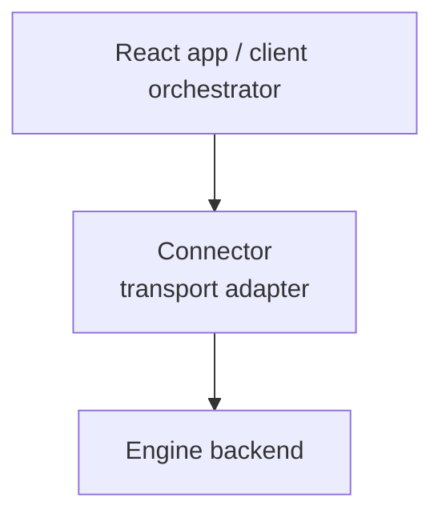

A Connector is the transport boundary between the Maelstrom client and the engine backend. It carries protocol messages, reports connection state, and keeps the UI from knowing whether the engine is reached through WebSocket, HTTP, or an in-memory test harness.

The connector should be boring. If it starts making layout decisions or hiding engine failures, it is doing work that belongs somewhere else.

## Where connectors fit

The protocol defines the payload. The connector defines how that payload travels.

## Common connector shapes

| Connector shape | Fits when | Trade-off |
| --- | --- | --- |
| WebSocket | Interactive browser sessions | Requires connection lifecycle handling. |
| HTTP | Simple request/response deployments | Less natural for streaming or long-lived sessions. |
| In-memory | Tests, local harnesses, embedded demos | Not a browser deployment boundary. |

## What a connector should own

- Opening and closing the transport session.
- Sending user intent or chart request messages.
- Receiving engine responses and errors.
- Updating connection status so the UI can disable or retry actions.

## What a connector should not own

- Choosing which Vessels appear.
- Mutating Vessel state outside declared actions.
- Converting provider-specific errors into user-facing policy by itself.

Those responsibilities belong to the engine or application action handlers.

## Next steps

- [Connectors](/guides/client/custom-connectors/) — implement a transport adapter
- [The Protocol](/understanding/protocol/) — understand the payload the connector carries
