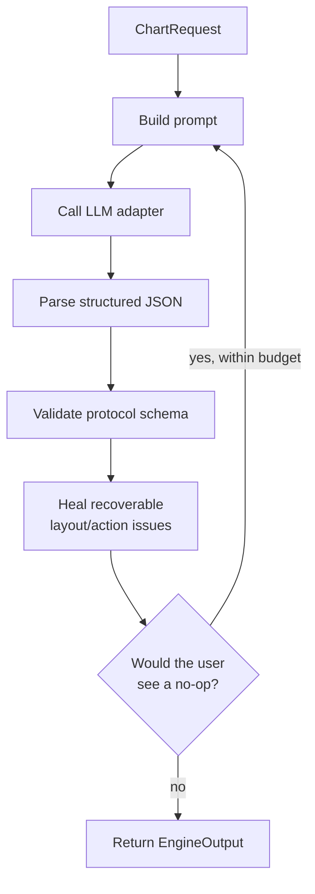
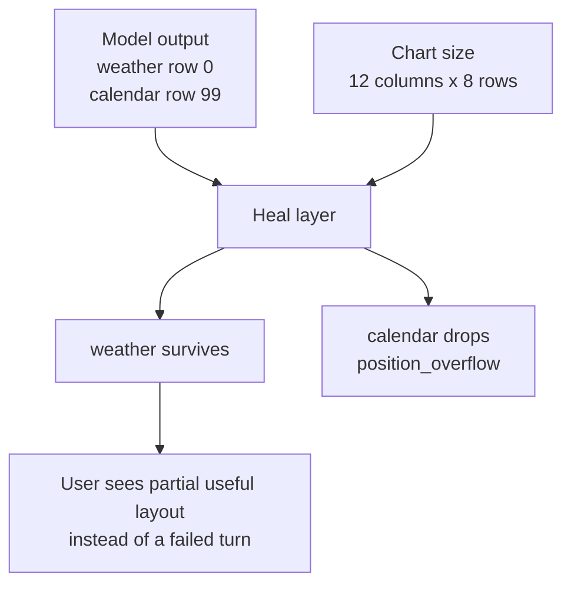

The Engine is Maelstrom's decision core. Given the current chart state and a user intent, it asks an LLM to produce a layout and an execution plan, then returns a structured response.

`@maelstrom-co/engine` is a **reference implementation**, not a mandate. Production systems may keep this package if its concurrency, history, logging, and safety trade-offs match their needs, or replace it with another implementation behind the same `Engine.handle()` contract. It ships so you can run Maelstrom locally, build demos, and understand how the contract works. It is not production-grade — production deployments supply their own implementation behind the same boundary.

## Where it fits

Most React applications never import the engine directly. They use [`@maelstrom-co/react`](/getting-started/quick-start), which orchestrates the client and talks to whichever engine is configured. You'll reach for the engine package when you're:

- Building a server that accepts chart requests over your own transport
- Embedding Maelstrom into a non-React framework
- Writing tests against engine behaviour
- Implementing your own engine to swap in production

## The boundary

The engine exposes a single durable contract:

```ts title="Engine.handle()"
interface Engine {
  handle(
    message: EngineMessage,
    signal?: AbortSignal,
  ): Promise<Result<EngineOutput, EngineError>>;
}
```

Inputs and outputs are tagged envelopes (see [The Protocol](/understanding/protocol)). Every message carries a `sessionId`, `id`, and `timestamp`. Outputs carry `sessionId` and `id` so callers can correlate request and response. The wire format is the engine format — connectors and transports are pure passthrough.

This signature is the contract. The implementation behind it can change without anything else needing to know.

## Pipeline diagram



## What the reference implementation does

For a `chart_request`, the engine runs:

1. Build the prompt from your vessels, the current chart state, and any update reasons
2. Call the configured LLM adapter
3. Parse and validate the structured response
4. Heal recoverable problems (drop overflowed positions, prune unreachable layouts)
5. Retry once if the result would be empty
6. Record the turn in history and return the response

Errors short-circuit the pipeline; recoverable problems become diagnostics that consumers don't see.

## Validation and recovery

The engine validates inputs at three boundaries and the LLM's output at a fourth:

1. **Engine config** — `createEngine()` validates `EngineConfig` against a strict Zod schema and eagerly builds system prompts at startup. Misconfigured system prompt customizers throw synchronously, but user prompt customizer errors still surface on the first request as a `ValidationError`.
2. **Engine messages** — every inbound `EngineMessage` envelope is parsed against the protocol Zod schema. Malformed payloads short-circuit before any LLM call with a `RequestValidationError` carrying the structured `path` of the failing field.
3. **LLM structured output** — the JSON the model returns is parsed against the protocol schemas inside the adapter call. Schema-violating output surfaces as a `ProviderError`; a structurally valid response missing required content (such as an empty `userMessage`) surfaces as a `ParseError`.
4. **LLM output coherence** — even a parseable response can be incoherent: positions overflowing the chart, unknown vessel/variant references, duplicate instance IDs, malformed tiling trees. This layer doesn't fail; it heals.

### Heal, don't fail

For step 4, an empty UI is worse than a partial one. The heal layer drops invalid pieces and records each one with a structured reason — categorical labels such as `position_overflow`, `unknown_vessel`, `unknown_variant`, `size_below_minimum`, `duplicate_instance_id`, or `tree_missing_child`. Soft-failures like a missing `rationale` are recorded as warnings. Drop entries and warnings stay engine-internal: they feed the retry decision and engine logs, but the engine strips them at its boundary. Consumers receive only the surviving layout; rendering proceeds with whatever made it through.

### Example: Healed output

If the model returns two positions and one overflows the chart, the engine can keep the valid position and drop the invalid one:



The dropped entry is logged for diagnostics, but consumers receive only the surviving layout.

### When the engine retries

After healing, the engine recommends retry only when the user would otherwise see a no-op:

- **Empty-when-needed layout** — the request asked for instances but every position dropped (severity `unrecoverable`).
- **All actions skipped for fixable reasons** — the proposed plan was non-empty but every action was rejected for a reason the LLM could plausibly fix on retry, e.g. `unknown_vessel`, `params_parse_failed`, `action_not_valid` (severity `medium`).

A partial layout or partial action plan does **not** trigger retry — partial output beats waiting for a re-roll. Non-fixable skip reasons (`state_drift`, `self_transition_noop`) don't recommend retry on their own, but they don't suppress retry either: if any *other* skip in the same response is fixable and no actions survived, retry still fires. The retry budget is `EngineConfig.maxRetries` (default `1`).

## Configuration shape

```ts title="Configuring the engine"
import { geminiText } from '@tanstack/ai-gemini';
import { createEngine } from '@maelstrom-co/engine';

const engine = createEngine({
  adapter: geminiText('gemini-2.0-flash'),
  // logger, prompt customizations, history store, retry policy — all optional.
});
```

The pluggable surfaces are intentionally small:

- **`adapter`** — the LLM provider, via TanStack AI. Swap Gemini, OpenAI, Anthropic, your own.
- **`history`** — opt-in conversation history with a store you supply (Redis, Postgres, SQLite). The reference engine ships an in-memory store for tests but never as a default.
- **`prompt`** — replace, prepend, append, or transform individual prompt sections.
- **`logger`** — any object with `debug` / `info` / `warn` / `error` works.

## What this implementation isn't

- **Multi-instance safe.** The per-session mutex is in-process. Production deployments need session affinity or a distributed lock.
- **Persistent.** The bundled in-memory store is for tests; supply your own store for anything that needs to survive a process restart.
- **Hardened against adversarial input.** It's a reference, not a security boundary.

If your use case crosses any of these lines, plan to replace this engine with one of your own. The `Engine` interface is the only thing you need to keep stable.

## Next steps

- [Quick Start](/getting-started/quick-start) — run it end-to-end in a browser
- [Architecture Overview](/understanding/architecture) — see where the engine fits in the wider system
- [The Protocol](/understanding/protocol) — the envelopes and types the engine speaks
- [Engine package README](https://github.com/maelstrom-co/maelstrom/blob/main/packages/engine/README.md) — full technical reference for this implementation
