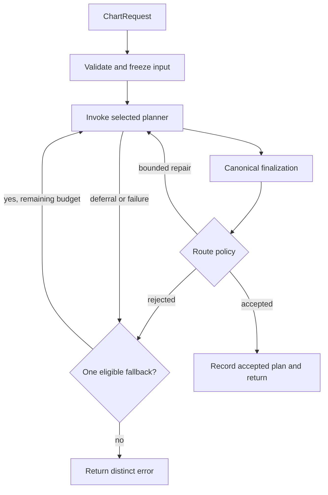
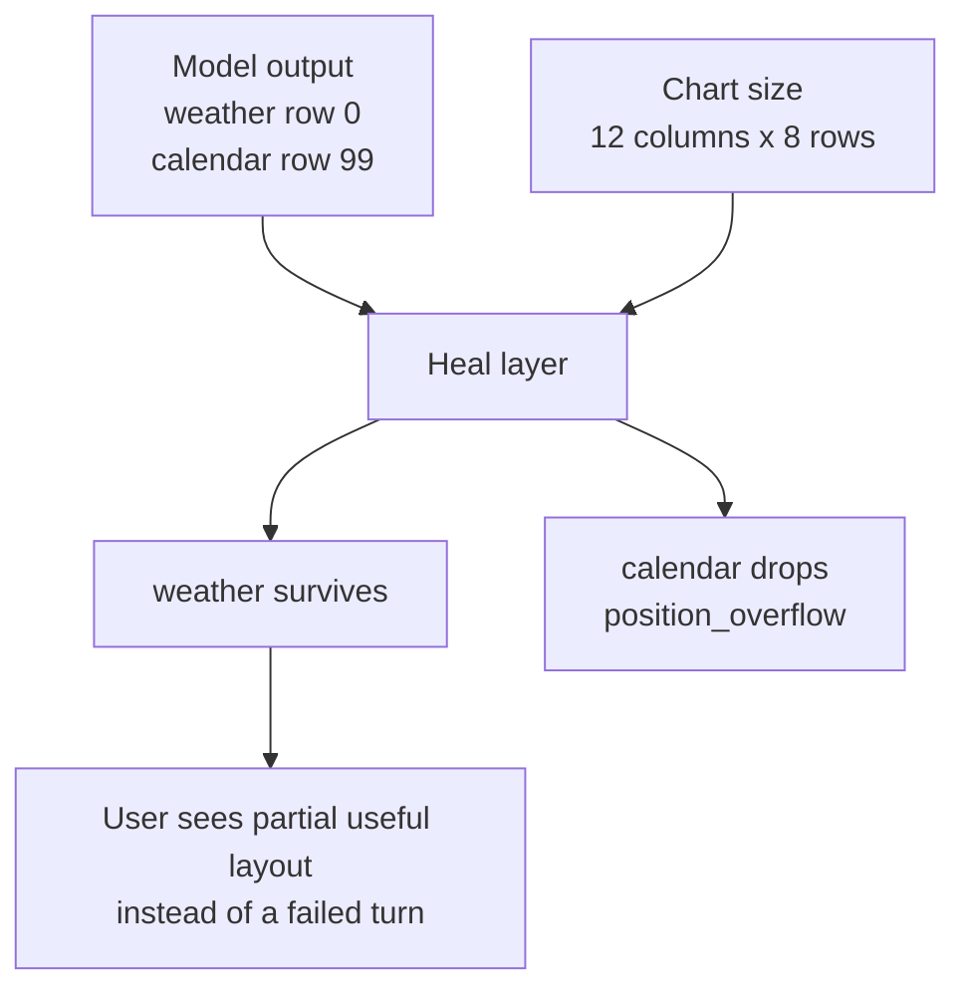

The Engine is Maelstrom's decision core. It finalizes a planner's layout and
ordered execution plan for the current chart state and intent. A conventional
LLM remains the default; experimental Jev uses the same server-side boundary.

`@maelstrom-co/engine` is a **reference implementation**, not a mandate. Production systems may keep this package if its concurrency, history, logging, and safety trade-offs match their needs, or replace it with another implementation behind the same `Engine.handle()` contract. It ships so you can run Maelstrom locally, build demos, and understand how the contract works. It is not production-grade — production deployments supply their own implementation behind the same boundary.

## Where it fits

Most React applications never import the engine directly. They use [`@maelstrom-co/react`](/getting-started/quick-start), which orchestrates the client and talks to whichever engine is configured. You'll reach for the engine package when you're:

- Building a server that accepts chart requests over your own transport
- Embedding Maelstrom into a non-React framework
- Writing tests against engine behaviour
- Implementing your own engine to swap in production

## The boundary

The engine exposes a single durable contract:

```ts title="Engine.handle()"
interface Engine {
  handle(
    message: EngineMessage,
    signal?: AbortSignal,
  ): Promise<Result<EngineOutput, EngineError>>;
}
```

Inputs and outputs are tagged envelopes (see [The Protocol](/understanding/protocol)). Every message carries a `sessionId`, `id`, and `timestamp`. Outputs carry `sessionId` and `id` so callers can correlate request and response. The wire format is the engine format — connectors and transports are pure passthrough.

This signature is the contract. The implementation behind it can change without anything else needing to know.

## Pipeline diagram



## What the reference implementation does

For a `chart_request`, the engine runs:

1. Validate and detach the request, enum values, and both history projections.
2. Check the planner's layout capability before provider work.
3. Invoke the planner and finalize its complete candidate.
4. Apply the route's policy and request bounded repair when permitted.
5. Start the optional fallback once for an eligible outcome, using remaining budgets.
6. Record only the accepted finalized response and return it.

All attempts share the same deeply frozen input. The engine alone owns repair
and fallback. One conventional LLM invocation performs one TanStack `chat()`;
Jev can perform up to three stage fetches. Every logical provider call claims
the shared budget. Hidden adapter HTTP retries are not separate logical claims.
Cancellation, deadline expiry, and budget exhaustion stop the operation.

## Validation and recovery

The engine validates inputs at three boundaries and the LLM's output at a fourth:

1. **Engine config** — `createEngine()` validates `EngineConfig` against a strict Zod schema and eagerly builds system prompts at startup. Misconfigured system prompt customizers throw synchronously, but user prompt customizer errors still surface on the first request as a `ValidationError`.
2. **Engine messages** — every inbound `EngineMessage` envelope is parsed against the protocol Zod schema. Malformed payloads short-circuit before any LLM call with a `RequestValidationError` carrying the structured `path` of the failing field.
3. **Provider output** — recognized malformed responses map to `InvalidProviderResponseError`; opaque adapter exceptions remain `ProviderError`. The built-in LLM retains its non-empty `userMessage` requirement. Other planners can omit prose.
4. **Candidate coherence** — the canonical finalizer checks layout bounds, tree/instance coherence, parameters, and action order. It resolves new tiling instances before validating actions and simulates variant transitions in sequence.

### Healing is an explicit policy

Adapter shorthand preserves `heal-and-ship`: a renderable subset can be useful
even after the repair limit. The finalizer reports dropped entries with stable
codes such as `position_overflow` or `unknown_vessel`. Diagnostics feed the
engine's repair decision and logs, not the wire response.

Explicit routes must choose a policy. `strict` rejects material layout repair
or dropped/invalid actions, offers bounded repair, then eligible fallback.
Without an accepted plan it returns semantic `invalid_plan` deferral. It still
allows valid empty plans. Neither optional prose nor an empty action list makes
a plan invalid. Structural validity does not prove that a plan matches intent.

### Example: Healed output

If the model returns two positions and one overflows the chart, the engine can keep the valid position and drop the invalid one:



Under `heal-and-ship`, consumers receive only the surviving layout. A strict
route rejects this partial result and enters repair or fallback instead.

### Resize-only turns

A chart resize is the one trigger that arrives with no user or vessel signal, so the chart state the LLM sees on such a turn is identical to the state before an action it already ran, and the engine never sees vessel contents, so it cannot tell a first run from a replay. On a turn whose every update reason is a `chart_resize`, an action runs only if its definition declares `idempotent: true` **and** the model emitted it with no parameters. Missing the flag is recorded as `non_idempotent_on_resize`; carrying parameters despite the flag is recorded as `parameterized_on_resize`.

The parameter half is what the flag alone cannot cover. `idempotent` promises that running an action twice with the *same* parameters matches running it once; it says nothing about running it with different ones. A resize asks for nothing, so any parameter value the model emits can only have come from the conversation history: `showWeek()` is a reshape the new size may call for, while `setLocation("Tokyo")` is either a replay of an earlier turn or an overwrite nobody asked for, even on an action marked idempotent. Parameters count as the model emitted them, so an action free to take parameters but invoked with none still runs.

One escape stays open by design: a resize batched together with a user intent or vessel mutation is an ordinary turn, and the guard never fires on it. A freshly declared instance id is not a second escape, because a vessel may back every instance of itself with one store, so an action replayed at a new id can still duplicate state an older id already holds. The same predicate drives a prompt-side instruction, so the LLM is told to return an empty plan before the guard ever has to refuse one.

### When the engine retries

Under `heal-and-ship`, the engine recommends repair only when the user would otherwise see a no-op:

- **Empty-when-needed layout** — the request asked for instances but every position dropped (severity `unrecoverable`).
- **All actions skipped for fixable reasons** — the proposed plan was non-empty but every action was rejected for a reason the LLM could plausibly fix on retry, e.g. `unknown_vessel`, `params_parse_failed`, `action_not_valid` (severity `medium`).

A partial layout or partial action plan does **not** trigger retry — partial output beats waiting for a re-roll. Non-fixable skip reasons (`state_drift`, `self_transition_noop`, `non_idempotent_on_resize`, `parameterized_on_resize`) don't recommend retry on their own, but they don't suppress retry either: if any *other* skip in the same response is fixable and no actions survived, retry still fires. The retry budget is `EngineConfig.maxRetries` (default `1`).

For explicit routes, `maxRepairAttempts` replaces shorthand `maxRetries`.
Strict routes request repair for any material rejection, not only a no-op.
The planner receives `phase.kind: 'repair'`, the full previous candidate, and
the public bounded `FinalizationReport`. Third-party planners use that same
contract without importing internal validators. `Planner.invoke` returns a
complete candidate, semantic deferral, or typed failure; it does not route fallback.

### Presentation and accepted history

A successful wire response needs a layout and ordered actions, not prose.
Response `userMessage` and `rationale`, and turn history `assistantMessage`,
are optional. The client applies layout before actions, including actions on
instances introduced by the same response. Text-free success needs no empty
card or invented message.

Structured history records accepted plans, not proof of observed execution.
The LLM conversation projection uses a bounded structural summary when prose
is absent. Jev uses the independent structured projection. Separate retention
budgets keep existing `deriveLLMContext` and `maxChars` semantics intact.
See [conversation history](/guides/engine/conversation-history) for custom hooks.

## Configuration shape

```ts title="Configuring the engine"
import { geminiText } from '@tanstack/ai-gemini';
import { createEngine } from '@maelstrom-co/engine';

const engine = createEngine({
  adapter: geminiText('gemini-2.0-flash'),
  // logger, prompt customizations, history store, retry policy — all optional.
});
```

The pluggable surfaces are intentionally small:

- **`adapter`** — the LLM provider, via TanStack AI. Swap Gemini, OpenAI, Anthropic, your own.
- **`planner`** — explicit primary and optional fallback routes, with finalization, repairs, deadline, and logical-call budget.
- **`history`** — opt-in conversation history with a store you supply (Redis, Postgres, SQLite). The reference engine ships an in-memory store for tests but never as a default.
- **`prompt`** — replace, prepend, append, or transform individual prompt sections.
- **`logger`** — any object with `debug` / `info` / `warn` / `error` works.

## What this implementation isn't

- **Multi-instance safe.** The per-session mutex is in-process. Production deployments need session affinity or a distributed lock.
- **Persistent.** The bundled in-memory store is for tests; supply your own store for anything that needs to survive a process restart.
- **Hardened against adversarial input.** It's a reference, not a security boundary.

If your use case crosses any of these lines, plan to replace this engine with one of your own. The `Engine` interface is the only thing you need to keep stable.

## Next steps

- [Configure a planner backend](/guides/engine/planner-backends) — four configurations, deadlines, terminal errors, and local rollback.
- [Jev reference](/reference/engine-jev/readme/) — implementation limits and historical evidence that rules out default promotion.
- [Quick Start](/getting-started/quick-start) — run it end-to-end in a browser
- [Architecture Overview](/understanding/architecture) — see where the engine fits in the wider system
- [The Protocol](/understanding/protocol) — the envelopes and types the engine speaks
- [Engine package README](https://github.com/maelstrom-co/maelstrom/blob/main/packages/engine/README.md) — full technical reference for this implementation
