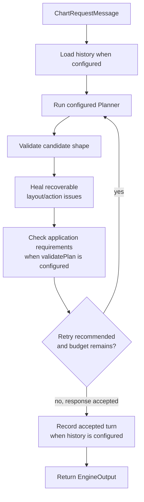
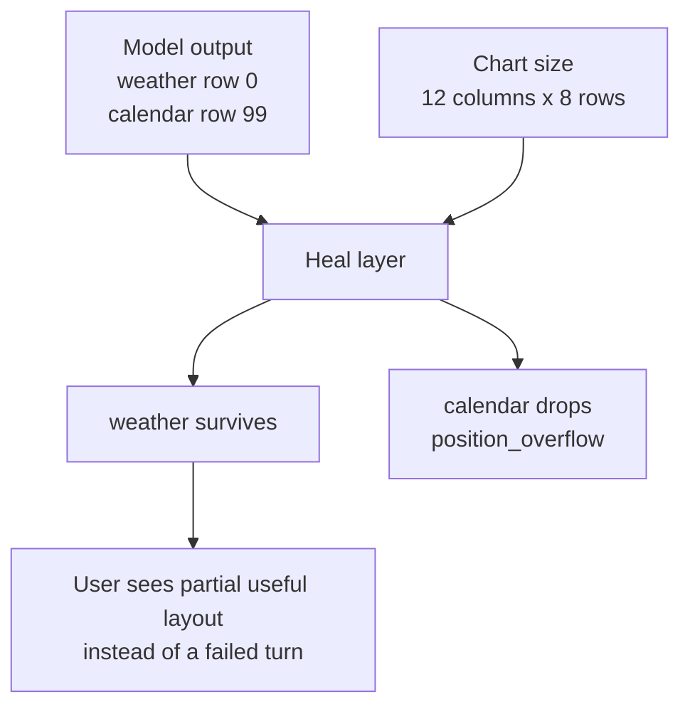

The Engine runs a configured Planner against the current Chart state and update reasons. It validates the proposed layout and execution plan, repairs recoverable problems, and returns a response for the client to apply.

`@maelstrom-co/engine` is the reference implementation for local development and demos. Production deployments are expected to supply an implementation behind the same `Engine` interface. See [Deployment limits](#deployment-limits) for the reference implementation's storage and concurrency constraints.

The Planner owns the decision process. The reference LLM Planner, `@maelstrom-co/planner-llm`, builds prompts and calls a provider adapter. Applications can supply another compatible Planner without replacing the Engine.

## Where it fits

Most React applications never import the engine directly. They use [`@maelstrom-co/react`](/getting-started/quick-start), which orchestrates the client and talks to whichever engine is configured. You'll reach for the engine package when you're:

- Building a server that accepts chart requests over your own transport
- Embedding Maelstrom into a non-React framework
- Writing tests against engine behaviour
- Implementing your own engine to swap in production

## The boundary

The request-handling part of the `Engine` interface is:

```ts title="Engine.handle()"
interface Engine {
  handle(
    message: EngineMessage,
    signal?: AbortSignal,
  ): Promise<Result<EngineOutput, EngineError>>;
}
```

Every `EngineMessage` carries a `sessionId`, `id`, and `timestamp`. A successful `EngineOutput` echoes the input's `sessionId` and `id`. The interface also provides `getHistory()` to read recorded session history.

The duplex wire contract uses `ClientEnvelope` and `ServerEnvelope`. The Engine-side `handleEnvelope` adapter decodes a client envelope, dispatches it, and maps the outcome to a server envelope. For example, `chart_response` becomes `engine.maelstrom.response`, with the input ID in `requestId`. Connectors use the protocol codecs to encode and decode those envelopes. See [The Protocol](/understanding/protocol#message-envelopes) for the distinction.

## Pipeline diagram



## What the reference implementation does

For a `chart_request`, the engine runs:

1. Validate the message and load prior session history when configured.
2. Pass the request and history to the configured Planner.
3. Validate the candidate's shape and heal recoverable layout and Action problems.
4. Check application requirements through `validatePlan`, when configured.
5. Retry if validation recommends it and the configured budget permits another attempt.
6. Record the accepted turn when history is configured, then return the response.

Without a history configuration, each request runs without retained conversation history. With history, identical requests sharing a session and message ID can reuse an in-flight or stored response.

Errors end the request. Healing records diagnostics for logs and retry decisions; those records are omitted from the returned response.

## Validation and recovery

Validation follows the ownership boundaries:

- `createEngine()` validates its configuration synchronously. The LLM Planner separately validates its options and builds system prompts at construction. Invalid system-prompt customizers throw there; user-prompt customizer failures return a `ValidationError` during a request.
- The Engine parses each inbound `EngineMessage` against the protocol schema. A malformed message returns a `RequestValidationError` before the Planner runs.
- The LLM Planner requests structured output through its provider adapter. Provider failures return a `ProviderError`. Every Planner's candidate must also pass the Engine's shape validation before healing begins; a missing required field returns a `ValidationError` at that boundary.
- The response processor checks layout and Action coherence. Recoverable problems, such as an overflowing position or an invalid Action, produce diagnostics. A blank required `userMessage` returns a `ParseError`.
- An optional `validatePlan` hook checks the healed response against application requirements. Unmet requirements can trigger a retry; requirements still unmet after the retry budget return a `ValidationError`.

A request may set `skipReply: true` when its caller writes the user-facing reply itself. Validation then accepts a response without `userMessage`, passes a supplied `userMessage` through unchanged even when it is blank, and accepts a needs-clarification result that asks the user a question instead of changing the layout. `Engine.handle()` still returns only responses that carry a non-blank `userMessage`, so it refuses an absent or blank reply and a needs-clarification result with a `ValidationError` on field `skipReply`.

### Recoverable output problems

The response processor preserves valid parts of a candidate while dropping or repairing invalid entries. It records reasons such as `position_overflow`, `unknown_vessel`, `unknown_variant`, `size_below_minimum`, `duplicate_instance_id`, or `tree_missing_child`. A blank `rationale` produces a warning. These diagnostics feed retries and logs; the client receives the healed layout and accepted Actions.

### Example: Healed output

If the model returns two positions and one overflows the chart, the engine can keep the valid position and drop the invalid one:



The dropped entry is logged for diagnostics, but consumers receive only the surviving layout.

### Resize-only turns

A resize-only request carries no user intent or Vessel mutation. The Engine has no Vessel contents with which to distinguish a repeated side effect from new work. When every update reason is a `chart_resize`, it accepts an Action only if the definition declares `idempotent: true` and the Planner supplied no parameters. Missing the flag produces `non_idempotent_on_resize`; supplying parameters produces `parameterized_on_resize`.

Idempotence applies to repeated calls with the same parameters. A resize gives the Planner no reason to choose a new parameter value: `showWeek()` may adjust a view, while `setLocation("Tokyo")` changes application state. An Action that allows parameters can still run on resize if the Planner invokes it without them.

A resize batched with user intent or a Vessel mutation follows the ordinary Action rules. Newly introduced Instances still follow the resize-only rule because several Instances may share one application store. The reference LLM Planner also tells the model to return an empty execution plan for resize-only requests.

### When the engine retries

Healing recommends a retry in either of these cases:

- The request included Instances, but the healed layout is empty (severity `unrecoverable`).
- The proposed execution plan was non-empty, every Action was skipped, and at least one skip had a fixable reason such as `unknown_vessel`, `params_parse_failed`, or `action_not_valid` (severity `medium`).

A partial layout or partial execution plan does not trigger a healing retry on its own. Non-fixable skip reasons (`state_drift`, `self_transition_noop`, `non_idempotent_on_resize`, `parameterized_on_resize`) do not recommend retry by themselves. They can occur alongside fixable skips that do recommend retry.

Application requirements reported by `validatePlan` can also recommend a retry, even when part of the layout or execution plan is valid. The same `EngineConfig.retry` budget applies. Its default, `{ max: 1 }`, permits the initial attempt and one retry; `false` disables Engine-level retries. Planner errors return immediately.

## Configuration shape

This example uses the reference LLM Planner with Gemini. The adapter reads its API key from `GOOGLE_API_KEY` or `GEMINI_API_KEY`.

```ts title="Configuring the engine"
import { geminiText } from '@tanstack/ai-gemini';
import { createEngine } from '@maelstrom-co/engine';
import { llmPlanner } from '@maelstrom-co/planner-llm';

const engine = createEngine({
  planner: llmPlanner({ adapter: geminiText('gemini-3.1-pro-preview') }),
  // logger, history store, instrument, retry policy: all optional.
});
```

The configuration assigns these responsibilities:

- `planner` produces the candidate response for each `chart_request`. `llmPlanner({ adapter, prompt?, modelOptions? })` from [`@maelstrom-co/planner-llm`](https://github.com/maelstrom-co/maelstrom/blob/main/packages/planner-llm/README.md) makes one structured-output LLM call per attempt. Its `adapter` selects the provider, and `prompt` customizes prompt sections. `pipeline`, `withFallback`, and `withRetry` compose stages into a Planner. See the [engine README](https://github.com/maelstrom-co/maelstrom/blob/main/packages/engine/README.md#planners-and-stages).
- `history` enables conversation history with an application-supplied store, such as Redis, Postgres, or SQLite. The bundled in-memory store must also be selected explicitly.
- `validatePlan` checks the healed response against application requirements and returns issues for retry feedback.
- `instrument` observes Planner stages and defaults to `noopInstrument`. `pipeline` wraps each stage with `instrument.stage(name, stage)` once per request. Stages report model calls and other events through `instrument.event(name, attributes)`, using OpenTelemetry GenAI attribute names where applicable. For example:

  ```ts title="A logging instrument"
  import type { Instrument } from '@maelstrom-co/engine';

  const instrument: Instrument = {
    stage: (name, stage) => async (input, ctx) => {
      ctx.logger.info('stage', { name });
      return stage(input, ctx);
    },
    event: (name, attributes) => console.info(name, attributes),
  };
  ```
- `retry` sets the maximum retries after validation recommends another attempt. `false` runs the configured Planner once.
- `logger` provides `debug`, `info`, `warn`, and `error` methods.

## Deployment limits

- History mutation locks and in-flight deduplication are process-local. Distinct requests in one session can still run their Planners concurrently. Deployments must coordinate those requests when ordering matters, including across server instances.
- The bundled in-memory history store loses its contents on restart. Durable history requires an application-supplied store.
- The reference Engine does not provide an application security boundary. Hosts and Action handlers must enforce the application's access rules.

See the [engine reference](https://docs.maelstrom-ai.co/reference/engine/readme/) for storage and concurrency requirements when supplying an implementation.

## Next steps

- [Quick Start](/getting-started/quick-start): run Maelstrom in a browser.
- [Architecture Overview](/understanding/architecture): follow a request from the client through planning and back to the UI.
- [The Protocol](/understanding/protocol): understand Engine messages and wire envelopes.
- [Engine package README](https://github.com/maelstrom-co/maelstrom/blob/main/packages/engine/README.md): look up configuration and implementation requirements.
