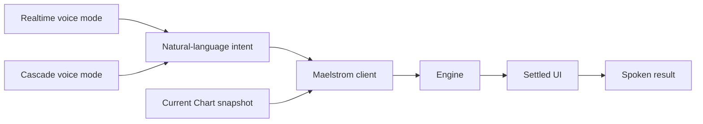
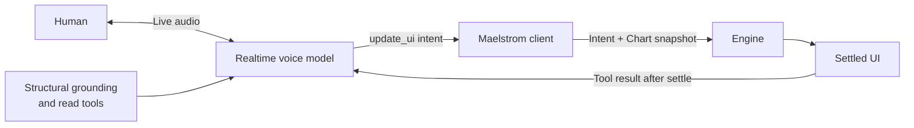
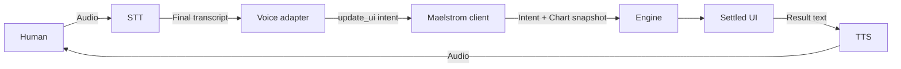

Voice systems usually follow one of two architectural modes. A **voice-to-voice realtime model** handles an ongoing spoken conversation. A **cascade** passes speech through separate speech-to-text (STT) and text-to-speech (TTS) stages. Neither mode changes how Maelstrom plans a UI.

Both modes cross into Maelstrom only as natural-language intent. The client then captures the current Chart snapshot for the Engine. A voice model's memory, transcript, or belief about the interface never becomes Engine planning input.

That shared boundary lets you choose a voice architecture for audio quality, latency, and operations without creating another UI planning path.

## Voice-to-voice realtime mode

A realtime model receives speech and produces speech within one long-running conversation. The provider may manage turn detection, interruption, transcripts, and response generation as parts of the same session.

In Maelstrom's realtime route, structural grounding helps the model discuss the interface. Read-only tools can refresh that picture when needed. Grounding is conversational context, not planning truth. Only the natural-language `update_ui` intent crosses into the client.

The client builds the Chart snapshot and sends it to the Engine. After the result renders, `RealtimeSession` releases the successful tool result. The model can then narrate evidence from the settled UI instead of predicting the outcome.

Realtime mode can shorten a turn because audio does not have to wait for separate STT, text-processing, and TTS handoffs. It can also support fluid interruption and conversational pacing. Actual latency still depends on the provider, network, model, turn policy, and application workload.

The tighter integration has a cost. Conversation behavior, turn handling, audio quality, and model capabilities may be coupled to one provider's session API. Applications also have less independent control over recognition and synthesis than they do in a cascade.

## Cascade mode

A cascade divides the spoken turn into explicit stages. STT produces a final transcript. Maelstrom treats that transcript as natural-language intent. TTS speaks the result only after the UI settles.

Each boundary creates a place to choose or specialize a component. A team can select STT for a language, noisy environment, or domain vocabulary. A clinical product, for example, may evaluate recognition models against the medical terms its users actually speak. TTS can be selected separately for voice quality, language coverage, cost, or deployment policy.

Those choices add work. The application must deploy, secure, observe, and recover the transport, STT, and TTS stages. Each handoff may add latency. Teams should measure complete turns rather than assume that one component's benchmark predicts user experience.

## Compare the modes

| Concern | Voice-to-voice realtime | Cascade |
| --- | --- | --- |
| End-to-end path | One speech-native session handles the conversation and audio response. | Audio passes through separate STT and TTS stages around the Maelstrom request. |
| Latency | Fewer explicit handoffs can reduce turn latency and support natural pacing. Results vary by provider and network. | Additional stages and network boundaries may increase latency, but component choice and deployment location also matter. |
| Component control | The provider usually owns more of turn detection, recognition, conversation response, and synthesis. | The application can choose and replace STT and TTS independently. |
| Specialization | Depends on the options exposed by the realtime model and session API. | STT or TTS can be selected for language, domain vocabulary, voice, cost, or policy needs. |
| Operations | Fewer application-operated speech stages, plus the realtime connection and credential service. | More services, credentials, health checks, scaling decisions, and failure paths. |
| Observability | One session can simplify correlation, but internal stages may be less visible. Provider telemetry determines the available detail. | Stage-level metrics can isolate STT, transport, and TTS behavior, but the team must correlate them across a turn. |
| Failure isolation | A session failure may affect recognition, conversation, and speech output together. | A stage can fail independently. For example, TTS can fail after a UI update has already succeeded. |
| Privacy and compliance | Audio and conversational context follow the realtime provider's processing and retention controls. | Separate stages can support different vendors or deployment policies, but every stage and transport must still be assessed. |

No mode is inherently private or compliant. Review where audio, transcripts, credentials, telemetry, and retained context travel. Confirm provider terms and deployment controls for the jurisdictions and data classes your application serves.

## Choose realtime when conversation leads

Realtime mode is a strong candidate when the experience depends on low-latency back-and-forth, interruption, or expressive spoken responses. Examples include a hands-free dashboard or an assistant that helps a user explore the UI through a fluid conversation.

Choose it when the realtime provider's capabilities and controls fit your requirements. Prototype with realistic network conditions and session lengths. Measure interruption behavior, response latency, cost, and failure recovery before committing.

Follow the [OpenAI Realtime setup guide](/guides/voice/openai-realtime/) for Maelstrom's shipped realtime implementation.

## Choose cascade when component choice leads

Cascade mode is a strong candidate when recognition or synthesis needs independent specialization. It can fit multilingual applications, domain-specific vocabulary, custom voices, provider portability, or policies that require separate control over speech stages.

Choose it when that control justifies the extra latency and operational surface. Test the complete pipeline with representative speakers and vocabulary. Track each stage separately, but also correlate one user turn from captured audio through settled UI and spoken result.

Follow the [LiveKit cascade setup guide](/guides/voice/livekit-cascade/) for Maelstrom's shipped cascade implementation.

## Keep the boundary fixed

Whichever mode you choose, preserve the same rule: voice determines what the user appears to want, while the Maelstrom client supplies what is actually on screen. The Engine plans from the client-built Chart snapshot. It never plans from a realtime model's grounding, an STT worker's state, or a transcript-derived picture of the UI.

Return to the [Voice overview](/guides/voice/overview/) for the common React integration and package boundaries. Read the [Architecture Overview](/understanding/architecture/) for the full client and Engine request loop.
