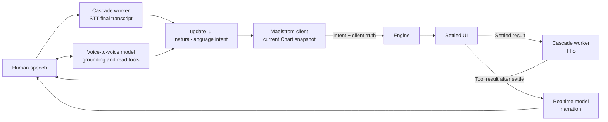
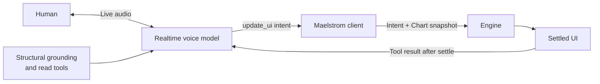

Voice systems usually follow one of two architectural modes. A **voice-to-voice realtime model** handles an ongoing spoken conversation. A **cascade** passes speech through separate speech-to-text (STT) and text-to-speech (TTS) stages. Neither mode changes how Maelstrom plans a UI.

Both modes cross into Maelstrom only as natural-language intent. The client then captures the current Chart snapshot for the Engine. A voice model's memory, transcript, or belief about the interface never becomes Engine planning input.

That shared boundary lets you choose a voice architecture for audio quality, latency, and operations without creating another UI planning path.

## Voice-to-voice realtime mode

A realtime model receives speech and produces speech within one long-running conversation. The provider may manage turn detection, interruption, transcripts, and response generation as parts of the same session.

In Maelstrom's realtime route, structural grounding helps the model discuss the interface. Read-only tools can refresh that picture when needed. Grounding is conversational context, not planning truth. Only the natural-language `update_ui` intent crosses into the client.

The client builds the Chart snapshot and sends it to the Engine. After the result renders, `RealtimeSession` releases the successful tool result. The model can then narrate evidence from the settled UI instead of predicting the outcome.

OpenAI owns voice activity and turn handling for this mode. That provider ownership can support fluid interruption and conversational pacing, but it also couples turn behavior, recognition, and speech output to the provider session.

## Cascade mode

A cascade divides the spoken turn into explicit stages. In Maelstrom's LiveKit mode, the browser admits turn audio, STT produces a final transcript, and TTS speaks the result only after the UI settles.

```mermaid
flowchart LR
  accTitle: Cascade voice flow
  accDescr: A browser-controlled turn admits audio to STT, the final transcript becomes Maelstrom intent, and TTS receives the result after the UI settles.

  Human["Human"] -->|"Accepted turn audio"| Turn["Browser turn control"]
  Turn --> STT["STT"]
  STT -->|"Final transcript"| Adapter["Voice adapter"]
  Adapter -->|"update_ui intent"| Client["Maelstrom client"]
  Client -->|"Intent + Chart snapshot"| Engine["Engine"]
  Engine --> UI["Settled UI"]
  UI -->|"Result text"| TTS["TTS"]
  TTS -->|"Audio"| Human
```

One automatic turn follows this path:

1. Browser VAD accepts speech, sends bounded transport pre-roll once, and opens microphone publication to the LiveKit room. In manual mode, the application opens the same transport turn through `turnControl`.
2. At speech end, the adapter drains accepted audio, pauses publication, and asks the worker to finalize STT.
3. The Deepgram worker publishes one final transcript.
4. The browser's `LiveKitAdapter` converts the transcript to an `update_ui` tool call carrying only natural-language intent.
5. `RealtimeSession` submits that intent to the Maelstrom client, which captures the current Instances, Variants, and Chart dimensions.
6. The Engine plans against the client-built snapshot and returns the normal Execution Plan and Layout Directives.
7. For a successful UI update, `RealtimeSession` waits for rendering to settle before returning the result to the adapter. Malformed arguments and genuine submission failures return immediately.
8. The adapter sends result text on the LiveKit `speak` topic, and the Cartesia worker publishes audio back to the room.

The worker performs only STT and TTS. It receives no Vessel, Instance, Variant, Action, Chart, or grounding context, and `LiveKitAdapter.injectGrounding()` is intentionally a no-op. Sending UI structure to the worker would create a second planner.

Each cascade boundary creates a place to specialize a component. A team can select STT for a language, noisy environment, or domain vocabulary and choose TTS separately for voice quality, language coverage, cost, or deployment policy.

Maelstrom's LiveKit adapter owns turn boundaries in the browser. Automatic VAD is enabled by default, with `/vad-web/` assets and 250 milliseconds of transport pre-roll; `vad: false` selects intentional manual mode. A safe automatic-mode failure pauses upstream publication before exposing `turnControl`, while failures that cannot preserve transport safety are fatal.

Read [Browser VAD and barge-in](/understanding/browser-vad-and-barge-in/) for the detection, privacy, pre-roll, serialization, and fallback contract. The [LiveKit cascade guide](/guides/voice/livekit-cascade/#configure-browser-vad) contains the copyable setup.

Those choices add work. The application must deploy, secure, observe, and recover the transport, browser turn control, STT, and TTS stages. Each handoff may add latency. Measure complete turns rather than assuming that one component's benchmark predicts user experience.

## Compare the modes

| Concern                | Voice-to-voice realtime                                                                            | Cascade                                                                                                                   |
| ---------------------- | -------------------------------------------------------------------------------------------------- | ------------------------------------------------------------------------------------------------------------------------- |
| End-to-end path        | One speech-native session handles conversation and audio response.                                 | A browser-delimited turn passes through separate STT and TTS stages around the Maelstrom request.                         |
| Turn ownership         | The realtime provider manages voice activity, interruption, and response pacing.                   | The LiveKit adapter owns automatic browser VAD and exposes explicit controls only in manual mode.                         |
| Latency                | Fewer explicit handoffs can reduce turn latency. Results vary by provider and network.             | Detection, transport, STT, and TTS add boundaries; component choice and deployment location also matter.                  |
| Component control      | The provider owns more recognition, conversation, and synthesis behavior.                          | The application can tune browser VAD, select manual turns, and replace STT or TTS independently.                          |
| Specialization         | Depends on options exposed by the realtime model and session API.                                  | STT or TTS can be selected for language, vocabulary, voice, cost, or policy needs.                                        |
| Operations             | Fewer application-operated speech stages, plus the realtime connection and credential service.     | More services, credentials, health checks, scaling decisions, assets, and failure paths.                                  |
| Observability          | One session can simplify correlation, but provider telemetry determines internal detail.           | Stage-level metrics can isolate VAD, transport, STT, and TTS behavior, but the team must correlate them.                  |
| Failure isolation      | A session failure may affect recognition, conversation, and speech output together.                | A stage can fail independently; safe VAD failure can degrade to manual control, while TTS can fail after the UI succeeds. |
| Privacy and compliance | Audio and conversational context follow the realtime provider's processing and retention controls. | Admitted audio, executable VAD assets, transcripts, transport, and each provider require assessment.                      |

No mode is inherently private or compliant. Review where audio, transcripts, credentials, telemetry, retained context, and executable VAD assets travel. Confirm provider terms and deployment controls for the jurisdictions and data classes your application serves.

## Choose realtime when conversation leads

Realtime mode is a candidate when the experience depends on low-latency back-and-forth, interruption, or expressive spoken responses. Prototype with realistic network conditions and session lengths. Measure interruption behavior, response latency, cost, and failure recovery.

Follow the [OpenAI Realtime setup guide](/guides/voice/openai-realtime/) for Maelstrom's shipped realtime implementation.

## Choose cascade when component choice leads

Cascade mode is a candidate when recognition or synthesis needs independent specialization. It can fit multilingual applications, domain-specific vocabulary, custom voices, provider portability, or policies that require separate control over speech stages.

Choose it when that control justifies the extra latency and operational surface. Test the complete pipeline with representative speakers and vocabulary, and correlate one turn from admitted audio through settled UI and spoken result.

Follow the [LiveKit cascade setup guide](/guides/voice/livekit-cascade/) for the automatic-VAD cascade and conditional manual controls. Continue with [Browser VAD and barge-in](/understanding/browser-vad-and-barge-in/) for its detailed operating contract.

## Keep the boundary fixed

Whichever mode you choose, preserve the same rule: voice determines what the user appears to want, while the Maelstrom client supplies what is actually on screen. The Engine plans from the client-built Chart snapshot. It never plans from a realtime model's grounding, an STT worker's state, or a transcript-derived picture of the UI.

A voice model's belief about the interface may help conversation, but it never becomes planning input. Voice providers do not supply Vessel IDs, Actions, or layout coordinates to the Engine. `RealtimeSession` preserves this boundary by routing only natural-language intent.

Return to the [Voice overview](/guides/voice/overview/) to wire either mode into your UI. Read the [Architecture Overview](/understanding/architecture/) for the full client and Engine request loop.
