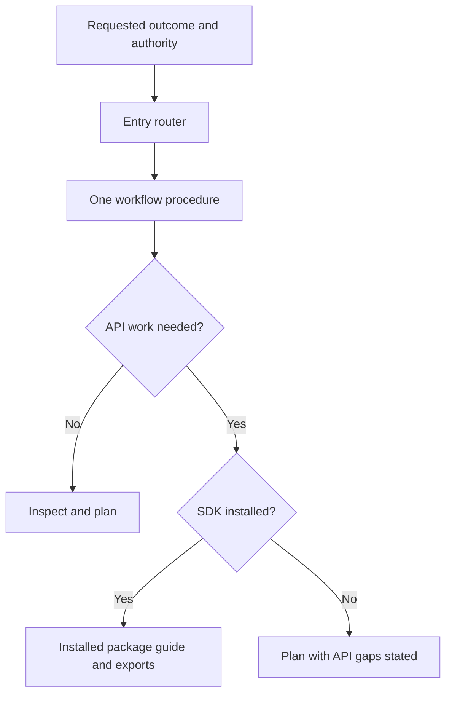

# A clearer first task

Portable workflows lead into release-matched SDK recipes without turning a planning request into permission to change an application.

[PR #249](https://github.com/maelstrom-co/maelstrom/pull/249) · Source snapshot `64db87970db40c2120989bf34d5ab374c4790299` · [Self-contained HTML](pr-249.html)

## 1. The skills already existed

Maelstrom already shipped an entry skill, seven workflow procedures, and package-owned SDK guides. Its documentation build produced a revision-matched ZIP. The missing piece was a clear route from obtaining those files to requesting a useful, bounded task.

The two kinds of guidance answer different questions. A workflow helps you inspect an application, select a capability, and plan verification. An SDK guide supplies API facts for the particular package release installed in that application. This change keeps those responsibilities separate rather than introducing another framework or installer.

This walkthrough covers [PR #249](https://github.com/maelstrom-co/maelstrom/pull/249) at `64db8797`, relative to `4fe3ee96`. The separate migration evaluator belongs to [PR #250](https://github.com/maelstrom-co/maelstrom/pull/250).

## 2. Planning and permission did not line up

Quick Start presented onboarding as a planning task, while the copied prompt instructed implementation. The router also directed missing procedures to be installed before continuing. Those instructions could turn a request to inspect an application into changes the user had not approved.

The revised prompt makes authority explicit. An omitted or unchanged authority placeholder means planning only. The implementation path starts only after a bounded goal is authorized.

**`apps/docs/prompts/library/maelstrom-project-onboarding.md`**

```markdown
Requested authority: [PLAN ONLY | IMPLEMENT THE BOUNDED INTEGRATION]

If authority is omitted or the placeholder is unchanged, use PLAN ONLY.
For PLAN ONLY, make no edits or installations. Report the selected pilot and
verification plan, then stop. For IMPLEMENT THE BOUNDED INTEGRATION, inspect first
and implement the smallest useful pilot. Ask only when inspection reveals a
material decision outside the authorized goal.
```

The important boundary is the default. A planning request can identify a pilot and verification steps without installing packages or editing application files. The router applies the same distinction when a procedure is missing.

## 3. Workflow ownership and API ownership

The entry router selects one procedure by the primary outcome. The procedure then consults only the references needed for that task. Loading every workflow would obscure which one owns the process, so the starting path remains narrow.



API-specific work takes a second path through the installed package. The owning `package.json` supplies the version authority; the workflow bundle does not promise that its examples match every SDK release. If no SDK exists yet, repository inspection and planning can continue, while API details remain unverified.

Fourteen package guides gain local task recipes, verification advice, and troubleshooting. The React recipes include branded Instance identifiers for tiling seeds and bounded DOM tests. These are guidance changes, not production SDK API changes.

## 4. A complete first-use path

The documentation page connects installation, discovery, task selection, SDK guidance, and maintenance. It offers three supported installation targets and seven starter requests, each paired with expected evidence. The first request asks for a plan; a separate request grants bounded implementation authority.

Installation remains interactive. The pinned installer can choose Project or Global scope, so the instructions explicitly tell you to choose Project. Listing installed files proves presence, not successful loading or correct application. The page asks you to confirm discovery before relying on the workflow.

Preview builds must install their own bundle. The page therefore fills command URLs from the origin being viewed, and repeats that initialization when client navigation restores the page.

**`apps/docs/src/pages/agents/skills/index.astro`**

```ts
  const initBundleCommands = () => {
    const servedBundle = new URL('/agents/skills/bundle.zip', location.origin).href;
    for (const pre of document.querySelectorAll<HTMLElement>('[data-bundle-command]')) {
      const code = pre.querySelector('code');
      if (!code?.textContent) continue;
      code.textContent = code.textContent.replace(skillBundleUrl, servedBundle);
      pre.hidden = false;
    }
  };
  initBundleCommands();
  document.addEventListener('astro:page-load', initBundleCommands);
```

The command blocks stay hidden until that URL is ready. A manual ZIP download remains available when JavaScript is disabled. This avoids presenting a production-bundle command as a preview-build installation.

## 5. A procedure carries the files it needs

Individual installation exposed another boundary. The authored repository shares reference files between procedures, but an installer may copy only one procedure directory. A relative link into a missing sibling then fails, even though its `SKILL.md` is present.

The bundler follows relative Markdown links transitively. It copies reachable resources into the procedure's generated directory and rewrites their links, retaining fragments. Missing resources, escaping paths, and conflicting destinations stop the build.

**`apps/docs/tools/skills/bundle.ts`**

```ts
        if (!files[dependency]) {
          throw new Error(
            `Missing skill reference: ${sourcePath} -> ${target}`,
          );
        }
        pending.push(dependency);
        const localPath = destinationFor(dependency);
        if (
          posix.normalize(
            posix.join(posix.dirname(destination), targetPath),
          ) === localPath
        ) {
          return link;
        }
        const localTarget =
          posix.relative(posix.dirname(destination), localPath) + fragment;
```

The worklist is what makes this a dependency closure rather than a single-file copy. A referenced file can point to another reference, and that second file must travel too. Canonical voice architecture and decision records enter the generated bundle through the same mechanism.

This is why the installation instructions use the generated ZIP rather than the authored GitHub tree. Package-owned API recipes remain inside their SDK packages and update with those releases.

## 6. Where the journey lives

The page and catalog carry the first-use story. The bundler owns resource projection. SDK packages own their release-matched examples. Tests and research records keep those promises separate from broader claims about model performance.

| File or group | Role |
| --- | --- |
| `README.md`, Quick Start, sidebar configuration and tests | Place the first-use path beside existing getting-started material. |
| `apps/docs/src/pages/agents/skills/index.astro` | Connect installation and discovery to bounded planning and implementation. |
| `apps/docs/src/lib/skill-onboarding.ts` (new) | Give each starter task one request and an evidence expectation. |
| The onboarding prompt, router, and skills README | Make permission and installed-version ownership explicit. |
| `bundle.ts` and its new filesystem tests | Produce self-contained procedure directories from shared authored resources. |
| Fourteen package `common-tasks.md` files (new), with guide entry-point updates | Keep practical construction and verification advice beside the owning SDK release. |
| `sdk-examples.test.ts`, onboarding authority tests, and browser cases (new) | Protect recipe compilation, planning defaults, command origins, and navigation behavior. |
| `acceptance.ts`, trial guard and runtime helpers with tests (new) | Check optional read-only discovery in fresh consumers without replacing application review. |
| Research records (new), trial README, prompt architecture, and docs target configuration | Document boundaries and connect the tooling to normal verification. |

## 7. What the checks can establish

Bundle tests exercise real reference trees, including transitive links and conflicts. Recipe tests compile examples against built public declarations. Browser cases check the visible first-use path, same-origin commands after navigation, and narrow-screen layout. The optional acceptance runner checks discovery and read-only selection, while leaving correct application for review.

Those checks do not establish live Engine planning, microphone behavior, or provider integration. Hosted installation remains unverified. Automatic skill selection also depends on the selected tool; an installer listing is not activation.

The historical task comparisons remain exploratory. Their sample and combined treatments do not establish a consistent quality advantage or token savings. A later harness restart removed the private raw traces and snapshots, so the curated summary cannot supply independently reproducible evidence.

## 8. Start with one task and explicit authority

PR #249 makes existing Maelstrom guidance easier to install, discover, and use without broadening a planning request. Generated procedure directories carry their references; installed packages remain the API authority. The result is a clearer first-use path, not a demonstrated quality or token-saving benefit.

