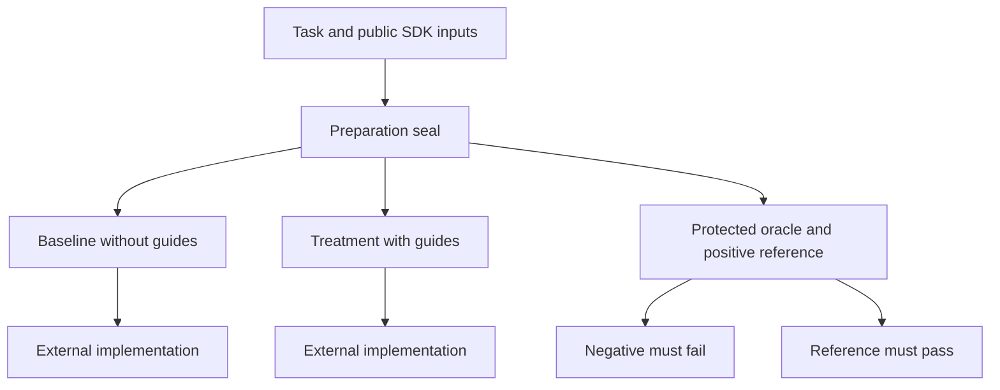
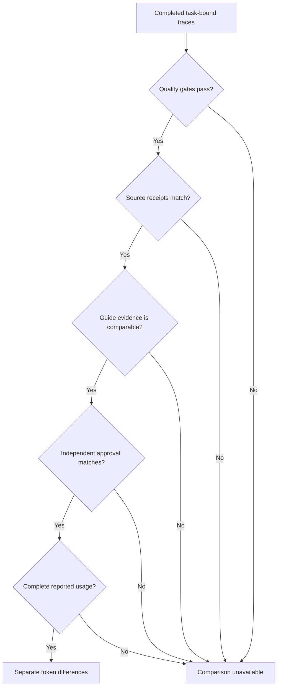

# Evidence before comparison

A paired migration evaluator checks frozen implementations and their evidence before it compares task-bound token counts.

[PR #250](https://github.com/maelstrom-co/maelstrom/pull/250) · Source snapshot `e132b850d9eb3997a4c1cf8529efb69424c51780` · [Self-contained HTML](pr-250.html)

## 1. There was already an evaluation workflow

Maelstrom already had prompt fixtures, SDK type checks, React behavior tests, browser checks, and read-only discovery trials. Those tools established different kinds of evidence. They did not establish a repeatable comparison between implementations produced with and without skill guidance.

The historical trials showed why that distinction matters. A migration control replaced the supplied Connector, the application's dependency for communicating with Maelstrom, yet passed its functional checks. Manual review caught a boundary the oracle had not checked. The original private evidence later disappeared, leaving a curated summary rather than a reproducible benchmark.

This walkthrough covers [PR #250](https://github.com/maelstrom-co/maelstrom/pull/250) at `e132b850`, relative to the `64db8797` head of [PR #249](https://github.com/maelstrom-co/maelstrom/pull/249). It describes the new paired evaluator, not another copy of the onboarding change.

## 2. A passing sample is not a fair comparison

Compilation can accept code that substitutes the wrong Connector. An added test can pass by asserting a constant or checking source spelling. A completed trace can describe an older submission at the same directory. Counting tokens before resolving those differences compares unlike work.

The evaluator therefore separates functional checks, ordinary quality gates, evidence validation, and independent approval. Missing usage remains unavailable. None of these stages becomes proof that skills improve quality or reduce costs simply because the tooling runs successfully.

## 3. Freeze two consumers and one independent contract

Preparation creates a baseline and a treatment with the same task, public SDK runtime, declarations, ordinary documentation, configuration, and starting application. Only the treatment receives workflow and SDK guides. A seal binds their snapshots, a private positive reference, the oracle, and the preparation identity.



The starting application must fail functional checks because the integration is missing. The private reference must pass those same checks. Seven criteria exercise the supplied Connector and filtering, application-owned authorization and mutations, uncertain cancellation, and rollback across enabled and legacy paths.

The operator must keep the protected directory outside the external participants' access. Dependency download caches also stay outside the consumer trees, so download state does not become submitted-source evidence. Preparation does not launch a model.

## 4. Keep consumer side effects away from the oracle

Submitted tests run executable code. Reusing their directory for the oracle lets a test replace the supposedly independent check. Creating the oracle directory too early also lets that test modify a sibling copy before its original state is recorded.

The evaluator waits for consumer checks and verified cleanup before creating a fresh oracle copy. Its complete snapshot must match the submitted snapshot before the trusted oracle is written.

**`apps/docs/tools/skills/migration-cli.ts`**

```ts
    await materialize(source, oracleExecution);
    const freshCopy =
      JSON.stringify(await migrationSnapshot(oracleExecution)) ===
      JSON.stringify(snapshot);
    if (reference)
      await writeFile(join(oracleExecution, 'src/OrdersApp.tsx'), positiveApp);
    await writeFile(join(oracleExecution, 'oracle.test.tsx'), oracleSource);
    const reportPath = join(oracleExecution, 'oracle-report.json');
    const oracleBefore = await migrationSnapshot(join(oracleExecution, 'src'));
```

A mismatch prevents oracle execution. After the oracle runs, preservation checks cover its source, configuration, setup, and submitted files. Missing or changed executable evidence fails the functional check. A `finally` block removes both execution copies, including on failure.

Added tests receive a second challenge: they run against the original missing integration. A matching assertion failure establishes provisional detection, not behavioral relevance. Source-text checks can pass that mechanical challenge, so independent review still decides whether both submissions and their tests exercise the intended behavior.

## 5. An interrupted test is not detected behavior

An assertion report alone cannot establish a regression. A signal, publication error, or uncertain cleanup may leave that report behind even though the command did not finish normally. The evaluator permits provisional detection only for an ordinary nonzero exit after cleanup verification.

**`apps/docs/tools/skills/migration-process.ts`**

```ts
    if (result.outcome === 'timeout')
      throw new Error('Trial timed out; isolated supervisor deadline');
    if (result.outcome === 'failed') {
      if (
        Number.isSafeInteger(result.code) &&
        result.code > 0 &&
        result.signal === null
      )
        throw new MigrationCommandFailure();
      throw new Error('Migration process interrupted or failed to start');
    }
    if (result.outcome !== 'passed') throw new Error('Invalid process outcome');
    if (result.code !== 0 || result.signal !== null)
      throw new Error('Invalid successful process completion');
```

The supervisor retains its process-group identity before publishing evidence. Cleanup sends a signal and verifies that group absence within a bound. If verification is uncertain, the operation fails and retains numeric identities. Uncertain consumer cleanup aborts evaluation before another oracle starts.

These controls manage known processes, not hostile-code isolation. Code can create another session and escape the group. The operator still needs an externally isolated, disposable environment without secrets or live-service access.

## 6. Match the trace to the reviewed source

Version 4 requires each attempt to run a sealed local helper as its last tool operation. The helper emits the preparation identity and a hash of every submitted source file. The trace parser requires that successful receipt before the final answer and compares it with the source hash being reviewed.

**`apps/docs/tools/skills/migration-evaluation.ts`**

```ts
          const receipt = JSON.parse(delivered);
          const expected = binding.submission;
          if (
            !expected ||
            receipt.type !== 'maelstrom_migration_submission' ||
            receipt.version !== 1 ||
            receipt.attemptId !== expected.attemptId ||
            receipt.sourceHash !== expected.sourceHash ||
            !/^[a-f0-9]{64}$/.test(receipt.sourceHash)
          ) {
            valid = false;
          } else submissionBound = true;
```

Changing source after recording a trace breaks that match. Missing receipts and later tool activity also make the trace ineligible. Old preparations and receipt-less traces cannot authorize a version 4 comparison; they require a newly prepared pair.

Instruction evidence has its own boundary. Treatment must receive complete normalized migration and installed React SDK guides. Baseline instruction fingerprints or any sealed workflow catalog exposure, including the entry router, disqualify the comparison. Reads after the final answer cannot manufacture activation.



Only distinct completed sessions for the same task and provider/model, passing quality gates, matching source receipts, and approved source hashes reach token comparison. Uncached input, output, cache reads, and cache writes remain separate. The differences are reported token counts, not verified billing.

## 7. Each module owns an evidence boundary

The new tooling remains inside the documentation workspace. Its modules separate preparation, behavior, trace validation, approval, and process lifecycle rather than changing production SDK APIs.

| File or group | Role |
| --- | --- |
| `apps/docs/tools/skills/migration-cli.ts` (new) | Coordinate sealed preparation, checks, copied execution, approval, and comparison. |
| `migration-fixture.ts` and `migration-oracle.ts` (new) | Define the missing integration, private reference, and seven behavioral criteria. |
| `migration-evaluation.ts` and `migration-submission-worker.mjs` (new) | Bind snapshot hashes, guide delivery, completed traces, receipts, and usage. |
| `migration-review.ts` (new) | Validate human behavioral attestations against the preparation and both source hashes. |
| `migration-process.ts` and its worker and cleanup scripts (new) | Bound known-process lifecycle and preserve uncertain identity. |
| Five `migration-*.test.ts` files (new) | Challenge tampering, source mutation, meaningless tests, malformed evidence, and cleanup faults. |
| Docs package command and trial README | Expose the operator workflow and its explicit execution consent. |
| `docs/research/migration-evaluation-method.md` (new) | Record the method and limits on interpreting deterministic checks. |
| The existing browser grader | Preserve its rejection reason explicitly when stack formatting omits it. |

## 8. Recorded provenance is not authentication

The source receipt links reported source bytes to a trace. It does not authenticate the transcript. The review file is a human attestation, not reviewer authentication. Both boundaries remain explicit instead of treating a matching JSON file as proof of trust.

The author reports 366 passing docs tests, uncached typecheck and Biome, and required builds. Regression fixtures challenge direct and sibling oracle substitution, deleted oracle evidence, stale receipts, partial guides, signal termination, and cleanup faults. Cancellation mutations use separate fixtures so a late completion cannot alter another test's source.

These checks establish evaluator behavior. They do not demonstrate a model's implementation quality, token savings, live Engine planning, or audio-provider integration. The unsafe-execution flag supplies consent only; external isolation remains necessary.

## 9. Compare only evidence that agrees

PR #250 makes a paired migration comparison conditional on working behavior, preserved inputs, complete instruction delivery, source-bound traces, and independent approval. Its output can report separate token differences when those conditions agree. It does not turn deterministic fixtures into a measured benefit from skills or replace external isolation.

